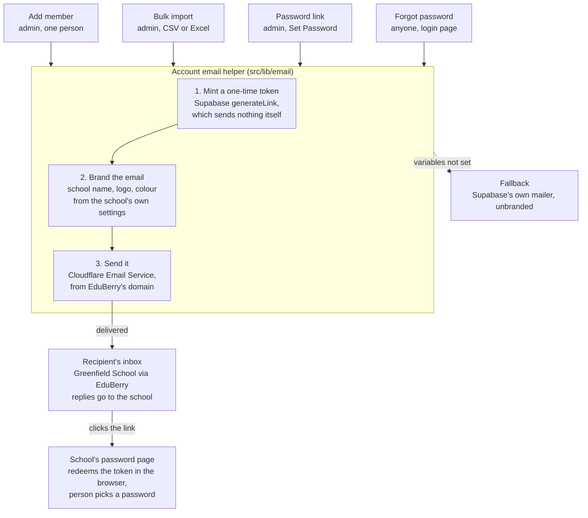

# Account Email System — Design & Status

As of 24 Oct 2026.

The code is live on main but dormant: no email goes through Cloudflare until three platform variables are set. The email layer itself is ready for many schools; the app around it is still one-school-per-deployment.

## Status at a glance

All the code is written and on `main` (commits `1167e36` and `6b45e89`), but no email has been sent through Cloudflare yet. Until the platform variables are set, every flow falls back to Supabase's built-in mailer, exactly as before.

| Part | Status | Notes |
| --- | --- | --- |
| Email templates (invite, reset), school-branded | Done | 8 unit tests pass, covering wording, HTML escaping and the logo/colour checks |
| Cloudflare sender (REST API) | Built, not tested | Not yet run against the live API; the sender name + address format is unconfirmed |
| Invites for new accounts (single and bulk import) | Built, not tested | Shows the admin a copyable link if only the email fails |
| "Email a password link" button (students and staff) | Built, not tested | In the Set Password window of both profile managers |
| Forgot password on the login page | Built, not tested | Server route; same answer whether or not the account exists |
| Password page accepts the emailed link | Built, not tested | `/update-password` redeems the token in the browser |
| Cloudflare sending domain + API token | Waiting on you | One-time, for the whole platform |
| Platform variables set in hosting | Waiting on you | Three values, shared by every school |
| First live test send | Not started | Blocked by the two rows above |
| Checkout creates the school and emails its first admin | Not started | Part of self-serve provisioning |
| Workers email binding (after the move to Cloudflare) | Not started | Replaces the API token; about 20 lines |

## How it works

All four triggers call the same helper. It asks Supabase for a one-time token without letting Supabase send anything, builds the school-branded email, and sends it through Cloudflare. If the Cloudflare variables are missing, Supabase's own unbranded mailer is used instead.

## What sends an email

Four actions send an email. All four share one helper (`src/lib/email/accountEmails.ts`), so they have the same branding, sender and security rules.

| Trigger | Who | Route | Email wording | If the email fails |
| --- | --- | --- | --- | --- |
| Add a student or staff member | Admin | `/api/admin/create-user` | "Set up your account" | The account is still created; the admin sees a one-time link to share |
| Bulk import (CSV or Excel) | Admin | `/api/admin/bulk-import` | "Set up your account" | The account is still created; the result lists each address whose email failed |
| "Email a password link" in Set Password | Admin | `/api/admin/send-password-email` | "Set up" if they have never signed in, otherwise "Reset" | The admin sees the error and a one-time link to share |
| "Forgot your password?" on login | Anyone | `/api/auth/forgot-password` | "Reset your password" | Logged on the server; the person sees the same message either way |

The "auto-confirm with a password" option sends no email and is unchanged. The admin's own "Set password" field also still works.

On "bulk": this system sends account emails one person at a time, including during a bulk import (8 at once). It is not for newsletters or announcements to all parents. That would need unsubscribe handling and consent tracking, which this system does not have.

## Sender identity

Every email goes out from EduBerry's own domain, never a school's. The school is named everywhere the reader looks.

| Part of the email | What it shows | Where it comes from |
| --- | --- | --- |
| From address | `no-reply@<your sending domain>` | `EMAIL_FROM_ADDRESS`, a platform setting |
| From name | "Greenfield School via EduBerry" | School name from the school's Design settings + `EMAIL_PLATFORM_NAME` |
| Reply-To | The school office's email | School profile → Email (left out if blank) |
| Subject | "Set up your Greenfield School account" or "Reset your Greenfield School password" | School name |
| Header | School logo (if it is an https link) and name | Design settings |
| Button colour | School's primary colour (if a valid hex code) | Design settings |
| Footer | "Sent by EduBerry on behalf of Greenfield School." | Both names |
| Link | `https://<school's domain>/update-password?token_hash=…` | The school's own site |

Why one domain: SPF, DKIM and DMARC (the records that keep mail out of spam) only need setting up once, on a domain you control. Schools never touch DNS, and one school can't harm another's sender reputation by misconfiguring theirs.

## Security controls

The public forgot-password form is the main attack surface, because anyone can use it. These are the controls in place.

| Threat | Control |
| --- | --- |
| Phishing with a real school email: an attacker requests a reset for a victim and makes the link point to their own site | The link's domain never comes from the request's `Origin` header. It comes from `NEXT_PUBLIC_SITE_URL`, then Vercel's production domain, then the host the request reached. Fixed in `6b45e89`; the earlier version could be abused this way, but it never sent mail because it was not configured. |
| Mail scanners using up the one-time link before the person clicks (Outlook Safe Links and similar) | The link opens the school's own page, which redeems the token with JavaScript (`verifyOtp`). Scanners fetch the page but don't run that step. The token is then removed from the address bar. |
| Finding out who has an account | Forgot password gives the same answer for every address, and only existing accounts get mail. |
| Using the form to spam someone | At most 1 email a minute per address and 10 requests an hour per IP address. These counters live on each server instance, not in one shared place. |
| School-entered text breaking the email | School name, logo and colour are escaped or checked before going into the HTML. Quotes, angle brackets and line breaks are stripped from the From name. |
| Non-admins sending emails | Admin routes check the caller's token and their admin role. Each send is written to the admin audit log as `user.password_email`. |
| A school changing where mail is sent from | Sending credentials are platform variables only. There is no in-app setting for them. |

Semgrep (the repo's security scanner, same rules as CI) reported no findings on the changed files.

## Configuration

Setup is done once for the whole platform. A new school needs no email configuration: its name, logo and reply-to address come from settings the school fills in anyway.

| Variable | Example | Scope | Required |
| --- | --- | --- | --- |
| `CLOUDFLARE_ACCOUNT_ID` | the account that owns the sending domain | Platform, same for every school | Yes |
| `CLOUDFLARE_EMAIL_API_TOKEN` | API token with Email Sending permission | Platform, same for every school | Yes |
| `EMAIL_FROM_ADDRESS` | `no-reply@mail.eduberry.in` | Platform, same for every school | Yes |
| `EMAIL_PLATFORM_NAME` | `EduBerry` (the default) | Platform | No |
| `NEXT_PUBLIC_SITE_URL` | `https://greenfield.eduberry.in` | Per school | No, worked out automatically |

If any of the three required values is missing, the app uses Supabase's own mailer, as before.

One-time steps:

1. In Cloudflare, onboard the sending domain under Email Service → Email Sending. This publishes its SPF, DKIM and DMARC records.
2. Create an API token with Email Sending permission.
3. While on Vercel, add the three values as team-level Shared Environment Variables so every school project picks them up. After the move to Cloudflare Workers, the token isn't needed: the app sends through a built-in email binding instead.

The Supabase-mailer fallback still needs each school's `/update-password` address in Supabase → Auth → Redirect URLs. The Cloudflare path doesn't need it.

## Gaps and risks

The biggest risk is that nothing has been sent for real yet; the rest are limits to plan around.

| Gap | Impact | Fix |
| --- | --- | --- |
| No live send yet | The Cloudflare request format is untested end to end | One test invite to an address you own, right after setup |
| Sender written as name + address is unconfirmed in Cloudflare's docs | If rejected, every send fails with a request-format error | Change one line in `src/lib/email/cloudflare.ts` to send the address only |
| New Cloudflare accounts start on a low daily quota that rises over time; no number is published | A large first bulk import can run past it. Those accounts are still created and listed as "invite failed" | Resend from each profile, or request a higher limit from Cloudflare before onboarding a big school |
| Rate-limit counters are per server instance | Weak against a spread-out attack on the forgot-password form | Add a Cloudflare rate-limiting rule on `/api/auth/forgot-password` |
| No delivery log | Admins can't see whether an email arrived or bounced later; only immediate errors show | Store send results per user, and read bounces from Cloudflare |
| No "resend to everyone pending" action | After a quota hit, resends are one profile at a time | Add a bulk resend on the profile lists |
| Link expiry isn't stated in the email | The email says "expires soon"; the real limit is the Supabase project's email link expiry setting | Put the exact time in the template once it's fixed per project |
| Tied to Supabase Auth | One-time tokens come from Supabase (`generateLink`) | Rewire when auth moves off Supabase; templates and sender stay |

Cloudflare also caps each email at 50 recipients and 5 MiB, which these one-recipient emails are far below. [Source: Cloudflare Email Service limits](https://developers.cloudflare.com/email-service/platform/limits/)

## Multi-tenant readiness

The email system is ready for many schools today. The app around it is not yet: it runs as one deployment and one database per school, with no way to start a new school without a person doing setup.

| Layer | Readiness | Today | What multi-tenant needs |
| --- | --- | --- | --- |
| Email credentials and sender | Ready | One set of platform values shared by every school | Nothing |
| Email branding per school | Ready | Read per send from that school's own settings | In a shared app: look up the school first (the tenant routing row) |
| Link domain in emails | Ready | Taken from the school's own host | Nothing |
| Per-school secrets (bank, WhatsApp, Razorpay) | Ready | Stored in each school's database, admin-only | Nothing for one database per school |
| Tenant routing: which school is this request for | Not built | Answered by which deployment received it | A domain-to-school lookup in front of every request |
| Provisioning at checkout | Not built | Manual | Create the database, run migrations, save branding, map the domain, create the first admin, send the invite |
| Data model | Ready | About 219 tables, none with a school column; settings are keyed by name only | Nothing if each school keeps its own database. A shared database would need a school column on every table and query |
| Database access and permissions | Major rework | 125 front-end files query the database directly, guarded by Postgres row-level security: about 700 policy statements, 350 function definitions, 145 triggers and 19 scheduled jobs across 259 migration files | Cloudflare's database (D1, SQLite) has none of these. Queries move behind server routes and permission checks move into code |
| Login (auth) | Major rework | Supabase Auth, one user pool per school project | A replacement auth system, which also provides the one-time links these emails carry |
| File storage | Needs work | 2 Supabase Storage buckets (`classroom-files`, `subtask-attachments`) | Cloudflare R2 with a folder or bucket per school |
| Live updates | Needs work | Supabase Realtime in 4 files | Durable Objects or polling |

Recommended shape on Cloudflare: one app serving every school, finding the school from the domain, with one D1 database per school. D1 allows 50,000 databases per account and 10 GB per database on Workers Paid ([source](https://developers.cloudflare.com/d1/platform/limits/)). That keeps today's data model and isolates each school's data by design.

The move off Postgres (the "Major rework" rows) is the large piece of work, not email. The counts above are `CREATE` statements in the migration files, so a few are re-definitions of the same object.

## Next steps

The first three unblock email for every current school. The rest belong to the move to Cloudflare and self-serve checkout.

- [ ] Onboard the sending domain in Cloudflare Email Sending and create the API token
- [ ] Set the three platform variables (Vercel Shared Environment Variables for now)
- [ ] Send one test invite and one forgot-password email to an address you own; fix the sender format if Cloudflare rejects it
- [ ] Add a Cloudflare rate-limiting rule on `/api/auth/forgot-password`
- [ ] Ask Cloudflare for a higher daily limit before the first large bulk import
- [ ] Decide the auth system that replaces Supabase Auth, then rewire the one-time links
- [ ] Switch sending to the Workers email binding as part of the move
- [ ] Build checkout provisioning: database, migrations, branding, domain, first admin, invite email
- [ ] Add a delivery log and a "resend to everyone pending" action
