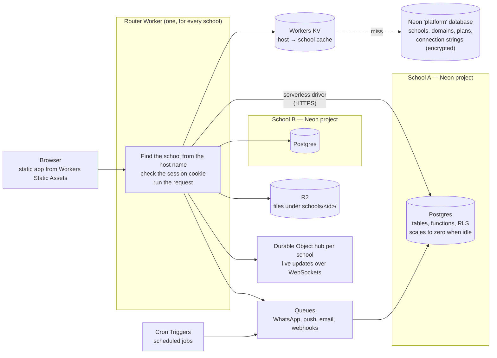

# Architecture Options: Neon, Durable Objects, D1 and the Rest

As of 5 Nov 2026. Part of the [rebuild docs](README.md). The 27 Oct version of this doc recommended a SQLite Durable Object per school; on 5 Nov the owner chose Neon Postgres instead, and this doc now records that decision, the checks behind it and what it costs.

## Summary

**Decision: each school keeps its own Postgres database, moved from Supabase to Neon, and everything else runs on Cloudflare: one Workers app for every school, the static web app, R2 for files, Queues and Cron Triggers for background work, and a small Durable Object per school for live updates. Supabase, including Supabase Auth, goes away entirely.**

- **Cloudflare can replace Supabase, but only by rewriting the database.** The Cloudflare-only design (a SQLite Durable Object per school) works, and is the cheapest to run, but it moves 268 SQL functions, 171 triggers and 699 row-level security policies into TypeScript, and changes every type and query. That rewrite is the single biggest risk in the whole rebuild.
- **Neon keeps the database as it is.** The tables, functions, triggers and policies move with `pg_dump` and keep working. What changes is around the database: sign-in, files, scheduled jobs, live updates and the server routes. Eleven Supabase-specific hooks inside the database need replacing (listed below), not 1,100 objects.
- **It costs more per school than the Cloudflare-only design, and less than Supabase today.** From the [cost study](02-cost-study.md), per school per month including Cloudflare:
  - today's school (about 1,200 users): **about $14**, against $25 on Supabase now;
  - a 10,000-user school on its own Neon project: **about $30**, against about $13 on Durable Objects;
  - the same school in a shared Neon "pod" of 20 schools: **about $15**.
  The extra money buys months of build time and a much smaller chance of breaking money and attendance logic.
- **Four things the checks found that shape the design:**
  1. **Neon has no Indian region.** The nearest is Singapore (`aws-ap-southeast-1`). Requests from India add about 30–60 ms per database round trip, and school data would be stored outside India; confirm that no school contract forbids it.
  2. **Hyperdrive allows 25 configurations per account**, so it cannot give each school its own pool. Workers reach each school's database with Neon's serverless driver over HTTPS, using a connection string looked up per request.
  3. **`pg_cron` runs only while a Neon compute is awake**, which would stop the database scaling to zero. Scheduled jobs move to Cloudflare Cron Triggers, which call the same SQL functions.
  4. **Neon's Launch plan holds 100 projects.** One project per school works up to 100 schools; past that, either the Scale plan (compute price doubles) or pods of several schools' databases per project.

## What stays and what changes

Counts are from the live database (`mps-web`, read 5 Nov 2026).

| Area | Today | Under Neon |
| --- | --- | --- |
| Tables, views, enums, indexes | 217 tables, 17 views, 37 enums, 879 indexes | Unchanged |
| Functions and triggers | 268 functions, 171 triggers | Unchanged except the 6 that touch Supabase internals (below) |
| Row-level security | 699 policies | Unchanged; `auth.uid()` is provided by a small shim fed by our own sign-in |
| Browser to database | supabase-js from the browser, 126 files | Phase 1: Neon's Data API (PostgREST syntax) with the same queries; phase 2: one call per screen through the Worker ([16](16-frontend-and-api.md)) |
| Server code | 57 Next.js API routes on Vercel | Worker routes |
| Login | Supabase Auth, 1,178 accounts, bcrypt hashes | EduBerry's own accounts in each school's database ([12](12-auth-and-permissions.md)) |
| Files | Supabase Storage, 2 buckets | R2 ([15](15-files-and-media.md)) |
| Live updates | Supabase Realtime on 6 tables | A Durable Object hub per school with WebSockets ([14](14-jobs-messaging-realtime.md)) |
| Scheduled jobs | 15 `pg_cron` jobs, 3 with `pg_net` | Cloudflare Cron Triggers and Queues calling the same functions |
| Timetable solver | Python on Vercel | Cloudflare Containers |

The Supabase-specific hooks inside the database, from the live catalogue:

| Hook | Where | Replacement |
| --- | --- | --- |
| `auth.uid()` in 155 policies and 99 functions | RLS and helpers such as `get_user_role()` | A shim schema `auth` with `uid()` reading the user id our sign-in sets for each request; nothing in the policies changes |
| `auth.jwt()` in 2 functions | `get_student_edu_dashboard`, `get_student_edu_standings` | The same shim returns the request's claims |
| `auth.users` | 4 foreign keys (`profiles`, `announcement_likes`, `announcement_reads`, `push_subscriptions`), trigger `on_auth_user_created` → `handle_new_user`, function `sync_role_to_auth_metadata` | Our `auth.users` table in each school's database, keyed by the same ids; the trigger stays; the metadata sync is dropped |
| `pg_net` in 3 functions | `fee_kick_drain`, `wa_kick_drain`, `transport_kick_drain` | Removed; Queues consumers drain the outboxes ([14](14-jobs-messaging-realtime.md)) |
| `pg_cron` | 15 jobs | Cron Triggers |
| `supabase_vault` | Installed, used by no function | Dropped |
| `storage.objects` policies | Storage buckets | R2 behind the Worker's permission checks |
| Realtime publication | 6 tables | Writes on those tables publish to the school's hub |

Extensions in use that Neon supports: `pgcrypto`, `uuid-ossp`, `btree_gist`, `pg_stat_statements`, `plpgsql` (and `pg_cron`, which is not used for the reason above).

## Requirements

| # | Requirement | Why |
| --- | --- | --- |
| R1 | One school can never read or change another school's data | Schools are separate customers |
| R2 | A school of 10,000 users runs comfortably at peak | About 40–65 requests a second at the morning peak |
| R3 | Multi-step money and attendance changes stay atomic | Fee allocation, refunds, payroll runs, payout claims, attendance recompute |
| R4 | A new school goes live without a person or a deploy | Self-serve signup |
| R5 | Per-school scheduled jobs in the school's time zone | Fee autogen, reminders, transport runs, WhatsApp timers |
| R6 | Live bus tracking and live leave updates | Replaces Supabase Realtime |
| R7 | Files per school, private by default | Leave certificates, coursework, avatars |
| R8 | Point-in-time recovery per school | A school must be restorable on its own |
| R9 | Each school's own domain or subdomain | `school.eduberry.in` or the school's own |
| R10 | Per-school secrets | Bank, Razorpay, WhatsApp |
| R11 | Room to grow | Years of history per school |
| R12 | No Supabase, including no Supabase Auth | Owner's decision |
| R13 | The smallest rewrite that meets R1–R12 | Added 5 Nov: build time and risk now weigh more than the lowest bill |

## Options considered

| Option | Shape |
| --- | --- |
| **G. Neon project per school (chosen)** | One Workers app; each school has its own Neon project (its own Postgres and compute); connection string per school in the platform database |
| H. Neon pods | As G, but up to ~20 schools' databases share one Neon project and its compute |
| D. Durable Object per school (27 Oct recommendation) | Each school's data in its own SQLite Durable Object, logic rewritten in TypeScript |
| A. D1 per school | One D1 database per school, bound by name |
| B / C. Shared or sharded D1 | Many schools per D1 database with `school_id` |
| E. Workers for Platforms + D1 | A copy of the app per school |
| F. One shared Postgres with `school_id` | All schools in one database, row-level security by `school_id` |

## Validation against the requirements

✔ meets it, △ meets it with work or limits, ✘ does not meet it.

| Requirement | G. Neon per school | H. Neon pods | D. DO per school | A. D1 per school | F. Shared Postgres |
| --- | --- | --- | --- | --- | --- |
| R1 Isolation | ✔ separate project and compute | ✔ separate database, shared compute | ✔ separate object | ✔ separate database | △ every policy needs `school_id` |
| R2 10,000-user peak | ✔ autoscaling compute up to 16 CU | △ neighbours share the compute | ✔ | △ round trip per query | △ one database for all |
| R3 Atomic logic | ✔ Postgres transactions, `FOR UPDATE`, as today | ✔ | ✔ after the rewrite | ✘ batch only | ✔ |
| R4 No deploy per school | ✔ Neon API creates a project | ✔ create a database | ✔ | △ binding per school | ✔ |
| R5 Per-school jobs | △ Cron Trigger fan-out | △ same | ✔ alarm per object | △ fan-out | △ fan-out |
| R6 Live updates | △ Durable Object hub | △ same | ✔ on the object | △ hub | △ hub |
| R7 Files | ✔ R2 | ✔ | ✔ | ✔ | ✔ |
| R8 Per-school recovery | ✔ restore the school's branch (7 days on Launch, 30 on Scale) | △ a restore rolls back every school in the pod; one school needs a copy-out | ✔ 30 days per object | ✔ 30 days | ✘ whole database only |
| R9, R10 | ✔ | ✔ | ✔ | ✔ | ✔ |
| R11 Growth | ✔ no practical size cap | ✔ | △ 10 GB per object, archive old years | △ 10 GB | ✔ |
| R12 No Supabase | ✔ | ✔ | ✔ | ✔ | ✔ |
| R13 Smallest rewrite | ✔ database moves as is | ✔ | ✘ every function, trigger and policy rewritten | ✘ same | ✘ `school_id` on 217 tables and 699 policies |

Only G and H meet R13. G is chosen to start, because it gives each school its own restore and its own compute, and needs no change to the database at all. H is the cost lever for later (§ Option H).

## Option G in detail: a Neon project per school (chosen)

What the checks found (Neon and Cloudflare documentation, read 5 Nov 2026):

| Check | Result |
| --- | --- |
| Compute | Sized in CUs: 1 CU is about 4 GB of RAM with its CPU; the smallest is 0.25 CU; Launch autoscales up to 16 CU |
| Billing | Compute time only while awake: $0.106 per CU-hour on Launch, $0.222 on Scale; storage $0.35 per GB-month; change history for restores $0.20 per GB-month; no monthly minimum |
| Scale to zero | After 5 idle minutes on Launch (can be turned off); 1 minute to always-on on Scale |
| Projects | 100 per account on Launch and Free, 1,000 on Scale (more on request) |
| Recovery | Instant restore to any point within 7 days on Launch, 30 days on Scale; branches for staging and tests |
| Regions | AWS US, Europe, Singapore, Sydney, São Paulo; no India |
| Connections | Pooled endpoint (PgBouncer, transaction mode) up to 10,000 client connections |
| Extensions | `pgcrypto`, `uuid-ossp`, `btree_gist`, `pg_stat_statements`, `pg_trgm`, `postgis` and more; `pg_cron` only with scale-to-zero off; `pg_net` and `supabase_vault` not listed |
| Data API | PostgREST-style HTTP API per branch; requests carry a JWT; access is decided by Postgres grants and RLS; `auth.uid()` returns the token's `sub` as a uuid. Release status not stated on the page: treat as a spike |
| Auth | Neon offers a managed Better Auth that stores users in a `neon_auth` schema; import of existing bcrypt hashes is not documented, so EduBerry keeps its own sign-in ([12](12-auth-and-permissions.md)) |
| Hyperdrive | Included in Workers Paid with unlimited queries, but 25 configurations per account and a static binding each: fine for the platform database, not for one per school |

Costs of this choice, stated plainly:

- **A database bill outside Cloudflare.** About $9–30 per school a month in compute, depending on size and how long the school is active each day.
- **Every request crosses to Singapore.** A screen that makes several dependent queries pays each round trip. Logic already lives in SQL functions, so most screens become one function call; Smart Placement runs the Worker near the database when a route needs several queries.
- **Two kinds of database to run.** Postgres per school plus Workers KV for the host cache; D1 is no longer needed.
- **Neon's own products are not used** (Neon Auth, Neon Functions, Neon Object Storage): Cloudflare covers the same ground and keeps the rest of the stack in one place. Revisit only if one of them removes real work.
- **Live updates and scheduled jobs are no longer "free" inside the database.** Both are built on Cloudflare ([14](14-jobs-messaging-realtime.md)), and must not wake a school's database more often than they need to: a compute kept awake all night costs money for nothing.

## Option H: Neon pods

Several schools' databases (up to about 20) in one Neon project share one autoscaling compute. Compute that sits idle between one school's requests serves another, so a 10,000-user school costs about $15 a month instead of $30.

What it gives up:

- **Restore granularity.** Neon restores a branch, and a branch holds every database in the pod. Restoring one school means restoring the branch to a new branch and copying that school's database back; slower and manual.
- **Noisy neighbours.** One school's heavy report slows the others on the same compute.
- **Moving a school** between a pod and its own project is a dump and restore.

Use pods for small schools once the fleet passes about 50 schools, or before passing 100 projects on Launch.

## Option D: the Durable Object design (27 Oct recommendation)

It remains the cheapest to run (about $13 a month for a 10,000-user school, about $1.60 for a 1,200-user one, both at fleet scale) and the strongest isolation. It was set aside because it rewrites the whole database layer. Revisit it if Neon's bill grows past what the extra build effort would cost, or for new, smaller modules that can live in an object from the start. The analysis that led to it is in git history (`git show 702b954:docs/cloudflare-rebuild/01-architecture-options.md`).

## Other options in brief

- **A. D1 per school:** no interactive transactions, a binding and redeploy per school, a round trip per query. Rejected.
- **B / C. Shared or sharded D1:** 10 GB cap, one query at a time for every school, no row-level security. Rejected.
- **E. Workers for Platforms + D1:** keeps D1's limits and adds $25 a month and an upload per school per release. Rejected.
- **F. One shared Postgres with `school_id`:** cheap compute, but adding `school_id` to 217 tables and every policy is a rewrite of its own, one mistake leaks across schools, and a restore rolls back everyone. Rejected.

## What replaces each Supabase and Vercel piece

| Today | Rebuild | Notes |
| --- | --- | --- |
| Vercel hosting, one project per school | One router Worker + Workers Static Assets | Static asset requests are free |
| Next.js pages (client-rendered) | Static single-page app | [16](16-frontend-and-api.md) |
| Next.js API routes | Worker routes | |
| Supabase Postgres, one project per school | Neon Postgres, one project per school | `pg_dump` / `pg_restore` ([90](90-data-migration-and-cutover.md)) |
| Supabase's PostgREST API from the browser | Neon Data API in phase 1; Worker endpoints in phase 2 | [16](16-frontend-and-api.md) |
| Row-level security | Unchanged | `auth.uid()` from our own sign-in |
| PL/pgSQL functions and triggers | Unchanged | |
| Supabase Auth | EduBerry's own accounts in each school's database | bcrypt hashes import as they are |
| Supabase Storage | R2, keys prefixed by school | [15](15-files-and-media.md) |
| Supabase Realtime | Durable Object hub per school | |
| `pg_cron` | Cron Triggers fanned out through a queue | |
| `pg_net` | Queues consumers | |
| `payment_secrets` table | Stays, encrypted at rest with a key held in Workers Secrets | [17](17-integrations-and-secrets.md) |
| Python solver on Vercel | Cloudflare Containers | |
| Per-school Vercel project and env vars | One row per school in the platform database | |

## Spikes to run first

| # | Question | Pass when |
| --- | --- | --- |
| S1 | Does the live database restore into Neon unchanged? | `pg_dump` of `public` restores into a Neon project; every function compiles; row counts match per table |
| S2 | Do the 699 policies work with our `auth.uid()` shim? | The permission matrix from [91](91-test-and-parity-plan.md) passes for every role against the restored copy |
| S3 | Is the Data API a safe phase-1 path? | Ten of today's heaviest browser queries run unchanged through `@neon/postgrest-js` with a JWT from our sign-in; RLS applies; latency from India measured |
| S4 | How fast are screens from India to Singapore? | Home, attendance and the fee counter answer in under 300 ms at the 95th percentile through the Worker |
| S5 | Does a 10,000-user school fit its compute? | Synthetic 10,000-user data; 100 requests a second for 10 minutes; autoscaling stays under 2 CU; no pool exhaustion |
| S6 | Do old passwords work? | Imported bcrypt hashes sign in and re-hash on success |
| S7 | Does a school scale to zero at night? | With jobs on Cron Triggers, the compute is suspended from 21:00 to 06:00 except for the nightly job window |
| S8 | Does a restore touch only one school? | Restore one school's project to an hour ago; others untouched; time to restore recorded |

If S3 fails, phase 1 goes straight to Worker endpoints for the screens that need it. If S4 fails, move the heaviest screens to single SQL functions first.

## Decision record

| Decision | Choice | Status |
| --- | --- | --- |
| Where school data lives | A Neon Postgres project per school | Decided 5 Nov 2026 (owner) |
| Where platform data lives | One Neon `platform` database, cached in Workers KV | Decided |
| Pods of many schools per project | Later, for cost | Revisit past about 50 schools |
| Durable Object per school for data | Not now | Kept as the low-cost alternative |
| Shared Postgres with `school_id` | Rejected | Rewrite of its own; restore rolls back everyone |
| Login | EduBerry's own auth, no Supabase Auth, no Neon Auth | Decided |
| Front end | Static single-page app on Workers Static Assets | Recommended ([16](16-frontend-and-api.md)) |
| Browser data access | Neon Data API in phase 1, Worker endpoints in phase 2 | Pending spike S3 |
| Live updates | Durable Object hub per school | Recommended ([14](14-jobs-messaging-realtime.md)) |
| Banks that need a client certificate | A bank gateway container | Recommended ([17](17-integrations-and-secrets.md)) |
| Data residency | Singapore (no Indian Neon region) | Confirm no school requires India-only storage |

## Sources

Read 5 Nov 2026:

- Neon [pricing](https://neon.com/pricing), [plans](https://neon.com/docs/introduction/plans), [regions](https://neon.com/docs/introduction/regions), [extensions](https://neon.com/docs/extensions/pg-extensions), [Data API](https://neon.com/docs/data-api/get-started), [Neon Auth](https://neon.com/docs/neon-auth/overview), [object hierarchy](https://neon.tech/docs/manage/overview), [connection pooling](https://neon.com/docs/connect/connection-pooling)
- Cloudflare [Hyperdrive pricing](https://developers.cloudflare.com/hyperdrive/platform/pricing/) and [limits](https://developers.cloudflare.com/hyperdrive/platform/limits/), [Workers pricing](https://developers.cloudflare.com/workers/platform/pricing/)
- Supabase [pricing](https://supabase.com/pricing)
