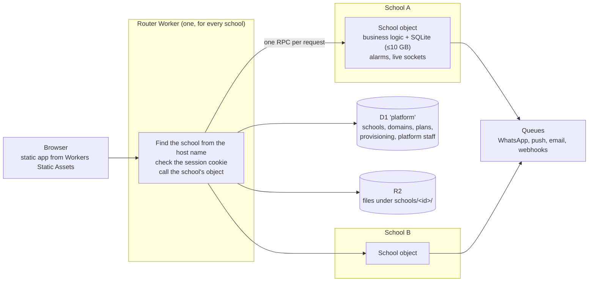

# Architecture Options: D1, Durable Objects and the Rest

As of 27 Oct 2026. Part of the [Cloudflare rebuild docs](README.md).

## Summary

**Recommendation: one Workers app for every school, with each school's data in its own SQLite Durable Object, one D1 database for the platform's own records, R2 for files, and Queues, Cron Triggers and Durable Object alarms for background work. Supabase, including Supabase Auth, goes away entirely.**

- **The preferred design (Workers + D1 + R2 + Queues + Cron Triggers) is feasible, but D1 is the wrong home for school data.** Validation found three problems with one D1 database per school, none of which a Durable Object has:
  1. **No interactive transactions in D1.** A Worker can only send a fixed list of statements as one batch; it cannot read, decide and then write inside one transaction. Today's money and attendance logic depends on exactly that: 89 `FOR UPDATE` row locks in 47 migration files, `SKIP LOCKED` queues and advisory locks. A Durable Object runs one request at a time and has real transactions (`transactionSync`), so the same logic ports directly to TypeScript.
  2. **Every D1 database needs a binding written into the Worker's config.** Adding a school means a redeploy, and one Worker holds about 5,000 bindings at most. A Durable Object is addressed by name at runtime (`idFromName(schoolId)`), so a new school needs no deploy.
  3. **Every D1 query is a network round trip** from the Worker to the database. Today's screens make 5–20 queries each. A Durable Object runs the queries next to its data, so one call from the Worker does all of them.
- **D1 still has a job:** the platform's own small database (schools, domains, plans, provisioning state, platform staff). It is shared, low-traffic and benefits from D1's console, export and HTTP API.
- **Shared D1 (all schools in one database) is not feasible** for schools of up to 10,000 users: one database is capped at 10 GB, which a single 10,000-user school fills in about five years; one database runs one query at a time for every school; and a missing `WHERE school_id = ?` anywhere leaks one school's data to another, with no row-level security to catch it.
- **Cost does not decide this.** A typical 10,000-user school costs about **$13 a month** on either Durable Objects or D1 (year one, list prices, after the plan's included usage); a high-usage one about **$19**. The two stay within 5% of each other until storage grows, where Durable Objects are cheaper ($0.20 against $0.75 per GB-month). See [02-cost-study.md](02-cost-study.md).
- **The biggest job is not the database product.** It is moving 268 SQL functions, 171 triggers, 696 row-level security policies and about 100 RPCs out of Postgres into TypeScript, and replacing 126 front-end files that query the database directly with calls to the school's API. That work is the same under every Cloudflare-native option.

## What has to move

Counts are from the live database (`mps-web`, read 27 Oct 2026) and the code on `main` at `4762ae2`.

| Area | Today | Count |
| --- | --- | --- |
| Tables | Postgres, `public` schema | 217 tables, 17 views, 37 enum types, 879 indexes |
| Business logic in the database | PL/pgSQL functions, mostly `SECURITY DEFINER` | 268 functions, 171 triggers |
| Access control | Row-level security policies | 696 policies |
| Browser to database | supabase-js from the browser | 126 files; 103 `.rpc()` calls, 261 `.in()` filters |
| Server code | Next.js API routes on Vercel | 57 routes |
| Pages | Next.js App Router | 86 pages: 68 client-rendered, 18 redirects |
| Login | Supabase Auth | 1,178 accounts, bcrypt password hashes |
| Files | Supabase Storage | 2 buckets, 630 objects, about 1.0 GB |
| Live updates | Supabase Realtime | 6 tables (leave, bus runs, stops, passengers, alerts) |
| Scheduled jobs | `pg_cron` + `pg_net` | 15 jobs, 3 of them every minute |
| Postgres extensions in use | | `pg_cron`, `pg_net`, `pgcrypto`, `uuid-ossp`, `btree_gist` (4 exclusion constraints) |
| Separate service | Python timetable solver (OR-Tools CP-SAT) on Vercel | 1 |

Live size and usage of the one school running today, over 13 days (14–27 Oct 2026):

| Measure | Value |
| --- | --- |
| Accounts | 1,177 (1,067 students, 86 teachers, 9 drivers, 8 coordinators, 5 admins, 1 principal, 1 smartboard) |
| Daily active users on a school day | about 80, mostly staff (65 teachers, 7 coordinators, 8 students) |
| Database requests from signed-in users | about 32,900 a day (about 500 per active staff member per school day) |
| Rows read | about 5.3 million a day |
| Rows inserted, updated or deleted | about 9,100 a day |
| Busiest hour | 08:00–09:00 IST, 23% of the day's sessions; 17:00–18:00 has 18% |
| Database size | 192 MB after about 9 months |
| Files | about 1.0 GB |

## Requirements the architecture must meet

These come from the app as it is today plus the multi-tenant goal.

| # | Requirement | Why |
| --- | --- | --- |
| R1 | One school can never read or change another school's data | Schools are separate customers; today each has its own Supabase project |
| R2 | A school of 10,000 users runs comfortably at peak | Morning check-in and attendance push about 40–65 requests a second at 10,000 users (cost study) |
| R3 | Multi-step money and attendance changes are atomic and serialised | Fee allocation, refunds, payroll runs, payout claims and attendance recompute all read, decide and write |
| R4 | A new school goes live without a person or a deploy | Self-serve signup and checkout |
| R5 | Per-school scheduled jobs in the school's time zone | Fee autogen, reminders, transport runs, WhatsApp timers |
| R6 | Live bus tracking and live leave updates | Replaces Supabase Realtime |
| R7 | Files per school, private by default | Classroom files, feedback files, avatars, banners, certificates |
| R8 | Point-in-time recovery and long-term backups per school | A school must be restorable on its own |
| R9 | Each school's custom domain or subdomain | `school.eduberry.in` or the school's own domain |
| R10 | Per-school secrets (bank, Razorpay, WhatsApp) | Already stored per school today |
| R11 | Room to grow past 10 GB per school | Old academic years must not count against the live database forever |
| R12 | No Supabase, including no Supabase Auth | Owner's decision |

## Options considered

| Option | Shape | Cloudflare-native |
| --- | --- | --- |
| A. D1 per school | One router Worker; one D1 database per school, each bound by name | Yes |
| B. Shared D1 | One D1 database for all schools; `school_id` on every row | Yes |
| C. Sharded D1 | A handful of D1 databases, each holding many schools with `school_id` | Yes |
| D. Durable Object per school | One router Worker; one SQLite-backed Durable Object per school holds that school's data and runs its logic | Yes |
| E. Workers for Platforms + D1 per school | A copy of the app per school as a "user Worker", each bound to its own D1 | Yes |
| F. Postgres through Hyperdrive (reference only) | Workers app; a Postgres you host elsewhere, reached through Hyperdrive; `school_id` plus row-level security | No: the database lives outside Cloudflare |

Option F is listed only as a yardstick: it is the smallest rewrite (functions, triggers and policies survive), but it keeps a database bill outside Cloudflare, which is what this move is meant to end.

## Validation against the requirements

✔ meets it, △ meets it with work or limits, ✘ does not meet it.

| Requirement | A. D1 per school | B. Shared D1 | C. Sharded D1 | D. DO per school | E. WfP + D1 | F. Postgres |
| --- | --- | --- | --- | --- | --- | --- |
| R1 Isolation | ✔ separate database | ✘ `WHERE` in every query | ✘ same as B inside a shard | ✔ separate object | ✔ separate database and Worker | △ row-level security |
| R2 10,000-user peak | △ round trip per query; needs batching or Smart Placement | ✘ one thread for all schools | △ one thread per shard, noisy neighbours | ✔ one call per request; ~1,000 req/s soft limit per school | △ as A | ✔ |
| R3 Atomic, serialised logic | ✘ batch only, no read-decide-write | ✘ as A | ✘ as A | ✔ single-threaded, real transactions | ✘ as A | ✔ |
| R4 No deploy per school | △ redeploy to add a binding; ~5,000 per Worker | ✔ | ✔ | ✔ created on first use | △ upload a Worker per school | ✔ |
| R5 Per-school jobs | △ cron fan-out | △ cron fan-out | △ cron fan-out | ✔ each school sets its own alarm | △ cron fan-out | ✔ `pg_cron` |
| R6 Live updates | △ needs Durable Objects anyway | △ same | △ same | ✔ WebSockets on the same object | △ same | △ needs Durable Objects anyway |
| R7 Files | ✔ R2 | ✔ R2 | ✔ R2 | ✔ R2 | ✔ R2 | ✔ R2 |
| R8 Recovery and backups | ✔ Time Travel 30 days; `d1 export` | △ whole-database restore only | △ per shard only | ✔ PITR 30 days per object; export must be built | ✔ as A | ✔ provider's |
| R9 Domains | ✔ Cloudflare for SaaS | ✔ | ✔ | ✔ | ✔ | ✔ |
| R10 Secrets | ✔ | ✔ | ✔ | ✔ | ✔ | ✔ |
| R11 Past 10 GB | △ archive old years | ✘ 10 GB for everyone | △ re-shard | △ archive old years | △ archive | ✔ |
| R12 No Supabase | ✔ | ✔ | ✔ | ✔ | ✔ | ✔ if not Supabase-hosted |

Only option D meets every requirement without a ✘. Options B and C fail on isolation and throughput; A and E fail on R3, the one requirement the money modules cannot do without.

## Option A in detail: D1 per school (the preferred design)

What works:

- **Isolation and recovery are excellent.** Each school is its own database with 30 days of Time Travel, `wrangler d1 export`, the dashboard console and the HTTP API.
- **Account limits fit.** 50,000 databases per account (raisable to millions), 1 TB of storage per account (raisable), 10 GB per database.
- **Read replicas** can spread read load across regions for free.

What the validation found:

| Finding | Evidence | Impact | Workaround |
| --- | --- | --- | --- |
| No interactive transactions | D1 runs in auto-commit; `batch()` is the only transaction and its statements are fixed before it is sent | Fee allocation, payment reversal, refund approval, payroll calculation and payout claims cannot read-check-write atomically | Rewrite each as one SQL statement or a trigger, use version columns and retry, or put a Durable Object in front of the database to serialise writes, which is option D with an extra hop |
| Static bindings | A Worker reaches a D1 database only through a binding in its configuration; about 5,000 per Worker (1 MB of script metadata) | Each new school means editing the config and redeploying; a bad deploy affects every school | Automate the redeploy in provisioning; split schools across several router Workers past a few thousand |
| Round trip per query | D1 runs in one location; the Worker runs near the user | A screen with 10 sequential queries pays 10 round trips | `batch()` independent queries, Smart Placement, and fewer, larger queries |
| Single thread per database | "Each database is single-threaded and runs one query at a time" | Same as option D | Same as option D: keep hot queries indexed and heavy reports off the request path |
| 100 bound parameters per query | D1 limit | 261 `.in()` filters in today's code; any list over 100 ids must be split | Chunk lists, or use a temporary table or JSON `IN (SELECT value FROM json_each(?))` |
| No `FOR UPDATE`, no `SKIP LOCKED`, no advisory locks, no exclusion constraints | SQLite | The outbox and payout claim queues lose their locking | Queues for outboxes; single-statement claims |

Verdict: **feasible for everything except the transactional modules, which would need a Durable Object in front anyway.** Once that Durable Object exists, the D1 behind it only adds a network hop and a second place for each school's data.

## Option B and C in detail: shared and sharded D1

| Finding | Detail |
| --- | --- |
| Storage | A 10,000-user school writes about 2 GB of database a year (measured 0.22 MB per user-year today). Ten such schools fill a 10 GB database in six months. The cap cannot be raised. |
| Throughput | One database serves one query at a time for every school on it. Ten 10,000-user schools at peak would ask one thread for 400–650 requests a second. |
| Isolation | SQLite has no row-level security. Every query, report, export and join must carry `school_id`; one omission leaks data across schools. Today 696 policies do this job. |
| Sharding (C) | Spreads load, but keeps every isolation risk of B, adds a shard map, and moving a school between shards is a data migration. |

Verdict: **not feasible** for schools of this size. Sharded D1 only pays off for thousands of tiny tenants, which EduBerry does not have.

## Option D in detail: a Durable Object per school (recommended)

A Durable Object is a small server with its own SQLite database (up to 10 GB). Exactly one copy of each object runs at a time, and it handles one request at a time. EduBerry would define a `School` class; each school gets one object, addressed by name.

What the validation found:

| Check | Result | Source |
| --- | --- | --- |
| Number of objects | Unlimited per account and per class | Durable Objects limits |
| Storage per school | 10 GB per object; writes fail with `SQLITE_FULL` at the cap, reads keep working | Durable Objects limits |
| Throughput | Soft limit about 1,000 requests a second per object; above that requests queue, then fail "overloaded" | Durable Objects limits |
| Transactions | `transactionSync()`; writes in one synchronous block commit together; requests never interleave | SQLite storage API |
| Provisioning | The object is created on first call to `idFromName(schoolId)`; no binding or deploy per school | Durable Objects API |
| Recovery | Point-in-time recovery to any moment in the last 30 days, per object | SQLite storage API (PITR) |
| Inspection | Data Studio in the dashboard reads and edits an object's SQL tables | Durable Objects Data Studio |
| Scheduled work | Each object sets its own alarm (`setAlarm`), billed as one row written | Durable Objects pricing |
| Live updates | Hibernatable WebSockets on the object; idle sockets are not billed for duration | Durable Objects pricing |
| SQL limits | Same as D1: 100 columns per table (widest table today has 44), 100 bound parameters, 100 KB statements, 2 MB rows | Durable Objects limits |
| Billing | Requests $0.15 per million; duration only while running; SQL rows and storage priced like D1 except storage at $0.20 per GB-month | Durable Objects pricing |

Costs of this choice, stated plainly:

- **No SQL access from outside.** There is no HTTP API or `wrangler d1 execute` for an object. Support tooling (a platform-admin "run query" screen, exports to R2) has to be built, and Data Studio covers ad-hoc looks.
- **Exports are ours to build.** Point-in-time recovery covers 30 days. Nightly or per-term exports to R2 for long-term backup and for schools that leave are part of the platform work.
- **Schema migrations run inside each object.** Each object checks its schema version when it wakes and applies pending migrations before serving. A sweep after each deploy wakes every school so that no school migrates on a parent's first click. A migration that fails stops only that school, and must be tested against a copy of real data first.
- **One thread per school.** A report that scans 2 million attendance rows blocks that school for its duration. Heavy reads need summary tables kept current on write, or must run in slices via alarms. This is equally true of D1.
- **CPU-heavy work stays out of the object.** Password hashing, PDF rendering and spreadsheet parsing run in the stateless Worker, so they never hold the school's single thread.
- **Location.** An object is placed near where it is first used (a location hint can steer it). Neither D1 nor Durable Objects offers an India-only jurisdiction today; the live Supabase project is in Mumbai (`ap-south-1`). Check whether any school contract requires data to stay in India before moving that school.

Splitting a school across more than one object is allowed and expected where it helps: for example a separate object for a bus run's live tracking and GPS trail, so that a busy morning of position fixes never queues behind a fee payment. Each split is decided in the section docs.

## Option E in detail: Workers for Platforms with D1 per school

Workers for Platforms runs a copy of the app per school as a "user Worker", each with its own D1 binding, behind a dispatch Worker. It removes the 5,000-binding ceiling and lets one school pin an older version. It keeps every D1 limitation from option A, adds $25 a month and turns every release into one upload per school. Worth revisiting only if schools need different code versions.

## Option F as a yardstick: Postgres through Hyperdrive

Keeping Postgres (hosted anywhere but Supabase) behind Hyperdrive keeps the 268 functions, 171 triggers and 696 policies working with modest changes. It is the fastest route off Vercel and Supabase Auth, but it keeps a separately billed database server, a single point of failure for every school, and `school_id` plus row-level security on all 217 tables. It is the fallback if the Durable Object spikes below fail.

## What replaces each Supabase and Vercel piece

| Today | On Cloudflare | Notes |
| --- | --- | --- |
| Vercel hosting, one project per school | One router Worker + Workers Static Assets | Static asset requests are free and unlimited |
| Next.js App Router pages (client-rendered) | Static single-page app served as assets | Pages already render in the browser; server rendering exists only to stamp the CSP nonce. Detailed in [16-frontend-and-api.md](16-frontend-and-api.md) |
| Next.js API routes | Routes in the router Worker, plus RPC methods on the school object | |
| Supabase Postgres, one project per school | SQLite in the school's Durable Object | Schema translated table by table in the section docs |
| Row-level security | Permission checks in the school object's methods, from the session's user and role | One shared authorization module, tested per role |
| PL/pgSQL functions and triggers | TypeScript methods on the school object; SQLite triggers only for simple bookkeeping | |
| Supabase Auth | EduBerry's own accounts, password hashes and sessions in each school object | Existing bcrypt hashes import as-is and are re-hashed on next sign-in |
| Supabase Storage | R2, one bucket, keys prefixed by school | Private by default, served through the Worker or short-lived signed links |
| Supabase Realtime | Hibernatable WebSockets on the school object (or a per-run object for buses) | |
| `pg_cron` | Each school object's own alarm; one Cron Trigger as a watchdog | Account limit: 250 Cron Triggers |
| `pg_net` outbound calls | Queues consumer Workers | Retries and dead-letter queues built in |
| Supabase Vault / `payment_secrets` table | Encrypted columns in the school object, key in Workers Secrets | |
| Email via Supabase or Cloudflare REST | Cloudflare Email Service binding | Already designed for in `docs/account-email-system.md` |
| Python solver on Vercel | Cloudflare Containers, started on demand | OR-Tools has no JavaScript build |
| Per-school Vercel project and env vars | One row per school in the platform D1; secrets in the school object | |

## Spikes to run first in the new repository

Each spike is small, throwaway and answers one question that could change this decision. Run them before building features.

| # | Question | Pass when |
| --- | --- | --- |
| S1 | Can a `School` object run today's heaviest screens fast enough? | Load the live school's data into an object; the home, attendance and fee-student screens answer in under 50 ms of object time at the 99th percentile |
| S2 | Does one object hold a 10,000-user school's peak? | Synthetic data for 10,000 users; 100 requests a second for 10 minutes with the real query mix; no "overloaded" errors and 99th percentile under 300 ms end to end from India |
| S3 | Can money logic port with the same guarantees? | Port one fee function chain (payment allocation and reversal) with `transactionSync`; concurrent payment tests give the same ledger as Postgres |
| S4 | Do existing passwords survive? | Import exported bcrypt hashes; sign in with them; re-hash on success |
| S5 | Do migrations and recovery work per school? | Ship a schema change; the sweep upgrades 100 test schools; a PITR restore of one leaves the others untouched |
| S6 | How long does a full-year report take? | 2 million attendance rows; the monthly summary from rollup tables in under 50 ms, and the raw scan measured |
| S7 | Does the browser app run as static assets? | Three real pages built as a static app, calling the Worker API, with a strict CSP and no inline scripts |
| S8 | Can data move from Supabase to an object losslessly? | Export the live database, transform, import; row counts and checksums match per table |

If S1, S2 or S3 fail, fall back to option F for the database and keep everything else in this plan.

## Decision record

| Decision | Choice | Status |
| --- | --- | --- |
| Where school data lives | SQLite Durable Object per school | Recommended, pending spikes S1–S3 |
| Where platform data lives | One D1 database (`platform`) | Recommended |
| Shared or sharded D1 for school data | Rejected | Fails isolation and throughput at 10,000 users |
| Workers for Platforms | Not now | Revisit if schools need different versions |
| Login | EduBerry's own auth, no Supabase Auth | Owner's decision |
| Front end | Static single-page app on Workers Static Assets | Recommended; detailed in [16-frontend-and-api.md](16-frontend-and-api.md) |
| Live bus runs | In the school object at launch; one object per run only if the bus peak measurably slows the school | Decided in [36-transport.md](36-transport.md) |
| Banks that need a client certificate | A bank gateway container makes those calls | Recommended in [17-integrations-and-secrets.md](17-integrations-and-secrets.md) |
| Data residency | Not decided | Confirm whether any school requires India-only storage |

## Sources

Cloudflare documentation, read 27 Oct 2026:

- [D1 limits](https://developers.cloudflare.com/d1/platform/limits/) and [D1 batch](https://developers.cloudflare.com/d1/worker-api/d1-database/)
- [Durable Objects limits](https://developers.cloudflare.com/durable-objects/platform/limits/), [pricing](https://developers.cloudflare.com/durable-objects/platform/pricing/) and [lifecycle](https://developers.cloudflare.com/durable-objects/concepts/durable-object-lifecycle/)
- [SQLite storage API, including PITR](https://developers.cloudflare.com/durable-objects/api/sqlite-storage-api/) and [Data Studio](https://developers.cloudflare.com/durable-objects/observability/data-studio/)
- [Workers limits](https://developers.cloudflare.com/workers/platform/limits/) and [pricing](https://developers.cloudflare.com/workers/platform/pricing/)
- [Workers for Platforms pricing](https://developers.cloudflare.com/cloudflare-for-platforms/workers-for-platforms/platform/pricing/)
- [Cloudflare for SaaS plans](https://developers.cloudflare.com/cloudflare-for-platforms/cloudflare-for-saas/plans/)
