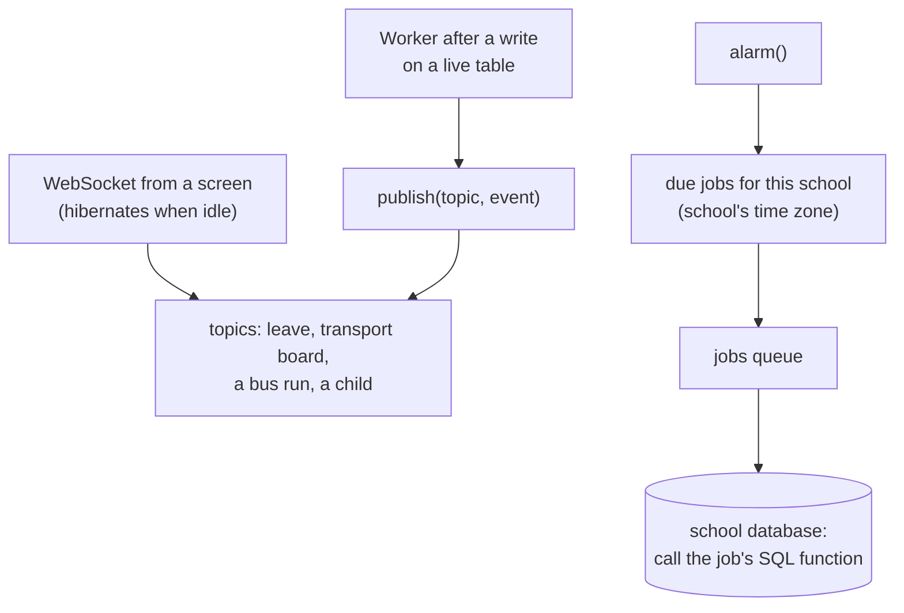

# Target Architecture

As of 5 Nov 2026. Part of the [rebuild docs](README.md). Builds on the decision in [01-architecture-options.md](01-architecture-options.md): Neon Postgres per school, Cloudflare for everything else.

## Summary

- **One deployment serves every school.** A single router Worker answers every host name; the school is found from the host, never from anything the browser sends.
- **Each school keeps its own Postgres database, in its own Neon project.** Tables, functions, triggers and row-level security move from Supabase as they are. The Worker reaches the database with Neon's serverless driver, using the school's connection string from the platform database.
- **Row-level security still decides who sees what.** Every query runs as the signed-in user: the Worker (or Neon's Data API) sets the user's id for the transaction, and the existing `auth.uid()` calls in 155 policies and 99 functions read it.
- **The browser app is static files** served free from Workers Static Assets. In phase 1 it keeps today's PostgREST-style queries, sent through a thin Worker proxy to Neon's Data API; in phase 2 each screen moves to one Worker endpoint ([16](16-frontend-and-api.md)).
- **A small Durable Object per school, the `SchoolHub`,** holds live WebSocket connections and the school's job timer. It holds no school data.
- **Background work** runs from the hub's timer and Cron Triggers through Queues. Nothing scheduled runs inside Postgres, so a school's database can sleep when nobody is using the app.

## Building blocks

| Block | Product | One per | Holds or does |
| --- | --- | --- | --- |
| `eduberry-app` router Worker | Workers + Static Assets | Platform | Serves the static app; runs `/api/*`; finds the school; signs in users and issues tokens; queries the school's database; uploads and serves files; verifies webhooks |
| School database | Neon project (Postgres 17) | School | The school's tables, functions, triggers, RLS policies and its `auth.users` and `sessions` tables |
| `platform` database | Neon project, reached through Hyperdrive | Platform | Schools, host names, plans, encrypted connection strings, provisioning state, platform staff, platform audit |
| Host cache | Workers KV | Platform | `host → schoolId, status, plan` for about a minute, so most requests never touch the platform database |
| `SchoolHub` | Durable Object | School | Live WebSocket fan-out (leave, transport); the school's job timer in its own time zone |
| `eduberry-files` bucket | R2 | Platform | All files, keys prefixed `schools/<schoolId>/` |
| `outbox` queue | Queues | Platform | Outgoing WhatsApp, web push and email |
| `jobs` queue | Queues | Platform | Scheduled work per school, migrations sweep, exports |
| `webhooks` queue | Queues | Platform | Verified bank, Razorpay and WhatsApp callbacks, delivered to the right school with retries |
| Email | Email Service binding | Platform | Account emails |
| `SolverContainer` | Containers | Platform | The Python CP-SAT timetable solver |
| Rate limiter | Rate Limiting binding | Platform | Login, forgot-password and public endpoints |
| Usage metrics | Workers Analytics Engine | Platform | Requests, errors and latency per school and route |
| Secrets | Workers Secrets | Platform | The key that encrypts connection strings, per-school token signing keys and school secrets; VAPID, email, Neon API key |

Created per school: a Neon project (by the Neon API, at signup), one `platform.schools` row, the hub (automatically, on first use) and a custom host name if the school brings its own domain.

## Request lifecycle

```mermaid
sequenceDiagram
  autonumber
  participant B as Browser
  participant W as Router Worker
  participant K as KV / platform DB
  participant N as School's Neon database
  B->>W: GET /fees (any page)
  W-->>B: index.html + JS from Static Assets (free, no code runs)
  B->>W: POST /api/fees/student-summary (cookie)
  W->>K: host → schoolId, plan, connection string (cached)
  W->>W: rate limit; verify the access token (signature only, no query)
  W->>N: one HTTPS transaction: set the user for this transaction, then select fees.student_summary(...)
  N->>N: RLS and the SQL function run as the user
  N-->>W: result
  W-->>B: JSON
```

Rules for every request:

1. **The school comes from the host name only.** A request body or header can never name a different school, and the Worker only ever holds that school's connection string.
2. **Every query runs as the user.** The Worker opens a transaction, sets the role to `authenticated` and the user's claims for that transaction only, then runs the query. Row-level security applies exactly as it does on Supabase today. Server-only work (webhooks, jobs) uses a separate, narrower database role per job, never a role that bypasses RLS for user requests.
3. **One round trip per request where possible.** The database is in Singapore; each round trip from India costs about 30–60 ms. Multi-step logic stays in SQL functions (as it is today), so a screen calls one function. Routes that genuinely need several dependent queries use Smart Placement so the Worker runs near the database.
4. **Transactions stay in the database.** Fee allocation, payout claims and attendance recompute keep their `FOR UPDATE` locks and their single-function transactions. Nothing in the Worker holds a transaction open across round trips.
5. **CPU-heavy work stays in the Worker.** Password hashing, PDF rendering, spreadsheet parsing and webhook signature checks never run in Postgres.

## How the database knows the user

Today Supabase's API gateway turns the browser's JWT into `request.jwt.claims` for each request, and `auth.uid()` reads it. The rebuild keeps that contract:

| Path | How the user is set |
| --- | --- |
| Worker routes | Each request's transaction starts with `set local role authenticated` and `select set_config('request.jwt.claims', <claims>, true)`; the claims come from the access token the Worker has just verified |
| Neon Data API (phase 1) | The browser sends the access token as a bearer token through the Worker's `/api/db` proxy; Neon checks it against the school's public key (JWKS) and provides `auth.uid()` from its `sub` claim |

`auth.uid()` must return the same id on both paths. Spike S2 in [01](01-architecture-options.md) decides whether to use Neon's `pg_session_jwt` functions for both, or our own small `auth` schema shim for the Worker path. Either way no policy or function changes ([12](12-auth-and-permissions.md)).

## Code layout of the new repository

```
apps/
  web/                 Static single-page app (Vite + React + React Router)
    src/pages/         One file per current route under src/app/**/page.tsx
    src/components/    Moved from src/components with minimal change
    src/api/           Data access: phase 1 the same query code against the Data API; phase 2 typed calls to /api
  worker/
    src/index.ts       Router: static assets, /api, /hooks, cron, queue consumers
    src/http/          Per-section routes (validate input, run one SQL call as the user)
    src/db/            Connection lookup, the "run as user" transaction helper, typed SQL calls
    src/auth/          Sign-in, password hashing, tokens, sessions
    src/hub/           SchoolHub Durable Object: live sockets and the job timer
    src/jobs/          Queue consumers: outbox, webhooks, jobs
    src/platform/      Platform database, provisioning through the Neon API, platform admin
db/
  migrations/          Plain SQL migrations applied to every school database (continues supabase-migrations/)
  platform/            Migrations for the platform database
packages/
  shared/              Types and validation shared by web and worker
services/
  solver/              Unchanged Python solver, as a container image
tools/
  import-supabase/     pg_dump / pg_restore wrapper per school, plus auth and file moves
  migrate/             Applies db/migrations to every school, tracked in the platform database
```

Choices to confirm in the first spikes:

| Choice | Recommendation | Why |
| --- | --- | --- |
| HTTP router | Hono | Small, typed, built for Workers |
| Database driver | `@neondatabase/serverless` (HTTP for single calls and batched transactions, WebSocket for the rare interactive transaction) | Works from Workers with a connection string chosen per request; no binding per school |
| Query layer | Plain SQL with types generated from the schema (for example Kysely with `kysely-codegen`) | The logic already lives in SQL functions; an ORM would add little |
| Migrations | Plain SQL files and a small runner that applies them school by school | Continues today's `supabase-migrations/` style; one failure stops only that school |
| Validation | Zod | Shared request schemas between `web` and `worker` |
| Front-end build | Vite + React Router | [16](16-frontend-and-api.md) |
| Tests | Vitest; Neon branches of a seeded test school for database tests | Real Postgres, real RLS, created and thrown away per run |

## Inside the `SchoolHub`



- **Live updates.** After a write on one of today's six live tables, the Worker publishes a small event to the hub, which forwards it to subscribed sockets. Idle sockets cost nothing while the hub hibernates.
- **Job timer.** The hub keeps the school's schedule (fee autogen, reminders, overdue marking, transport materialise, cleanups) and sets one alarm for the next due job. When it fires, it enqueues the job; the consumer calls the same SQL function `pg_cron` calls today. Jobs are gathered into a few windows a day so the database is not woken every few minutes ([14](14-jobs-messaging-realtime.md)).
- **The hub holds no school data**, so losing its memory loses nothing: sockets reconnect and the schedule is rebuilt from the school's settings.

## Environments and deploys

| Environment | Purpose | Data |
| --- | --- | --- |
| Local | `wrangler dev` and the Vite dev server | A Neon branch of a seeded test school (or local Postgres) |
| Preview | One per pull request | A fresh Neon branch of the seeded test school, deleted with the preview |
| Staging | Separate Cloudflare environment | A Neon branch of a real school, anonymised |
| Production | One Cloudflare account on Workers Paid; Neon organisation on Launch | Live schools |

Deploys:

1. Test: unit tests, then database tests on a fresh branch of the test school, then a migration dry run on a branch of every live school's project (branches are copy-on-write and cheap).
2. Apply new migrations school by school with `tools/migrate` before the Worker that needs them goes out; migrations are written to work with both the old and the new Worker.
3. Upload the new Worker version and roll it out gradually, watching error rates per school.

## Observability

| Need | How |
| --- | --- |
| Errors and logs | Workers Logs at 10% sampling, 100% for errors |
| Per-school metrics | One Analytics Engine point per API call: school, route, status, database time |
| Database | Neon's console per project: CU-hours, autoscaling, slow queries (`pg_stat_statements`) |
| Alerts | Error rate per school; a compute that never suspends at night (cost leak); queue backlog and dead letters |
| Audit | Each school keeps its audit tables as today; the platform database audits platform-staff actions |

## Security baseline

| Concern | Control |
| --- | --- |
| Session theft | Refresh token in an `HttpOnly; Secure; SameSite=Lax` cookie; access token short-lived (15 minutes) and kept in memory, not `localStorage` as today |
| Cross-site request forgery | `SameSite=Lax` plus an `Origin` check on state-changing routes |
| One school reaching another | The school comes only from the host; each request uses only that school's connection string; R2 keys are built server-side from the school id; a token is signed for one school and rejected by any other |
| Database credentials | Connection strings encrypted in the platform database; the role the Worker connects as cannot bypass RLS; the owner role is used only by migrations |
| Brute force | Rate Limiting on login, forgot-password, public verify and pay links; Turnstile after failures |
| Secrets | School secrets (bank, Razorpay, WhatsApp) stay in the school database, encrypted with a platform key |
| Webhooks | Signature checked in the Worker; the school comes from the URL path (`/hooks/<schoolId>/...`) and the signature must match that school's secret |

## Limits budget

| Limit | Value | Where it bites |
| --- | --- | --- |
| Neon projects | 100 on Launch, 1,000 on Scale | Pods or a second organisation before 100 ([11](11-tenancy-and-control-plane.md)) |
| Compute size | 0.25–16 CU autoscaling on Launch | Right-size per school |
| Latency India → Singapore | about 30–60 ms per round trip | One SQL call per screen |
| Pooled connections | 10,000 clients per project | Not a concern through the HTTP driver |
| Hyperdrive configurations | 25 per account | Platform database only |
| CPU per Worker request | 30 s default | PDF and spreadsheet work |
| Subrequests per Worker request | 10,000 default | Each HTTP query is one; fan-out jobs use Queues |
| Queue message | 128 KB | Send references, not payloads |
| Cron Triggers per account | 250 | A handful are enough; per-school timing lives in the hub |

## What the section docs add

Every section doc from 20 onwards describes, for its part of the app: how it works today, its tables (which move unchanged), its functions and which of them change, its server routes and their Worker equivalents, its scheduled jobs, live updates and files, and its single-tenant assumptions and how each is removed.
