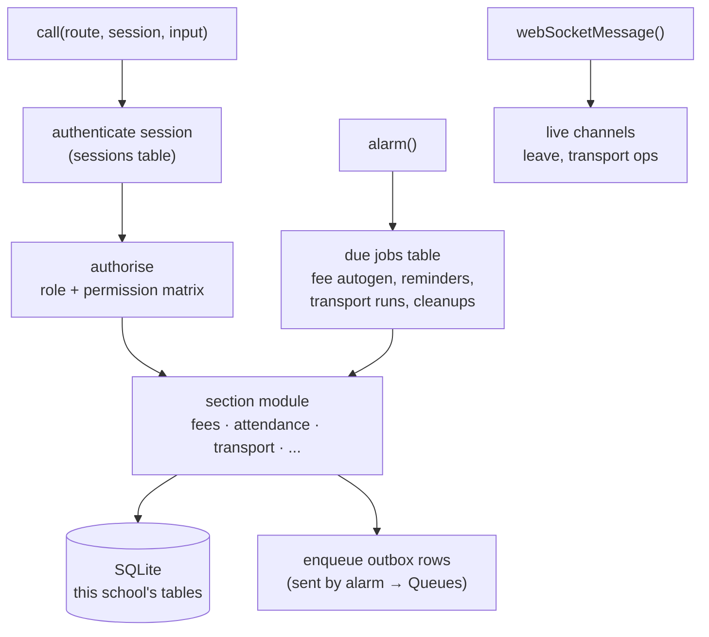

# Target Architecture

As of 27 Oct 2026. Part of the [Cloudflare rebuild docs](README.md). Builds on the decision in [01-architecture-options.md](01-architecture-options.md); read that first.

## Summary

- **One deployment serves every school.** A single router Worker answers every host name; the school is found from the host, never from anything the browser sends.
- **Each school is one `School` Durable Object** holding that school's SQLite database and running its business logic. The router Worker does everything stateless (sessions, rate limits, files, CPU-heavy work) and makes **one RPC call per request** to the school's object.
- **The browser app is static files**, built once and served free from Workers Static Assets. It talks only to `/api/*`; it never touches a database.
- **Background work** runs from each school's own alarm, with Queues for anything that leaves Cloudflare (WhatsApp, push, email, bank calls) and a few Cron Triggers as watchdogs.
- **Everything a section needs is listed in its own doc**; this doc fixes the shared skeleton every section plugs into.

## Building blocks

| Block | Cloudflare product | One per | Holds or does |
| --- | --- | --- | --- |
| `eduberry-app` router Worker | Workers + Static Assets | Platform | Serves the static app; runs `/api/*`; finds the school; checks sessions; calls the school object; uploads and serves files; verifies webhooks |
| `School` | SQLite Durable Object | School | The school's tables, business logic, scheduled work (alarm) and live WebSocket fan-out |
| `RunLive` (optional) | SQLite Durable Object | Bus run | One live bus run: position fixes, ETA, parents' live sockets. Keeps the busy GPS stream off the school's own thread (decided in the transport doc) |
| `platform` database | D1 | Platform | Schools, host names, plans, provisioning state, platform staff, platform audit log |
| `eduberry-files` bucket | R2 | Platform | All files, keys prefixed `schools/<schoolId>/` |
| `outbox` queue | Queues | Platform | Outgoing WhatsApp, web push and email messages |
| `jobs` queue | Queues | Platform | Fan-out work across schools (watchdog, migrations sweep, exports) |
| `webhooks` queue | Queues | Platform | Verified inbound bank, Razorpay and WhatsApp callbacks, delivered to the right school with retries |
| Email | Email Service binding | Platform | Account emails (see `docs/account-email-system.md`) |
| `SolverContainer` | Containers | Platform | The Python CP-SAT timetable solver, started on demand |
| Rate limiter | Rate Limiting binding | Platform | Login, forgot-password and public endpoints |
| Usage metrics | Workers Analytics Engine | Platform | Per-school request, error and latency counts; usage for billing |
| Secrets | Workers Secrets | Platform | Platform keys only (session signing, encryption key, VAPID, email). School secrets live encrypted in the school's own database |

Nothing is created per school except the `School` object (automatically, on first use), one row in `platform`, and a custom host name when the school brings its own domain.

## Request lifecycle

```mermaid
sequenceDiagram
  autonumber
  participant B as Browser
  participant W as Router Worker
  participant P as platform D1 (cached)
  participant S as School object
  B->>W: GET /fees (any page)
  W-->>B: index.html + JS from Static Assets (free, no code runs)
  B->>W: POST /api/fees/student-summary (cookie)
  W->>P: host → schoolId, status, plan (cached in memory ~60 s)
  W->>W: rate limit; read session cookie
  W->>S: SCHOOL.get(idFromName(schoolId)).call("fees.studentSummary", session, input)
  S->>S: check session, load user, check permission, run queries (one thread, one transaction)
  S-->>W: result
  W-->>B: JSON
```

Rules that hold for every request:

1. **The school comes from the host name only.** `greenfield.eduberry.in` or the school's own domain maps to one `schoolId` in `platform`. A request body or header can never name a different school.
2. **One object call per API request.** The object call receives the raw session token; the object validates it against its own `sessions` table, loads the user and role, and checks the permission before running anything. There is no second hop for auth.
3. **Each call is one transaction.** A method's writes either all happen or none do. Because the object runs one call at a time, there are no lost updates and no need for row locks.
4. **Calls stay short.** Target under 20 ms of object time, hard ceiling a few hundred ms. Anything longer (generate 9,000 invoices, recompute a term's attendance, import a spreadsheet) is split into batches that the object's alarm works through, with progress the screen can poll.
5. **CPU-heavy work stays in the Worker.** Password hashing, PDF rendering, spreadsheet parsing, image handling and webhook signature checks run in the router Worker before or after the object call.

## Code layout of the new repository

The new repository starts as a clone of this one. Keep the React components; replace the data layer, the server and the hosting.

```
apps/
  web/                 Static single-page app (Vite + React + React Router)
    src/pages/         One file per current route under src/app/**/page.tsx
    src/components/    Moved from src/components with minimal change
    src/api/           Typed client: one module per section, same function names as today's src/lib/*
  worker/
    src/index.ts       Router: static assets, /api routing, webhooks, cron, queue consumers
    src/http/          Per-section HTTP handlers (validate input, call the object)
    src/school/        The School Durable Object
      SchoolObject.ts  Entry point: call(), alarm(), webSocketMessage()
      modules/         One module per section: fees.ts, attendance.ts, ...
      authz.ts         Roles and permissions (replaces row-level security)
      migrate.ts       Schema migrations applied on wake
    src/platform/      platform D1 access, provisioning, platform admin
    src/jobs/          Queue consumers: outbox, webhooks, jobs
packages/
  schema/              Table definitions for the school database and platform D1, migrations
  shared/              Types and validation shared by web and worker; money, dates, permissions
services/
  solver/              Unchanged Python solver, packaged as a container image
tools/
  import-supabase/     One-off export, transform and import of each live school
```

Choices to confirm in the first spike (S1):

| Choice | Recommendation | Why |
| --- | --- | --- |
| HTTP router | Hono | Small, typed, built for Workers |
| Query layer | Drizzle ORM (SQLite dialect) with its Durable Objects driver | Typed tables and migrations for both the school SQLite and platform D1 from one schema package; raw SQL stays available |
| Validation | Zod | Shared request and response schemas between `web` and `worker` |
| Front-end build | Vite + React Router | Today's pages are already client components; see [16-frontend-and-api.md](16-frontend-and-api.md) |
| Tests | Vitest with `@cloudflare/vitest-pool-workers` | Runs Durable Objects, D1, R2 and Queues locally in the real runtime |

## Inside the `School` object



- **Modules.** Each section doc defines its module: its tables, methods, permissions and jobs. Modules call each other directly (in the same object), which replaces cross-table triggers and `SECURITY DEFINER` helpers.
- **Jobs table.** One `scheduled_jobs` table (job key, next run time in UTC, school-local schedule, last result). `alarm()` runs whatever is due, then sets the next alarm to the earliest pending job. This replaces all 15 `pg_cron` jobs and lets each school run them at its own local time.
- **Outbox.** Messages are written to an `outbox` table inside the same transaction as the change that caused them, then handed to the `outbox` queue by the alarm. A message is never sent for a change that rolled back.
- **Live updates.** Screens that need live data open a WebSocket to `/api/live`, which the Worker forwards to the school object (or a `RunLive` object). The object uses the hibernation API, so idle sockets cost nothing.

## Environments and deploys

| Environment | Purpose | Data |
| --- | --- | --- |
| Local | `wrangler dev` / Vite dev server; Miniflare runs Durable Objects, D1, R2 and Queues locally | Seeded test schools |
| Preview | One per pull request (Workers Previews get their own Durable Object namespace) | Seeded test schools |
| Staging | Separate Cloudflare account or environment, separate D1, R2, Queues | A copy of a real school, anonymised |
| Production | One Cloudflare account on Workers Paid | Live schools |

Deploys run from GitHub Actions with Wrangler:

1. Test: unit tests, Workers-runtime tests, migration test against a copy of real data.
2. Upload a new Worker version and roll it out gradually (Workers gradual deployments), watching error rates per school.
3. After a deploy that carries a schema migration, the `jobs` queue sweeps every school (`call("system.migrate")`) so each object is upgraded before its users arrive. Objects also upgrade themselves on first wake if the sweep has not reached them.
4. Durable Object class changes (new classes, renames) are declared in the Wrangler config; the `School` class itself never changes name.

## Observability

| Need | How |
| --- | --- |
| Errors and logs | Workers Logs at 10% head sampling in production (100% for errors via `console.error` plus tail Worker if needed). Logging every invocation adds about $5.90 per large school a month (cost study) |
| Per-school metrics | One Analytics Engine data point per API call: school, route, status, object time, rows read and written. Answers "which school is slow" and feeds usage billing |
| Traces | Workers tracing for slow requests |
| Alerts | Error-rate and "overloaded" alerts per school; queue backlog and dead-letter counts; daily export job failures |
| Audit | Each school keeps its own audit tables (admin, fee, payroll), as today; `platform` keeps an audit of platform-staff actions |

## Security baseline

| Concern | Control |
| --- | --- |
| Session theft through script injection | Sessions in `HttpOnly; Secure; SameSite=Lax` cookies, not `localStorage` as today. Strict CSP: `script-src 'self'` with no inline scripts (the static build needs none) |
| Cross-site request forgery | `SameSite=Lax` cookies plus an `Origin`/`Sec-Fetch-Site` check on every state-changing `/api` call |
| One school reaching another | The school id comes only from the host; every object call is scoped to one object; R2 keys are built server-side from that id |
| Brute force | Rate Limiting binding on login, forgot-password, public verify and pay links; Turnstile on the login and forgot-password forms after failures |
| Secrets | Platform secrets in Workers Secrets; school secrets (bank, Razorpay, WhatsApp) encrypted in the school database with a platform key, readable only by the server paths that use them |
| Webhooks | Signature checked in the Worker before anything is queued; the school is identified from the webhook URL path (`/hooks/<schoolId>/...`) and the signature must match that school's secret |
| Headers | Today's `next.config.js` headers (HSTS, nosniff, frame-ancestors, permissions policy) carried over as Static Assets `_headers` plus Worker response headers |

## Limits budget

Design every section against these limits; each section doc notes where it comes close.

| Limit | Value | Where it bites |
| --- | --- | --- |
| Durable Object throughput | ~1,000 requests a second per school (soft) | Only with long calls; keep calls short |
| SQLite size per school | 10 GB, cannot be raised | Archive closed academic years ([13-data-layer.md](13-data-layer.md)) |
| Bound parameters per query | 100 | Lists of ids: chunk, or pass one JSON array and use `json_each` |
| Columns per table | 100 | Widest table today has 44 |
| Row or value size | 2 MB | Large JSON blobs (exam templates, payroll traces) |
| SQL statement length | 100 KB | Generated bulk inserts: batch them |
| CPU per Worker request | 30 s default, up to 5 min | PDF and spreadsheet work |
| Worker bundle | 64 MiB uncompressed | Not a concern |
| Subrequests per request | 10,000 default | Fan-out jobs: use Queues instead |
| Queue message | 128 KB | Send references, not payloads |
| Cron Triggers per account | 250 | Only a few watchdogs are needed |

## What the section docs add

Every section doc from 20 onwards fills in, for its part of the app:

- its tables in the school database (translated from [reference/live-schema.md](reference/live-schema.md));
- its module methods and the API routes that call them;
- its permission rows in the shared matrix ([12-auth-and-permissions.md](12-auth-and-permissions.md));
- its scheduled jobs, outbox messages, live channels and files;
- its single-tenant assumptions and how each is removed.
