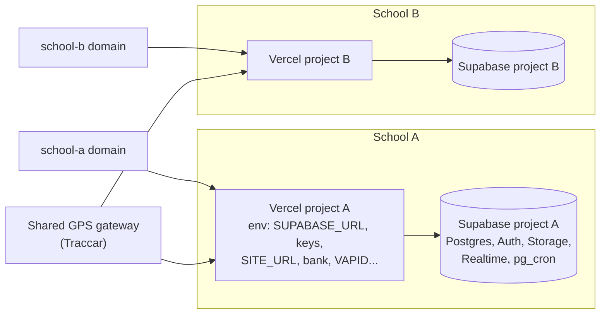
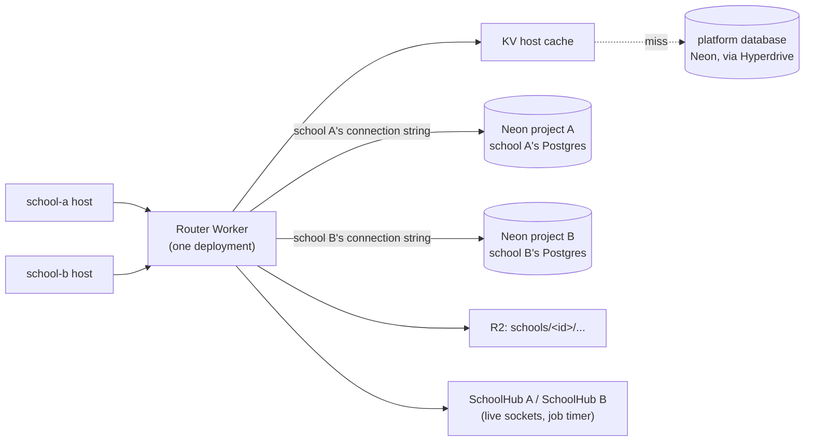
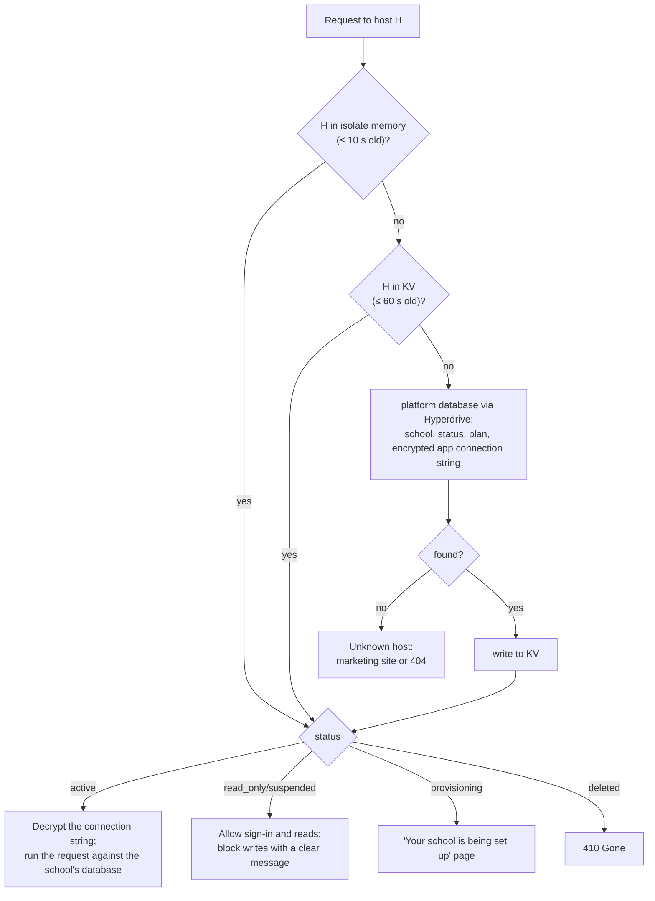

# Tenancy and the Control Plane

As of 5 Nov 2026. Part of the [rebuild docs](README.md). The design is a Neon Postgres project per school with Cloudflare for everything else ([01](01-architecture-options.md), [10](10-target-architecture.md)).

## Summary

- **Today a school is a deployment.** The Vercel project that receives a request, and the Supabase project its environment variables point at, decide which school the request belongs to. Starting a school means forking the repository, creating a Supabase project, running about 260 migrations by hand, setting environment variables and pointing a domain.
- **In the target a school is a row plus a database.** One `platform` database lists every school, its host names and its database. The router Worker maps the host to a school and runs the request against that school's database. Nobody creates databases by hand: when checkout succeeds, a provisioning job takes a database that was prepared in advance, seeds it and invites the first admin, so the school can use the app within seconds.
- **Isolation stays as strong as today.** Each school is still its own Postgres database in its own Neon project, with its own roles, backups and restore history. The Worker only ever holds the connection string of the school named by the host.
- **New schools start in pods.** Most schools start as a database in a shared Neon project (a "pod" of about 20 schools), which halves their cost and keeps well clear of the Launch plan's 100-project limit. Large or premium schools get a Neon project of their own ([02](02-cost-study.md), [04](04-database-and-region-options.md)).
- **About 20 single-school assumptions** have to go: per-deployment environment variables, a hard-coded Supabase host, a hard-coded default school name, static PWA manifest and icons, runtime URLs stored in the database, cron times fixed in UTC, and the `+91` country code. Each is listed below with its replacement.

## How tenancy works today



The README's "New School Deployment Checklist" is the provisioning process: fork, create a Supabase project, run migrations, set environment variables, configure the domain, seed the admin, send credentials. Nothing in the app knows that other schools exist, which is why isolation is strong today and onboarding is slow.

## How tenancy works in the target



## Single-school assumptions to remove

| # | Assumption today | Where | Replacement |
| --- | --- | --- | --- |
| 1 | Database chosen by `NEXT_PUBLIC_SUPABASE_URL` / anon key / service-role key | 34 + 9 + 30 references | School chosen from the host name; its connection string comes from `platform` |
| 2 | Supabase host hard-coded in `images.domains` | `next.config.js` | Images served from `/files/...` on the school's own host |
| 3 | Public site URL from `NEXT_PUBLIC_SITE_URL` or `VERCEL_PROJECT_PRODUCTION_URL` | Account emails, pay links, webhooks | The school's primary host from `platform.school_hosts` |
| 4 | Default branding names "Muthamil Public School" | `src/lib/pageConfig.ts` (`BRANDING_DEFAULTS`, `LOGIN_DEFAULTS`) | Neutral defaults; the real name is written into the school's settings at provisioning |
| 5 | Static PWA manifest ("EduBerry", fixed icons) | `public/manifest.json`, `public/*.png` | `/manifest.webmanifest` generated per school from its branding |
| 6 | Favicon route trusts only "our Supabase Storage" | `src/app/api/favicon/route.ts` | Trust only the school's own R2 prefix |
| 7 | Drain URL and cron secret saved into the database the first time a screen is opened | `site_settings.fee_runtime`, `transport_runtime_config`, `wa_runtime_config` | Not needed: queue consumers drain the outboxes ([14](14-jobs-messaging-realtime.md)) |
| 8 | Cron schedules fixed in UTC per project (fee autogen 02:00 IST, reminders 10:00 IST, transport materialise 03:00 IST) | `cron.job` | The school's `SchoolHub` timer, in the school's time zone, gathered into a few windows a day so the database can sleep |
| 9 | Country code 91 added to every 10-digit number | `normalize_msisdn(p_default_cc DEFAULT '91')` | Per-school setting `phone.default_country_code` |
| 10 | Time zone per school stored in `site_settings.attendance_config.timezone`, default `Asia/Kolkata`; one fee engine file hard-codes `Asia/Kolkata` | `attendance_timezone()`, `src/lib/fees/engine/dates.ts` | One school setting `school.timezone`, read by every module and by the hub |
| 11 | Currency and number format: `en-IN` in 37 files, `₹`/`INR` in 73 files | Front end | Keep as the default; read locale and currency from school settings so a non-Indian school is a setting, not a code change |
| 12 | Bank, Razorpay, WhatsApp, Smart Collect, payout and Cashfree credentials fall back to environment variables | `serverSecrets.ts`, `serverIntegrationSecrets.ts`, `paymentSecrets.ts` | School secrets only, stored encrypted in the school database ([17](17-integrations-and-secrets.md)) |
| 13 | Webhook URLs on the school's domain (`/api/fees/upi/webhook`, etc.) | Bank and Meta dashboards | `/hooks/<schoolId>/<provider>` on any EduBerry host; a domain change no longer breaks them |
| 14 | GPS forward URL contains the school's domain; gateway ownership keyed by domain | `docs/gps-system-status.md` | Forward to `/hooks/<schoolId>/gps/<deviceKey>`; ownership keyed by school id |
| 15 | Each school's Vercel project receives the GPS gateway token nightly | `gps-gateway-sync.yml` | One platform secret; per-school gateway users if the gateway stays shared |
| 16 | Supabase Auth redirect URLs configured per project | Supabase dashboard | Own auth; links built from the school's host ([12](12-auth-and-permissions.md)) |
| 17 | Maps keys (`NEXT_PUBLIC_MAPBOX_*`) per deployment | Transport maps | One platform key, or per-school override in settings |
| 18 | Solver URL and shared secret per deployment | `SOLVER_INTERNAL_URL`, `SOLVER_SHARED_SECRET` | One `SolverContainer` binding for all schools |
| 19 | VAPID key pair per deployment | `NEXT_PUBLIC_VAPID_PUBLIC_KEY`, `VAPID_PRIVATE_KEY` | One platform key pair; subscriptions are already per user |
| 20 | Migrations applied by hand per project | `supabase-migrations/` | `tools/migrate` applies `db/migrations` to every school database in turn and records each in `platform.school_migrations` ([13](13-data-layer.md)) |
| 21 | First admin seeded by hand; `STUDENT_PASSWORD` in a bulk script | `create-users-properly.js`, `scripts/bulk-create-students.js` | Provisioning creates the first admin and emails an invite |

Settings that already live in each school's database (branding, page themes, attendance rules, fee settings, WhatsApp templates and the rest of `site_settings`) are per-school data, not assumptions. They stay in the school's own tables unchanged.

## The `platform` database

A small Neon project of its own, in the same region as the schools, reached through Hyperdrive (one configuration, free on Workers Paid). It is read on cache misses and by the platform console. It never holds school data such as students, marks or money.

| Table | Purpose | Key columns |
| --- | --- | --- |
| `schools` | One row per school | `id` (stable uuid, also the `SchoolHub` name and the R2 prefix), `slug`, `display_name`, `status` (`provisioning`, `active`, `suspended`, `read_only`, `offboarding`, `deleted`), `plan_id`, `timezone`, `country`, `created_at` |
| `school_databases` | Where the school's data lives | `school_id`, `pod_id` (null for a project of its own), `neon_project_id`, `neon_branch_id`, `neon_endpoint_id`, `db_name`, `region`, `cu_min`, `cu_max`, `schema_version` |
| `school_db_credentials` | Connection strings the Worker uses | `school_id`, `purpose` (`app` for user requests, `jobs` for server-only work), `conn_enc` (encrypted with a platform key), `key_version`, `rotated_at` |
| `db_pods` | Shared Neon projects holding several small schools | `id`, `neon_project_id`, `region`, `cu_min`, `cu_max`, `school_count` |
| `ready_databases` | The pool of prepared databases waiting for a school | `id`, `kind` (`pod_seat`, `project`), `pod_id`, `neon_project_id`, `db_name`, `schema_version`, `created_at` |
| `school_hosts` | Every host name that serves a school | `host` (unique), `school_id`, `kind` (`subdomain`, `custom`), `is_primary`, `cf_custom_hostname_id`, `verification_status` |
| `plans` | What a plan allows | `id`, `name`, `max_users`, `max_storage_gb`, `modules` (fees, payroll, transport, timetable, exams...), `price` |
| `school_features` | Per-school overrides and feature flags | `school_id`, `key`, `value` |
| `provisioning_runs` | Steps of creating, moving, exporting or deleting a school | `id`, `school_id`, `kind`, `step`, `status`, `error`, `started_at`, `finished_at` |
| `school_migrations` | Which migrations each school database has | `school_id`, `version`, `checksum`, `applied_at`, `status`, `error` |
| `platform_users` | EduBerry staff who run the platform | `id`, `email`, `password_hash`, `role` (`owner`, `support`, `finance`), `mfa_secret` |
| `platform_sessions` | Their sessions (separate from school sessions) | `token_hash`, `user_id`, `expires_at` |
| `support_grants` | Time-limited, audited access by EduBerry support into a school | `school_id`, `platform_user_id`, `reason`, `granted_by`, `expires_at` |
| `platform_audit` | Every platform-staff action | `actor`, `action`, `school_id`, `details`, `at` |
| `school_usage_daily` | Rolled up from Analytics Engine and the Neon consumption API, for plans and billing | `school_id`, `date`, `requests`, `active_users`, `cu_hours`, `db_bytes`, `files_bytes` |

Owner (migration) credentials are not stored here. `tools/migrate` and provisioning fetch them from the Neon API when they run, with the platform's Neon API key.

## Finding the school for a request



- The KV entry holds the connection string still encrypted; the Worker decrypts it in memory with a key from Workers Secrets and never logs it.
- Status changes (suspend, reactivate) delete the KV key and take effect within about a minute everywhere; that is acceptable for every status change EduBerry makes.
- `www`, `app` and the bare platform domain are reserved for EduBerry's own pages and the platform console.

## Inside each school database

Each school's Postgres keeps Supabase's role names, because 699 policies and many grants name them:

| Role | Login | Used by |
| --- | --- | --- |
| Owner (`neondb_owner` or a named owner) | Yes | Migrations and provisioning only; owns the tables and the `SECURITY DEFINER` functions |
| `authenticated`, `anon` | No | Every user request: the Worker's login role switches to one of these for each transaction ([12](12-auth-and-permissions.md)) |
| `app_worker` | Yes | The `app` connection string. Member of `authenticated` and `anon`; owns nothing and has no `BYPASSRLS` |
| `app_jobs` | Yes | The `jobs` connection string. May execute the job and webhook functions and nothing else |
| `service_role` | No | Kept so existing grants and checks still compile; no login role is a member of it |

The Neon Data API (phase 1) connects with its own role and switches to `authenticated` from the verified token, so the same policies apply ([16](16-frontend-and-api.md)).

## Domains

| Kind | How | Cost |
| --- | --- | --- |
| Default subdomain `<slug>.edzee.in` | Wildcard DNS record and a Worker route `*.edzee.in/*` | Free |
| School's own domain, e.g. `app.greenfield.edu.in` | Cloudflare for SaaS custom hostname pointing at the Worker; the school adds one CNAME; certificate issued automatically | First 100 free, then $0.10 per host name per month |

A school can have several hosts; exactly one is primary, and that is the one used in emails, pay links, QR codes and certificates.

## Provisioning a school

Nobody creates projects by hand. A school is ready to use a few seconds after its checkout succeeds, because the slow part (creating a database and applying about 300 functions and 700 policies) is done ahead of time.

### Ready databases

The platform keeps a small pool of **ready databases**: created through the Neon API, the baseline schema and every migration applied, the roles and credentials made, and asleep. A ready database costs almost nothing (about 50 MB of storage, no compute while asleep). `tools/migrate` keeps them at the current schema version like every school. A background job tops the pool up whenever it drops below its target (for example 5 ready pod seats and 2 ready projects).

### From checkout to a working school

```mermaid
sequenceDiagram
  participant B as Buyer
  participant W as Router Worker
  participant P as Payment provider
  participant J as Provisioning job
  participant DB as Ready database
  B->>W: Checkout: school name, slug, admin email, plan
  W->>W: Reserve the slug (schools row, status provisioning)
  W->>P: Create the order
  P-->>W: Payment webhook (verified)
  W->>J: jobs queue: provision(schoolId)
  J->>DB: Claim one ready database from the pool
  J->>DB: Write name, time zone, country, branding defaults; create the first admin
  J->>J: Store the encrypted credentials, add the subdomain host, status active, clear the KV key
  J-->>B: Invite email: https://<slug>.edzee.in, set your password
  Note over J: Then: top up the pool; start the custom-domain set-up if one was given
```

| Step | What happens | Time |
| --- | --- | --- |
| 1 | At checkout, insert the `schools` row (status `provisioning`) and reserve the slug, so it cannot be taken while the buyer pays | At once |
| 2 | The verified payment webhook queues `provision(schoolId)` | Seconds |
| 3 | Claim a ready database from the pool, matching the plan: a seat in a pod for most new schools, a project of its own for large or premium plans ([below](#projects-pods-and-the-100-project-limit)). Record it in `school_databases` and `school_db_credentials` | Under a second |
| 4 | Seed the school: name, logo placeholder, time zone, country, academic year, neutral page themes, attendance rules, fee permission presets, message templates; create the first admin in `auth.users` | A second or two |
| 5 | Add `<slug>.edzee.in` to `school_hosts` (wildcard DNS already points at the Worker), set status `active`, clear the KV key | At once |
| 6 | Email the admin an invite from the school's branding; the buyer's browser, which has been waiting on a "setting up your school" page, moves to the new site | Seconds |
| 7 | In the background: top up the pool; if the buyer gave a custom domain, create the Cloudflare for SaaS hostname and show the CNAME to add (its certificate follows within minutes) | Minutes |

Every step is recorded in `provisioning_runs` and can be re-run safely, so a failed payment webhook retry or a crash part-way never leaves a half-made school. If the pool is ever empty, step 3 creates a database on the spot (about a minute) and the buyer sees the "setting up" page a little longer. The platform console starts the same job for schools onboarded by hand.

## Projects, pods and the 100-project limit

| School | Where its database lives | Why |
| --- | --- | --- |
| New and small schools (under about 2,000 users), and trials | A database in a pod: about 20 schools per Neon project, sharing one autoscaling compute | About half the cost of a project of its own; instant start from the pool; uses few of the 100 projects |
| Large schools (about 2,000 users and up) or a premium plan | A Neon project of its own | Own compute and autoscaling range, own restore history, no noisy neighbours |
| The live school (about 1,200 users) | A project of its own at first, as the cutover target ([90](90-data-migration-and-cutover.md)) | Simplest restore and rollback; it can join a pod later |
| Past 100 projects | A second Neon organisation on Launch, or the Scale plan (1,000 projects, twice the compute price) | When pods are not enough |
| Schools that must keep data in India | India-hosted Postgres instead of Neon ([04](04-database-and-region-options.md)) | Only if a contract requires it |

In a pod each school still has its own database, its own login roles and its own `auth.users`. `CONNECT` on each database is revoked from `PUBLIC` and granted only to that school's login roles, so one school's credentials cannot open another's database. What a pod gives up: restore is per project, so restoring one school in a pod means restoring the project to a branch and copying that school's database back with `pg_dump`; and the schools share one compute, so one busy school slows its neighbours.

A school that outgrows its pod moves to a project of its own (or back) in a provisioning run: put the school in `read_only`, `pg_dump` from the old database, `pg_restore` into the new one, switch `school_databases` and the credentials, clear the KV key, set `active`. For a 10,000-user school this is a few minutes.

## Suspending, exporting and deleting a school

| Action | Effect |
| --- | --- |
| Suspend | Status `suspended`: users can sign in and read; every write returns a "school suspended" message. The hub runs only clean-up jobs |
| Read-only (end of contract) | Same as suspended, but also offered an export |
| Export | A job in a container runs `pg_dump` of the school database into `exports/<schoolId>/<date>/` in R2, along with one CSV per table and a manifest of the school's files. The school admin downloads it from a signed link |
| Delete | After the agreed retention period: delete the Neon project (or the school's database in its pod), delete the R2 prefix, remove custom hostnames, mark the `schools` row `deleted` and keep only the platform audit trail |
| Restore (support) | Neon's point-in-time restore on the school's project, up to 7 days back on Launch, without touching any other school ([13](13-data-layer.md)) |

## Platform console

A separate area on the platform domain (`console.edzee.in`) for EduBerry staff only:

- schools list with status, plan, users, storage, compute hours, last activity, error rate;
- create, suspend, reactivate, export, delete a school; move it into or out of a pod;
- custom-domain status and re-verification;
- feature flags and plan overrides per school, including its autoscaling range;
- support access: request a time-limited grant into one school, which creates a session in that school flagged as support and logs every action to both the school's audit log and `platform_audit`;
- migration status per school after each deploy;
- a "never sleeps" list: schools whose compute stayed awake overnight, which is the main cost leak.

Platform staff never have standing access to school data. Every look inside a school goes through a support grant; nobody uses the owner role for support work.

## People in more than one school

Accounts belong to one school, as they do today (each school is its own Supabase project now). A teacher who works at two EduBerry schools has two accounts; a parent with children at two schools signs in to each school's site. A shared identity across schools is not needed for launch and would complicate isolation; revisit if schools in a group (a trust running several campuses) ask for it. Campus groups are better served by one school with several campuses, which payroll already models with work locations.

## Moving the current school

The live school becomes the first `schools` row, keeping its current domain as its primary custom host. Its Supabase database is dumped and restored into a new Neon project, its accounts are copied into its own `auth.users` with their password hashes, and its files are copied to R2: [13-data-layer.md](13-data-layer.md) and the cutover runbook in [90-data-migration-and-cutover.md](90-data-migration-and-cutover.md).

## Open questions

- [ ] Default subdomain format: `<slug>.edzee.in`, or a separate domain for school sites?
- [ ] Data location: Neon has no India region; Singapore is the nearest. Does any school contract require India-only storage?
- [ ] At what size does a school get a project of its own rather than a pod seat?
- [ ] Retention period between "read-only" and "deleted" (suggest 90 days).
- [ ] Which modules are plan-gated (fees, payroll, transport, timetable solver, WhatsApp)?
