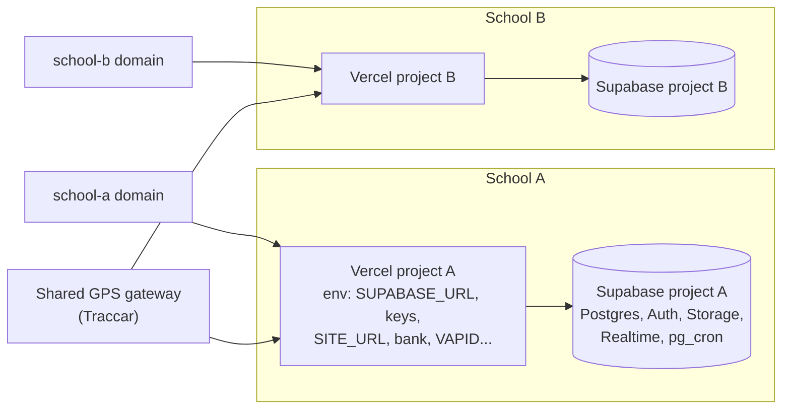
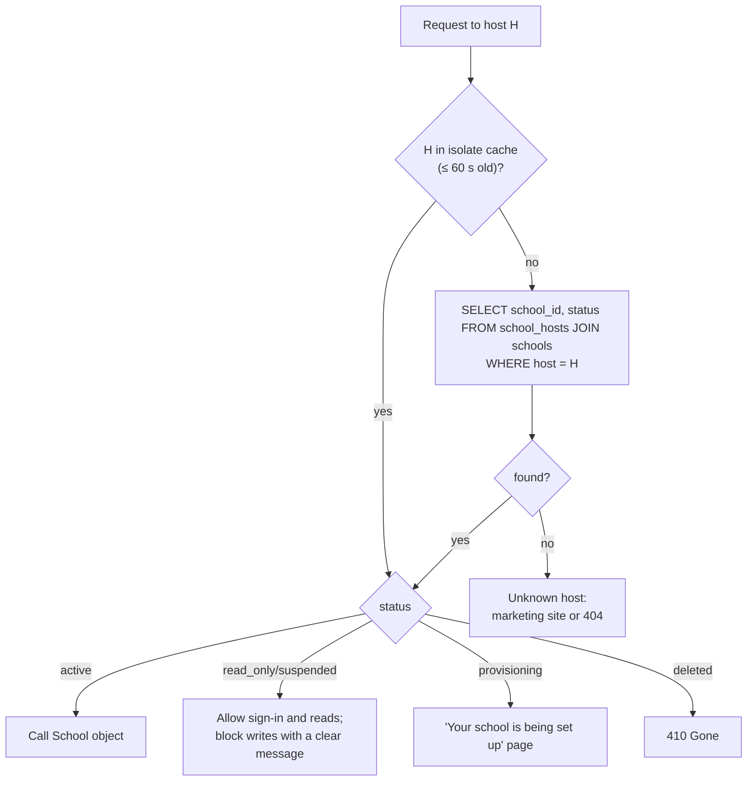

# Tenancy and the Control Plane

As of 27 Oct 2026. Part of the [Cloudflare rebuild docs](README.md).

## Summary

- **Today a school is a deployment.** Which school a request belongs to is decided by which Vercel project received it and which Supabase project its environment variables point at. Starting a school means forking the repository, creating a Supabase project, running about 260 migrations by hand, setting environment variables and pointing a domain.
- **In the target a school is a row.** One `platform` D1 database lists every school and its host names. The router Worker maps the host to a school id and calls that school's `School` object. Starting a school is an API call that takes seconds.
- **About 20 single-school assumptions** have to go: per-deployment environment variables, a hard-coded Supabase host, a hard-coded default school name, static PWA manifest and icons, runtime URLs stored in the database, cron times fixed in UTC, and the `+91` country code. Each is listed below with its replacement.

## How tenancy works today

The README's "New School Deployment Checklist" is the provisioning process: fork, create a Supabase project, run migrations, set environment variables, configure the domain, seed the admin, send credentials. Nothing in the app knows that other schools exist, which is why isolation is strong today and onboarding is slow.

## Single-school assumptions to remove

| # | Assumption today | Where | Replacement |
| --- | --- | --- | --- |
| 1 | Database chosen by `NEXT_PUBLIC_SUPABASE_URL` / anon key / service-role key | 34 + 9 + 30 references | School chosen from the host name through `platform` |
| 2 | Supabase host hard-coded in `images.domains` | `next.config.js` | Images served from `/files/...` on the school's own host |
| 3 | Public site URL from `NEXT_PUBLIC_SITE_URL` or `VERCEL_PROJECT_PRODUCTION_URL` | Account emails, pay links, webhooks | The school's primary host from `platform.school_hosts` |
| 4 | Default branding names "Muthamil Public School" | `src/lib/pageConfig.ts` (`BRANDING_DEFAULTS`, `LOGIN_DEFAULTS`) | Neutral defaults; the real name is written into the school's settings at provisioning |
| 5 | Static PWA manifest ("EduBerry", fixed icons) | `public/manifest.json`, `public/*.png` | `/manifest.webmanifest` generated per school from its branding |
| 6 | Favicon route trusts only "our Supabase Storage" | `src/app/api/favicon/route.ts` | Trust only the school's own R2 prefix |
| 7 | Drain URL and cron secret saved into the database the first time a screen is opened | `site_settings.fee_runtime`, `transport_runtime_config`, `wa_runtime_config` | Not needed: jobs run inside the school object and send to Queues |
| 8 | Cron schedules fixed in UTC per project (fee autogen 02:00 IST, reminders 10:00 IST, transport materialise 03:00 IST) | `cron.job` | Each school's own jobs table, in the school's time zone |
| 9 | Country code 91 added to every 10-digit number | `normalize_msisdn(p_default_cc DEFAULT '91')` | Per-school setting `phone.default_country_code` |
| 10 | Time zone per school stored in `site_settings.attendance_config.timezone`, default `Asia/Kolkata`; one fee engine file hard-codes `Asia/Kolkata` | `attendance_timezone()`, `src/lib/fees/engine/dates.ts` | One school setting `school.timezone`, read by every module |
| 11 | Currency and number format: `en-IN` in 37 files, `₹`/`INR` in 73 files | Front end | Keep as the default; read locale and currency from school settings so a non-Indian school is a setting, not a code change |
| 12 | Bank, Razorpay, WhatsApp, Smart Collect, payout and Cashfree credentials fall back to environment variables | `serverSecrets.ts`, `serverIntegrationSecrets.ts`, `paymentSecrets.ts` | School secrets only, stored encrypted in the school database ([17](17-integrations-and-secrets.md)) |
| 13 | Webhook URLs on the school's domain (`/api/fees/upi/webhook`, etc.) | Bank and Meta dashboards | `/hooks/<schoolId>/<provider>` on any EduBerry host; a domain change no longer breaks them |
| 14 | GPS forward URL contains the school's domain; gateway ownership keyed by domain | `docs/gps-system-status.md` | Forward to `/hooks/<schoolId>/gps/<deviceKey>`; ownership keyed by school id |
| 15 | Each school's Vercel project receives the GPS gateway token nightly | `gps-gateway-sync.yml` | One platform secret; per-school gateway users if the gateway stays shared |
| 16 | Supabase Auth redirect URLs configured per project | Supabase dashboard | Own auth; links built from the school's host ([12](12-auth-and-permissions.md)) |
| 17 | Maps keys (`NEXT_PUBLIC_MAPBOX_*`) per deployment | Transport maps | One platform key, or per-school override in settings |
| 18 | Solver URL and shared secret per deployment | `SOLVER_INTERNAL_URL`, `SOLVER_SHARED_SECRET` | One `SolverContainer` binding for all schools |
| 19 | VAPID key pair per deployment | `NEXT_PUBLIC_VAPID_PUBLIC_KEY`, `VAPID_PRIVATE_KEY` | One platform key pair; subscriptions are already per user |
| 20 | Migrations applied by hand per project | `supabase-migrations/` | Migrations run inside each school object on wake, plus a sweep after deploy |
| 21 | First admin seeded by hand; `STUDENT_PASSWORD` in a bulk script | `create-users-properly.js`, `scripts/bulk-create-students.js` | Provisioning creates the first admin and emails an invite |

Settings that already live in each school's database (branding, page themes, attendance rules, fee settings, WhatsApp templates and the rest of `site_settings`) are per-school data, not assumptions. They move into the school's own tables unchanged.

## The `platform` database (D1)

Small, shared and read on almost every request (through a cache). It never holds school data such as students, marks or money.

| Table | Purpose | Key columns |
| --- | --- | --- |
| `schools` | One row per school | `id` (stable id, also the Durable Object name), `slug`, `display_name`, `status` (`provisioning`, `active`, `suspended`, `read_only`, `offboarding`, `deleted`), `plan_id`, `timezone`, `country`, `created_at`, `data_location_hint` |
| `school_hosts` | Every host name that serves a school | `host` (unique), `school_id`, `kind` (`subdomain`, `custom`), `is_primary`, `cf_custom_hostname_id`, `verification_status` |
| `plans` | What a plan allows | `id`, `name`, `max_users`, `max_storage_gb`, `modules` (fees, payroll, transport, timetable, exams...), `price` |
| `school_features` | Per-school overrides and feature flags | `school_id`, `key`, `value` |
| `provisioning_runs` | Steps of creating, migrating, exporting or deleting a school | `id`, `school_id`, `kind`, `step`, `status`, `error`, `started_at`, `finished_at` |
| `platform_users` | EduBerry staff who run the platform | `id`, `email`, `password_hash`, `role` (`owner`, `support`, `finance`), `mfa_secret` |
| `platform_sessions` | Their sessions (separate from school sessions) | `token_hash`, `user_id`, `expires_at` |
| `support_grants` | Time-limited, audited access by EduBerry support into a school | `school_id`, `platform_user_id`, `reason`, `granted_by`, `expires_at` |
| `platform_audit` | Every platform-staff action | `actor`, `action`, `school_id`, `details`, `at` |
| `school_usage_daily` | Rolled up from Analytics Engine for plans and billing | `school_id`, `date`, `requests`, `active_users`, `rows_written`, `storage_bytes`, `files_bytes` |

## Finding the school for a request

- The lookup result is cached in the Worker isolate's memory for about a minute, so the D1 read happens a few times a minute per Cloudflare location, not per request.
- Status changes (suspend, reactivate) take effect within the cache lifetime; that is acceptable for every status change EduBerry makes.
- `www`, `app` and the bare platform domain are reserved for EduBerry's own pages and the platform console.

## Domains

| Kind | How | Cost |
| --- | --- | --- |
| Default subdomain `<slug>.eduberry.in` | Wildcard DNS record and a Worker route `*.eduberry.in/*` | Free |
| School's own domain, e.g. `app.greenfield.edu.in` | Cloudflare for SaaS custom hostname pointing at the Worker; the school adds one CNAME; certificate issued automatically | First 100 free, then $0.10 per host name per month |

A school can have several hosts; exactly one is primary, and that is the one used in emails, pay links, QR codes and certificates.

## Provisioning a school

One function (`provisionSchool`) runs these steps, records each in `provisioning_runs`, and can be re-run safely from any step.

| Step | What happens | Where |
| --- | --- | --- |
| 1 | Insert `schools` row with status `provisioning`; reserve the slug | platform D1 |
| 2 | Insert the subdomain into `school_hosts`; if a custom domain was given, create the Cloudflare for SaaS custom hostname and store its id | platform D1, Cloudflare API |
| 3 | `School.call("system.provision", {...})`: create every table at the current schema version, seed defaults (academic year, roles and permission grants, neutral page themes, attendance rules, fee permission presets, message templates), write the school's name, logo, time zone, country and contact email | School object |
| 4 | Create the first admin account and send the invite email from the school's branding | School object, Email Service |
| 5 | Set status `active` | platform D1 |

Self-serve signup (checkout) and the platform console both call the same function. The email doc's "Checkout creates the school and emails its first admin" row is this flow.

## Suspending, exporting and deleting a school

| Action | Effect |
| --- | --- |
| Suspend | Status `suspended`: users can sign in and read; every write returns a "school suspended" message. Alarms keep running only for clean-up jobs |
| Read-only (end of contract) | Same as suspended, but also offered an export |
| Export | A job walks every table of the school object in pages and writes newline-delimited JSON plus a manifest to `exports/<schoolId>/<date>/` in R2, together with a copy of the school's files list. The school admin downloads it from a signed link |
| Delete | After the agreed retention period: delete the school object's storage (`deleteAll()`), delete the R2 prefix, remove custom hostnames, mark the `schools` row `deleted` and keep only the platform audit trail |

## Platform console

A separate area on the platform domain (`console.eduberry.in`) for EduBerry staff only:

- schools list with status, plan, users, storage, last activity, error rate;
- create, suspend, reactivate, export, delete a school;
- custom-domain status and re-verification;
- feature flags and plan overrides per school;
- support access: request a time-limited grant into one school, which creates a session in that school flagged as support and logs every action to both the school's audit log and `platform_audit`;
- migration sweep status after each deploy.

Platform staff never have standing access to school data. Every look inside a school goes through a support grant.

## People in more than one school

Accounts belong to one school, as they do today (each school is its own Supabase project now). A teacher who works at two EduBerry schools has two accounts; a parent with children at two schools signs in to each school's site. A shared identity across schools is not needed for launch and would complicate isolation; revisit if schools in a group (a trust running several campuses) ask for it. Campus groups are better served by one school with several campuses, which payroll already models with work locations.

## Moving the current school

The live school becomes the first `schools` row, keeping its current domain as its primary custom host. Its data moves from Supabase into its school object through the importer described in [13-data-layer.md](13-data-layer.md) and the cutover runbook in [90-data-migration-and-cutover.md](90-data-migration-and-cutover.md).

## Open questions

- [ ] Default subdomain format: `<slug>.eduberry.in`, or a separate domain for school sites?
- [ ] Data location: does any school contract require India-only storage? Neither D1 nor Durable Objects has an India jurisdiction today.
- [ ] Retention period between "read-only" and "deleted" (suggest 90 days).
- [ ] Which modules are plan-gated (fees, payroll, transport, timetable solver, WhatsApp)?
