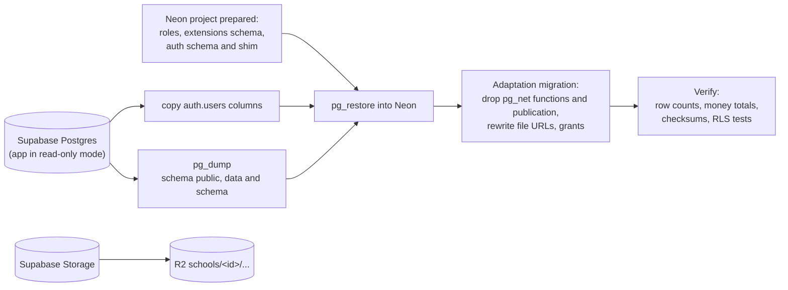

# Data Layer: Supabase Postgres to Neon Postgres

As of 5 Nov 2026. Part of the [rebuild docs](README.md). The full live schema is in [reference/live-schema.md](reference/live-schema.md). The design is a Neon Postgres project per school ([01](01-architecture-options.md), [10](10-target-architecture.md)).

## Summary

- **Each school's data moves from a Supabase Postgres 17 database to a Neon Postgres 17 database, as it is.** Tables, column types, ids, money in `numeric`, functions, triggers, policies and indexes move with `pg_dump` and `pg_restore`. No type map, no paise conversion and no rewrite of the business logic.
- **The work is the Supabase-specific hooks inside the database.** Eleven of them have to be replaced: `auth.uid()` and `auth.jwt()`, `auth.users`, the Supabase roles, the `extensions` schema, `pg_net` in four functions, 18 `pg_cron` jobs, the realtime publication, storage policies and URLs, and the unused vault. Each is listed below.
- **Migrations stay plain SQL files**, continuing `supabase-migrations/`. A small runner, `tools/migrate`, applies them to every school database in turn. Every release is first tried on a copy-on-write Neon branch of every school.
- **Size is not a ceiling any more.** A 10,000-user school adds about 2 GB a year, which costs about $0.70 a month more each year. Archiving is optional and done to keep the working set (and so the compute size) small, not to fit a cap.
- **Backups:** Neon's point-in-time restore covers each school separately, 7 days back on Launch and 30 on Scale. Weekly `pg_dump` copies to R2 keep a long-term record.

## What moves

From the live database on 5 Nov 2026:

| Object | Count | Moves |
| --- | --- | --- |
| Tables in `public` | 221 | As they are. 2 are obsolete (`timetable_period_slot_times_backup`; first-generation `school_fees`/`school_fee_payments` are empty) and can be dropped first |
| Indexes | 888 | As they are |
| Functions in `public` | 304 | As they are, except the four that call `pg_net` (below) |
| Triggers | 172 | As they are |
| Row-level security policies | 699 on `public` tables, 12 on `storage.objects` | Those on `public` tables as they are; storage policies are dropped |
| Views | 17 | As they are |
| Database size | 207 MB | About two minutes to dump and restore |

Extensions:

| Extension | On Supabase | On Neon |
| --- | --- | --- |
| `plpgsql`, `pgcrypto`, `uuid-ossp`, `btree_gist`, `pg_stat_statements` | Installed in schema `extensions` (except `plpgsql`) | Supported. Install them in a schema named `extensions` too, so qualified names and `search_path` settings keep working |
| `pg_cron` | 18 jobs | Not used: it runs only with scale to zero turned off, which would keep every school's compute awake ([14](14-jobs-messaging-realtime.md)) |
| `pg_net` | 4 functions | Not supported; replaced by queue consumers |
| `supabase_vault` | Installed, unused | Dropped |

## Supabase hooks and their replacements

| # | Hook | Where it is used | Replacement |
| --- | --- | --- | --- |
| 1 | `auth.uid()` | 155 policies, 99 functions | Same function, reading the claims the Worker or the Data API sets for each transaction ([12](12-auth-and-permissions.md)) |
| 2 | `auth.jwt()` | `get_student_edu_dashboard`, `get_student_edu_standings` (read `user_metadata.role`) | Same function; the access token carries `user_metadata.role` |
| 3 | `auth.users` | 4 foreign keys (`profiles`, `announcement_likes`, `announcement_reads`, `push_subscriptions`); trigger `on_auth_user_created` → `handle_new_user`; `sync_role_to_auth_metadata` writes `raw_user_meta_data` | Our own `auth.users` table with the same ids and the columns these use ([12](12-auth-and-permissions.md)) |
| 4 | Roles `anon`, `authenticated`, `service_role` and Supabase's default privileges | Every grant and many policies (`TO authenticated`) | Created in each school database before the restore; login roles `app_worker` and `app_jobs` added ([11](11-tenancy-and-control-plane.md)) |
| 5 | Schema `extensions` | `pgcrypto` in `fee_seal_receipt`, `fee_verify_document`, `payroll_lock_run`, `payroll_verify_lock` | Same schema name on Neon |
| 6 | `pg_net` | `fee_kick_drain`, `wa_kick_drain`, `transport_kick_drain` (call the app's drain routes); `cleanup_net_responses` | Dropped. The outbox tables stay; queue consumers drain them ([14](14-jobs-messaging-realtime.md)) |
| 7 | `pg_cron` | 18 jobs, 5 of them every minute | The school's `SchoolHub` timer calls the same SQL functions through the `jobs` queue, only when something is due ([14](14-jobs-messaging-realtime.md)) |
| 8 | Realtime publication `supabase_realtime` | `leave_applications`, `leave_approvals`, `transport_trip_runs`, `transport_run_stops`, `transport_run_passengers`, `transport_alerts` | Dropped. After a write to one of these tables the Worker publishes an event to the `SchoolHub` ([14](14-jobs-messaging-realtime.md)) |
| 9 | `storage.objects` policies and Storage URLs | 12 policies; URL columns such as `avatar_url`, `attachment_url`, `banner_url`, `logo_url` and branding JSON in `site_settings` | Files in R2, served by the Worker after a permission check; stored URLs rewritten at import ([15](15-files-and-media.md)) |
| 10 | Runtime URLs and the cron secret stored in the database | `site_settings.fee_runtime`, `transport_runtime_config`, `wa_runtime_config` | Not needed; left unused, removed in a later contract migration |
| 11 | `supabase_vault` | Installed, unused | Dropped |

Everything else in the schema is plain Postgres and needs no change.

## Functions and triggers

Because the database engine stays, the logic stays where it is. Each section doc lists its functions with one of these targets:

| Target | Meaning | Examples |
| --- | --- | --- |
| Unchanged | Moves with the dump, called as today | `fee_collect`, `staff_attendance_punch`, `transport_start_run`, `generate_salary_cycle`, `get_announcement_feed`, every guard trigger |
| Called by a job | Unchanged function; the hub timer calls it instead of `pg_cron` | `fee_autogen_tick`, `fee_reminder_tick`, `transport_tick`, cleanups |
| Drained by a consumer | The function still writes its outbox row; a queue consumer sends it | WhatsApp, push, fee and transport notifications |
| Replaced | The function goes; the Worker or a consumer does the work | The three `*_kick_drain` functions and `cleanup_net_responses` |
| New endpoint (phase 2) | A screen's several browser queries become one SQL function behind one Worker route | Each section's screen list ([16](16-frontend-and-api.md)) |

CPU-heavy work that does not belong in Postgres (password hashing, PDF rendering, spreadsheet parsing, webhook signatures) is already outside the database today and stays in the Worker.

## Schema migrations

| Rule | Detail |
| --- | --- |
| One folder | `db/migrations/` holds numbered plain SQL files for every school database, starting with a baseline taken from the live schema after the hook replacements. `db/platform/` holds the platform database's own |
| One runner | `tools/migrate` lists the schools from the platform database, fetches each school's owner credentials from the Neon API, and applies pending files in order, one transaction per file. It records version and checksum in `platform.school_migrations` |
| One school at a time | A failure stops that school only; the runner reports it and moves on. A school is never left half-migrated, because each file is one transaction |
| Dry run on branches | Before a release, CI creates a Neon branch of every school's database (copy-on-write, seconds, no copy of data), applies the pending migrations there, runs the database tests, and deletes the branches |
| Backward compatible | Migrations go out before the Worker that needs them, and old and new Workers run side by side during a gradual deploy. Migrations only add (expand); removals (contract) ship in a later release once nothing reads the old shape |
| Long operations | Index builds use `CREATE INDEX CONCURRENTLY` (in a file of its own, outside a transaction); large backfills run in batches as a job |
| Never edit a released migration | Write a new one |

## Query rules

These keep latency and compute in check. The database is in Singapore, so each round trip from India costs about 30–60 ms, and compute is billed for every minute the database is awake ([02](02-cost-study.md)).

1. **One SQL call per screen.** Multi-step reads and writes stay in SQL functions. A Worker route never runs a loop of queries.
2. **No `SELECT *`.** Return the columns the screen shows (today's README rule on `profiles(*)` applies everywhere).
3. **Index every column used to join or filter on a hot path**; Postgres does not index foreign keys automatically. Drop indexes that `pg_stat_statements` and `pg_stat_user_indexes` show are never used.
4. **Page with keys, not offsets** (`WHERE (created_at, id) < ($1, $2) ORDER BY created_at DESC, id DESC LIMIT 50`).
5. **Summary tables for anything that counts a term or a year** (attendance percentages, fee collection by head, edu points), kept up to date by triggers as today.
6. **Long work in batches** from a job: anything touching more than a few thousand rows runs in batches, so no transaction holds locks for long.
7. **Nothing polls the database.** No health checks, no "every minute" jobs, no open idle connections. Anything that wakes a school's compute when nobody is using the app costs money ([14](14-jobs-messaging-realtime.md)).
8. **Short transactions only.** The HTTP driver sends a whole transaction in one request; nothing holds a transaction open across round trips.

## Moving each school's data from Supabase

A one-off importer (`tools/import-supabase`) moves one school at a time, from an operator's machine with the Supabase database URL and the platform's Neon API key.

| Step | Detail |
| --- | --- |
| 1. Prepare | Provision the school's Neon project ([11](11-tenancy-and-control-plane.md), steps 1–3). Create the roles, the `extensions` schema with its extensions, and the `auth` schema with our `auth.users`, `auth.sessions` and the `auth.uid()` functions |
| 2. Freeze | Put the school's current app in read-only mode (a banner and blocked writes) for the cutover window |
| 3. Accounts | Copy the needed columns of `auth.users` into the new `auth.users` ([12](12-auth-and-permissions.md)) |
| 4. Dump and restore | `pg_dump --schema=public --no-owner --no-privileges` from Supabase; `pg_restore` into Neon as the owner; then re-apply grants from the baseline. Run the restore with triggers' side effects in mind: data is restored as it is, so no trigger needs to fire |
| 5. Adapt | Apply the adaptation migration: drop the `pg_net` functions and the realtime publication, leave the runtime-URL settings unused, and rewrite every Supabase Storage URL in a column to its new `/files/...` path |
| 6. Files | Copy each object from Supabase Storage to R2 under `schools/<schoolId>/`, keeping the rest of its path |
| 7. Verify | For every table: row count equal; for money tables: totals per student and per academic year equal; a checksum of ids and key columns equal; the RLS test suite passes against the new database ([91](91-test-and-parity-plan.md)) |
| 8. Switch | Point the school's host at the new platform; Supabase stays read-only for 30 days as a fallback |

The live school's database is 207 MB and its files about 1 GB, so the whole move takes minutes. Spike S1 rehearses it on a copy.

## Keeping the working set small

Compute size is set by memory: the current year's attendance, fees and marks should fit in RAM ([02](02-cost-study.md)). Data nobody reads makes the database bigger but rarely slower, and costs little to store. Two kinds of data are still worth moving out:

| Data | What to do |
| --- | --- |
| High-volume logs nobody browses (GPS telemetry, location attempts, notification history) | Already pruned by cleanup jobs today. Keep doing so, writing the old rows to R2 as compressed newline-delimited JSON first where they must be kept ([36](36-transport.md)) |
| Closed academic years | Stay in the database. If a large school's tables grow big enough to slow queries, partition the biggest (attendance, staff punches) by academic year; decide per table when it happens |

Indian record-keeping rules for fees and payroll (8 years) are met by keeping the rows in the database, plus the long-term `pg_dump` copies below.

## Backups

| Layer | What it gives | Who runs it |
| --- | --- | --- |
| Point-in-time restore | Restore one school's database to any moment in the last 7 days (Launch) or 30 days (Scale), as a new branch, without affecting any other school | Neon; a platform-console action wraps it |
| Restoring part of a school | Branch the school at a point in time, copy the needed rows from the branch, delete the branch | Platform team, from the console |
| Weekly logical copy | `pg_dump` of every school, run in the nightly job window so it does not wake the compute separately, to `backups/<schoolId>/<date>/` in R2 | Job in a container |
| Retention | Weekly copies kept 1 year, monthly copies kept 8 years (R2 lifecycle rules) | R2 |
| Restore drill | Quarterly: restore one school's weekly copy into a scratch Neon project and run the verify step | Platform team |

## Open questions

- [ ] Spike S1: does `pg_restore` of the live dump into Neon succeed with only the preparation above, and how long does it take?
- [ ] Spike S2: our own `auth.uid()` shim or `pg_session_jwt`?
- [ ] Query layer: Kysely with types generated from the schema, or plain tagged SQL? Either way the SQL functions are the interface.
- [ ] Should the 2 obsolete tables be dropped in the current app before the move?
