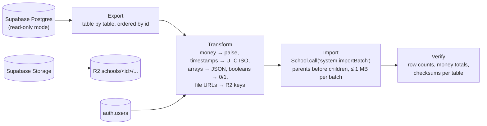

# Data Layer: Postgres to SQLite

As of 27 Oct 2026. Part of the [Cloudflare rebuild docs](README.md). The full live schema is in [reference/live-schema.md](reference/live-schema.md).

## Summary

- **Each school's data moves from a Supabase Postgres project into the SQLite database inside its `School` object.** Tables, columns and ids keep their names and values wherever possible, so the section docs can translate table by table and the importer can copy rows straight across.
- **Most of the schema translates mechanically.** The hard parts are money (Postgres `numeric` must become whole paise, never floating point), timestamps (one convention), 17 array columns, 4 exclusion constraints, and the 268 functions and 171 triggers, which become TypeScript in each section's module.
- **Migrations run inside each school object**, checked on every wake and pushed to all schools by a sweep after each deploy.
- **The 10 GB ceiling is handled by archiving closed academic years** into per-year archive objects that stay queryable, so the live database holds roughly the current and previous year.
- **Backups:** 30 days of point-in-time recovery comes free; nightly exports to R2 add long-term copies.

## What has to be translated

From the live database (27 Oct 2026):

| Object | Count | Notes |
| --- | --- | --- |
| Tables | 217 | 2 are obsolete (`timetable_period_slot_times_backup`, first-generation `school_fees`/`school_fee_payments` are empty) |
| Columns by type | uuid 736, text 613, timestamptz 417, numeric 138, boolean 113, date 105, integer 98, jsonb 62, enum 53, smallint 43, double 40, array 17, real 13, bigint 11, time 11 | |
| Foreign keys | 541 | 262 `ON DELETE CASCADE`, 251 `SET NULL`, 16 `RESTRICT`, 12 `NO ACTION` |
| Unique indexes (not primary) | 138 | |
| Partial indexes | 81 | SQLite supports them |
| Expression indexes | 14 | SQLite supports deterministic expressions |
| Check constraints | 180 | Most carry over; regular-expression checks move to code |
| Exclusion constraints | 4 | No-overlap date ranges; move to code |
| Enum types | 37 | `TEXT` + `CHECK` |
| Views | 17 | Fee and payroll reports; become queries or summary tables |
| Column defaults | `now()` 331, `gen_random_uuid()` 183, `nextval` 7, JSON literals 20 | Set in code |
| Generated columns | 1 | SQLite supports them |
| Functions | 268 | Become module methods |
| Triggers | 171 | Become module code; a few guards stay as SQLite triggers |

## Type mapping

Use SQLite `STRICT` tables so a wrong type is an error, not a silent conversion.

| Postgres | SQLite | Rule |
| --- | --- | --- |
| `uuid` | `TEXT` | Keep every existing id. New ids from `crypto.randomUUID()` in code |
| `text`, `varchar(n)` | `TEXT` | Add `CHECK (length(col) <= n)` only where the length matters |
| `boolean` | `INTEGER` | `0`/`1`, `CHECK (col IN (0,1))` |
| `smallint`, `integer`, `bigint` | `INTEGER` | |
| `numeric(10,2)`, `numeric(12,2)` holding money | `INTEGER` in paise | Rupees × 100, rounded on import. All arithmetic in integers; format only for display. Column names gain no suffix, but the shared `Money` type documents the unit |
| `numeric(5,2)`, `numeric(6,2)` holding days or counts (leave, LOP, encashable days) | `INTEGER` in hundredths | 1.5 days stored as 150 |
| `numeric(5,2)` holding percentages or tax rates | `INTEGER` in basis points | 18% stored as 1800 |
| `numeric` without precision (marks, scores) | `REAL` | Round to 2 decimal places on write; totals recomputed from parts, never accumulated |
| `real`, `double precision` | `REAL` | Coordinates, distances, accuracy |
| `date` | `TEXT` `YYYY-MM-DD` | A school-local calendar date, as today |
| `time` | `TEXT` `HH:MM:SS` | School-local clock time |
| `timestamptz` | `TEXT` ISO 8601 in UTC with `Z` (`2026-10-27T19:42:57.348Z`) | Sorts correctly as text, reads well in Data Studio, and matches the strings the front end already receives from Supabase |
| `jsonb` | `TEXT` | `CHECK (json_valid(col))`; read with `json_extract`, `->>` |
| `text[]`, `uuid[]`, `int[]`, `int2[]` | `TEXT` JSON array | Membership through `json_each`. Where an array is filtered on often (`tasks.classes`, `leave_applications.selected_approver_ids`, `timetable_entries.teacher_ids`), add a child table instead; each section doc decides |
| Enum types | `TEXT` | `CHECK (col IN (...))`, with a TypeScript union generated from the same list |
| `serial`/`nextval` | `INTEGER PRIMARY KEY` | Or a counters table where numbering is per year (`fee_number_series` already works that way) |
| `daterange` exclusion constraints | Code | Inside the object the check and the insert run in one call that nothing else can interleave with, so "check for overlap, then insert" is safe |

Postgres features with no SQLite equivalent and their replacement:

| Postgres | Replacement |
| --- | --- |
| Row-level security | The permission module ([12](12-auth-and-permissions.md)) |
| `SECURITY DEFINER` functions | Module methods; the object already runs with full access, and every method checks its caller |
| `FOR UPDATE`, `SKIP LOCKED`, advisory locks (89 + 6 + 6 uses) | Not needed: one call at a time per school |
| `now()`, `current_date` | One timestamp taken at the start of each call (`ctx.now`), so every row a call writes agrees, and tests can fix the clock |
| `AT TIME ZONE`, `date_trunc` in a zone | Date maths in code with the school's time zone; store the local `date` where the business meaning is a local date (attendance, leave, fee due dates) |
| `ILIKE`, `~` regular expressions | `LIKE` (case-insensitive for ASCII), lower-cased search columns, or FTS5; regular-expression checks in code |
| `generate_series` | Recursive CTE or a loop in code |
| `pg_cron`, `pg_net` | Alarms and Queues ([14](14-jobs-messaging-realtime.md)) |
| Realtime publication | WebSockets on the object ([14](14-jobs-messaging-realtime.md)) |
| Views | Queries in the module, or summary tables kept up to date on write |
| `fee_search_index` view | An FTS5 table maintained on write |

SQLite inside a Durable Object includes the JSON functions, FTS5 full-text search and the math functions. Foreign-key enforcement must be confirmed in spike S1 (D1 enforces by default); the importer and migrations must assume it is on.

## Functions and triggers

Every function in the [reference](reference/live-schema.md#functions-by-section) falls into one of five kinds. Each section doc assigns every one of its functions to a target.

| Kind | Examples | Target |
| --- | --- | --- |
| Access helpers | `get_user_role`, `is_classroom_staff`, `has_fee_permission`, `transport_run_is_mine` | Shared `authz` helpers in TypeScript |
| Business operations | `fee_collect`, `fee_reverse_payment`, `staff_attendance_punch`, `transport_start_run`, `generate_salary_cycle` | Module methods, each one transaction |
| Data triggers | `fee_alloc_refresh`, `tg_component_mark_recompute`, `transport_apply_fix`, `handle_profile_delete` | Explicit code in the method that makes the change. Hidden side effects become visible calls |
| Guard triggers | `fee_ledger_append_only`, `fee_payments_immutable`, `admin_audit_append_only`, `payroll_reject_locked_write` | Kept as SQLite triggers (`RAISE(ABORT, ...)`) as a safety net, and also enforced in code |
| Reports and feeds | `get_announcement_feed`, `transport_report_ontime`, `get_classroom_edu_leaderboard`, fee views | Module query methods, backed by summary tables where they scan large ranges |
| Scheduled ticks | `fee_autogen_tick`, `transport_tick`, cleanups | Jobs run from the school's alarm |

`update_task_updated_at` and `update_updated_at_column` (used by 109 tables) become one line in the shared write helper that stamps `updated_at = ctx.now`.

## Schema migrations

| Rule | Detail |
| --- | --- |
| One schema package | `packages/schema` defines every school table (Drizzle, SQLite dialect) and generates numbered SQL migrations. The platform D1 has its own migration folder applied with `wrangler d1 migrations apply` |
| Applied on wake | The `School` constructor runs `blockConcurrencyWhile(migrate)`: read `_migrations`, apply anything newer, in one transaction per migration |
| Applied after deploy | The `jobs` queue calls `system.migrate` on every school after a deploy that adds a migration, so users rarely wait for one |
| Backward compatible | Gradual deploys mean old and new code run at once for a while. Migrations only add (expand); removals (contract) ship in a later release once nothing reads the old shape |
| No table rebuilds on big tables in the request path | SQLite's `ALTER TABLE` is limited and some changes need a copy of the table. For a large table, do the copy in batches from the alarm, not inside the wake-up migration |
| Tested on real data | CI applies every pending migration to an anonymised copy of the largest school before release |
| Never edit a released migration | Write a new one |

## Query rules

These keep the bill and the school's single thread in check (see the cost study: rows written are 60% of the bill).

1. **Index every column used to join or filter on a hot path.** SQLite does not index foreign keys automatically.
2. **Every index must pay for itself.** Each index on a written column adds a billed row per write. Today's 879 indexes were tuned for Postgres; each section doc re-justifies its indexes.
3. **No `SELECT *`.** Return the columns the screen shows (today's README rule on `profiles(*)` applies everywhere).
4. **Lists of ids:** at most 100 bound parameters per statement. Pass one JSON array and use `IN (SELECT value FROM json_each(?))`.
5. **Page with keys, not offsets** (`WHERE (created_at, id) < (?, ?) ORDER BY created_at DESC, id DESC LIMIT 50`).
6. **Summary tables for anything that counts a term or a year** (attendance percentages, fee collection by head, edu points), updated in the same call as the change.
7. **Long work in batches:** anything touching more than about 2,000 rows runs as a job in batches of a few hundred rows per alarm tick.

## Moving each school's data from Supabase

A one-off importer (`tools/import-supabase`) moves one school at a time. It runs from an operator's machine or a Worker with access to the school's Postgres connection string and the platform API.

| Step | Detail |
| --- | --- |
| 1. Freeze | Put the school's current app in read-only mode (a banner and blocked writes) for the cutover window |
| 2. Export | Every table in `public` plus `auth.users` (see [12](12-auth-and-permissions.md)), streamed as JSON in primary-key order |
| 3. Transform | Apply the type map above. Money: `round(value * 100)`; reject any value with more than 2 decimal places. Rewrite every Supabase Storage URL found in a column (`avatar_url`, `attachment_url`, `banner_url`, `logo_url`, `photo_url`, `image_url`, `file_url`, branding JSON in `site_settings`) to the file's new path |
| 4. Import | Batches sent to the school object, each committed as one transaction; tables in foreign-key order; triggers and jobs disabled until the import completes |
| 5. Files | Copy each object from Supabase Storage to R2 under `schools/<schoolId>/` keeping the rest of its path |
| 6. Verify | For every table: row count equal; for money tables: totals per student and per academic year equal; a checksum of ids and key columns equal |
| 7. Switch | Point the school's host at the new platform; Supabase stays read-only for 30 days as a fallback |

The live school's database is 192 MB and its files about 1 GB, so a full import takes minutes, not hours.

## Archiving closed academic years

A 10,000-user school adds about 2 GB a year, so the live database would reach the 10 GB cap in about five years. Most of that growth is year-bound: attendance, staff punches, location checks, task history, exam answers, transport history.

| Data | When a year closes |
| --- | --- |
| Year-bound records still needed by screens (attendance, marks, report cards, fee ledgers, payroll) | Moved in batches to a per-year archive object, `SCHOOL_ARCHIVE.idFromName("<schoolId>:<yearCode>")`, with the same tables. Read-only methods there serve the academic record, old report cards and audits |
| Logs nobody browses (location attempts, GPS telemetry, notification history) | Written to R2 as compressed newline-delimited JSON, then deleted |
| Summaries (attendance percentages, fee totals per year) | Stay in the live object |

Closing a year is already an explicit action (`academic_years.status`, promotion). The archive move is a job started from it. Indian record-keeping rules for fees and payroll (8 years) are met by the archive objects, which cost $0.20 per GB-month.

## Backups

| Layer | What it gives | Who runs it |
| --- | --- | --- |
| Point-in-time recovery | Restore one school to any moment in the last 30 days | Built in; a platform-console action wraps `onNextSessionRestoreBookmark` |
| Nightly export | Rows changed since the last export (by `updated_at`), all tables, to `backups/<schoolId>/<date>/` in R2 | Job, per school, staggered across the night |
| Weekly full export | Every row of every table, same format as the offboarding export | Job |
| Retention | Nightly kept 35 days, weekly kept 1 year (R2 lifecycle rules) | R2 |
| Restore drill | Quarterly: restore one school's weekly export into a scratch object and run the verify step | Platform team |

## Open questions

- [ ] Confirm Drizzle's Durable Objects driver and migrator in spike S1, or fall back to raw SQL with a small migration runner.
- [ ] Which array columns become child tables (decided per section).
- [ ] Should new ids switch to time-ordered UUIDv7 for better index locality? Existing ids stay as they are either way.
