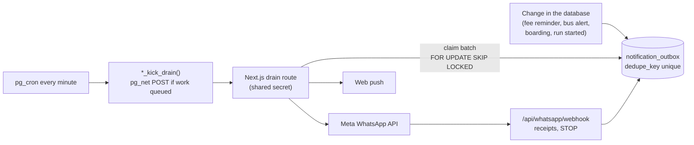
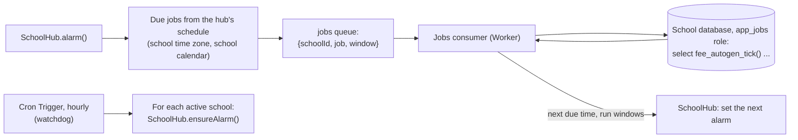
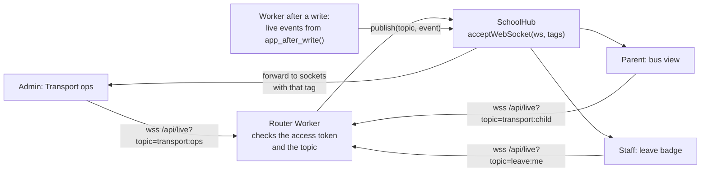

# Scheduled Jobs, Messaging and Live Updates

As of 5 Nov 2026. Part of the [rebuild docs](README.md). The design is a Neon Postgres project per school with Cloudflare for everything else ([01](01-architecture-options.md), [10](10-target-architecture.md)).

## Summary

- **Nothing scheduled runs inside Postgres, so a school's database can sleep.** Neon bills compute for every minute the database is awake, and it suspends after 5 idle minutes. Today 5 of the 18 `pg_cron` jobs run every minute, all day and all night; on Neon that alone would keep every school awake around the clock and roughly double its bill ([02](02-cost-study.md)).
- **`pg_cron` becomes each school's `SchoolHub` timer.** The hub, a small Durable Object, keeps the school's schedule in the school's time zone and sets one alarm for the next due job. When it fires, the job goes on the `jobs` queue and the consumer calls the same SQL function `pg_cron` calls today. Night jobs are gathered into one window, so the database wakes once a night.
- **`pg_net` drain calls become Queues.** Messages are still written to `notification_outbox` in the same transaction as the change that caused them. The Worker sees that the transaction left work in the outbox and sends a drain message to the `outbox` queue, whose consumer sends WhatsApp, web push and email and reports back.
- **Push notifications move to the server.** Today the browser calls `/api/announcements/notify` and `/api/leave/notify` after making a change. In the target the SQL function that makes the change queues the push, so a closed tab can no longer skip it.
- **Supabase Realtime (6 tables, 4 screens) becomes WebSockets on the `SchoolHub`**, using the hibernation API so idle connections cost nothing. The hub holds no school data; it forwards small events published by the Worker after a write.
- **Inbound webhooks get one URL shape**, `/hooks/<schoolId>/<provider>`, verified against that school's secret and processed once, whatever the provider retries.

## How it works today

### Scheduled jobs

From `cron.job` on the live project, 5 Nov 2026 (times UTC; IST = UTC + 5:30):

| Job | When | What it does | Section |
| --- | --- | --- | --- |
| `transport-tick` | every minute, all day | `transport_tick()`: stale-GPS detection, delay and not-started alerts, auto start and end of runs | 36 |
| `transport-notify-drain` | every minute | `transport_kick_drain()`: if the outbox has work, `pg_net` POSTs to `/api/transport/notify/drain` | 14 |
| `fee-drain` | every minute | `fee_kick_drain()`: same for `/api/fees/cron/drain` | 14 |
| `wa-reminders-tick` | every minute | `wa_reminders_tick()`: queues WhatsApp reminders that have come due | 25, 33 |
| `wa-reminders-drain` | every minute | `wa_kick_drain()`: same as the other drains, for WhatsApp reminders | 14 |
| `transport-watch-outbox` | every 15 minutes | Flags stuck outbox rows | 14 |
| `fee-autogen` | 20:30 (02:00 IST) | Generates invoices whose installment is due | 33 |
| `fee-overdue` | 21:00 (02:30 IST) | Marks overdue invoices, applies late fees | 33 |
| `transport-materialise-runs` | 21:30 (03:00 IST) | Creates tomorrow's bus runs from schedules, in the school's time zone | 36 |
| `transport-archive-telemetry` | 02:30 | Thins old GPS fixes into the archive | 36 |
| `cleanup-transport-telemetry` | 03:00 | Deletes raw fixes older than 7 days | 36 |
| `cleanup-transport-archive` | 03:15 | Deletes old archive rows | 36 |
| `cleanup-net-responses` | 03:20 | Clears `pg_net`'s response log | 14 |
| `wa-reminders-log-purge` | 03:25 | Purges the old WhatsApp reminder log | 25 |
| `transport-rollup-metrics` | 03:45 | Per-run and per-stop daily metrics | 36 |
| `cleanup-attendance-location-attempts` | 04:00 | Deletes old geofence attempts | 23 |
| `fee-reminders` | 04:30 (10:00 IST) | Queues fee reminders by schedule | 33 |
| `cleanup-stale-push-subscriptions` | 05:00 | Removes dead push subscriptions | 25 |

### Outgoing messages



- `notification_outbox` holds every queued message with a `dedupe_key`, channel, template, variables, attempts and status (`queued` → `sending` → `sent`/`delivered`/`failed`/`skipped`/`cancelled`).
- The drain address and secret are stored in the database (`site_settings.fee_runtime`, `transport_runtime_config`, `wa_runtime_config`) the first time a staff member opens the relevant screen.
- The drains split the outbox by `module`.

### Push notifications

- Browsers subscribe through `/api/push/subscribe` (rows in `push_subscriptions`).
- After creating an announcement or deciding a leave application, the browser itself calls `/api/announcements/notify` or `/api/leave/notify`; the server re-checks the caller, works out recipients and sends with the `web-push` library and the deployment's VAPID keys.
- If the tab closes between the change and that call, no push is sent.

### Live updates

| Screen | Subscribes to | Purpose |
| --- | --- | --- |
| Transport → Operations | `transport_trip_runs` (insert, update, delete), `transport_alerts` | Live board of today's runs and alerts |
| Parent's bus view (`useChildTransport`) | The active run, its stops and passengers | Where is my child's bus |
| Run detail (`useRunLive`) | One run, its stops and stop events | Driver and admin view of one run |
| Leave notifications (`useLeaveRealtime`) | `leave_applications`, `leave_approvals` for this user | Badge and list refresh |

Elsewhere screens poll: task unread counts (`task_unread_comment_count`), the midnight date roll-over (every minute), the SOS button and the exam timer. The driver's phone posts a GPS fix every 5 seconds while moving and every 20 seconds while parked, buffering in IndexedDB when offline.

### Inbound webhooks

| Route | From | Purpose |
| --- | --- | --- |
| `/api/fees/razorpay/webhook`, `/api/bus/razorpay/webhook` | Razorpay | Card and netbanking payments |
| `/api/fees/upi/webhook`, `/api/bus/upi/webhook` | The school's bank | Smart-collect and UPI credits |
| `/api/salary/payout/webhook`, `/api/bus/payroll/payout/webhook` | Bank or RazorpayX | Payout status |
| `/api/whatsapp/webhook` | Meta | Delivery receipts, STOP replies |
| `/api/transport/ingest` | Traccar gateway | GPS fixes from devices |

## Target design

### The rule: wake the database only when there is work

| Source of wake-ups today | Target |
| --- | --- |
| Three drains every minute | None. A drain message is queued only when a transaction actually left work in the outbox |
| `transport-tick` every minute, 24 hours | Every minute only between the first scheduled start and the last scheduled end of today's runs, which the nightly materialise job reports to the hub. A school without buses never ticks |
| `wa-reminders-tick` every minute | The tick function also returns when the next reminder is due; the hub sets its alarm for then |
| `transport-watch-outbox` every 15 minutes | Replaced by queue retries, the dead-letter queue and an alert |
| Ten night and morning jobs at scattered times | One nightly window per school, about 02:00 local: every cleanup, rollup and nightly job in sequence, then the weekly `pg_dump` on its day. The database wakes once, works for a few minutes and sleeps |
| `fee-reminders` at 10:00 IST | Unchanged time; the database is awake then anyway |

Any health check, monitoring ping or open idle connection would undo this. Monitoring reads Neon's API and Workers metrics, never the database ([10](10-target-architecture.md)).

### Jobs: the hub timer



The hub's schedule lives in its own Durable Object storage and is rebuilt from the school's settings if lost:

| Field | Meaning |
| --- | --- |
| `key` | `fees.autogen`, `fees.overdue`, `fees.reminders`, `wa.reminders`, `transport.tick`, `transport.materialise`, `nightly.maintenance`, ... |
| `rule` | Local-time rule: `daily 02:00`, `every 1m within today's run window`, `at next_due`, `weekly sun 02:30` |
| `next_run_at` | UTC instant of the next run |
| `last_run_at`, `last_status`, `last_error`, `attempts` | Copied to the school's `job_runs` table by the consumer for the admin's job status screen and alerts |
| `enabled` | Some jobs are off until the school turns the feature on (transport, WhatsApp) |

- Each job is one call to an existing SQL function, run with the `app_jobs` role, which may execute those functions and nothing else ([11](11-tenancy-and-control-plane.md)).
- A job that has more work than fits one call returns a cursor; the consumer queues the next batch at once.
- Queue retries cover a failed call; after the retries the message lands in a dead-letter queue and raises an alert.
- The hourly watchdog only repairs a hub whose alarm was never set (for example after a bug). It touches the hub, not the database.

### Outgoing messages through Queues

```mermaid
sequenceDiagram
  participant W as Worker (route or job consumer)
  participant N as School database
  participant Q as outbox queue
  participant C as Outbox consumer
  participant P as Provider (Meta / push / email)
  W->>N: one transaction: the change, outbox rows (by the same functions and triggers as today), then app_after_write()
  N-->>W: result + {outbox: 3, live: [...]}
  W->>Q: send {schoolId, drain}
  Q->>C: drain message
  C->>N: claim a batch (FOR UPDATE SKIP LOCKED, as today)
  C->>P: send (WhatsApp template, push, email)
  P-->>C: provider id or error
  C->>N: report results, update status and per-module logs
  Note over C,Q: failures retry with backoff; after N tries the dead-letter queue
```

- Every write transaction the Worker sends ends with `app_after_write()`. In the same round trip it returns how many outbox rows this transaction queued and which live events it produced, so no route needs its own code for either.
- The outbox table keeps today's `dedupe_key` rule, so the same fact is never messaged twice, and today's claim function, so two consumers never send the same row.
- A drain message is sent only after the transaction committed, so a change that rolls back never produces a message.
- Phase 1 only: queries the browser sends through the Data API proxy (`/api/db`, [16](16-frontend-and-api.md)) do not end with `app_after_write()`. Writes that queue messages or feed live screens (leave apply and decide, announcements, the driver and transport operations actions) therefore go through Worker routes from the start. As a safety net, while the school's compute is awake the hub sends one drain message a minute; it reads the compute's state from the Neon API, which does not wake it.
- Messages that expire (`expires_at`) are dropped by the consumer and reported as `skipped`, as today.
- One consumer handles every module; per-module behaviour (which phone-number id, which template) is data on the outbox row.
- Rate limits per provider (Meta's per-number throughput, Cloudflare Email's daily quota) are respected with queue batch size and concurrency settings.

### Push notifications

| Today | Target |
| --- | --- |
| Browser calls a `/notify` route after the change | The SQL function that publishes the announcement or decides the leave writes push rows to the outbox; recipients are worked out in SQL, as the `/notify` routes do today in Node |
| `web-push` library with Node crypto, VAPID keys per deployment | One platform VAPID key pair. Web push (ECDH, AES-128-GCM, ES256 VAPID signature) works with Workers' WebCrypto; `node:crypto` is also available. Confirm the library in a spike |
| Subscriptions per user per deployment | Same table in the school database; dead endpoints (404/410) removed by the consumer's report |

### Live updates



- A trigger on each of the six live tables records a small event (table, row id, operation, the topics it concerns) for the current transaction; `app_after_write()` returns and clears them. The Worker publishes them to the hub after commit.
- The Worker authenticates the upgrade with the access token and checks, with one SQL call, that the person may watch that topic; then it hands the socket to the hub. Idle sockets are not billed while the hub hibernates.
- Events carry what changed and the new row, or a "refetch" hint for larger changes.
- If the socket cannot connect (some school networks block WebSockets), the screen falls back to polling every 30 seconds.
- Polling that exists today for counts (task unread comments) can move to the same hub later; it is not required for launch.

GPS fixes are the heaviest live traffic: a 50-bus school sends about 3–10 fixes a second at peak. The hub can keep each bus's latest position in memory and forward it to watchers without a database write; Postgres records only stop arrivals, alerts and a thinned trail. [36-transport.md](36-transport.md) decides the details.

### Inbound webhooks

| Step | Where | Detail |
| --- | --- | --- |
| 1 | Worker | `POST /hooks/<schoolId>/<provider>`: look up the school in `platform`; reject unknown or deleted schools; rate-limit |
| 2 | Worker | Verify the signature with this school's secret for that provider (read from the school database, kept encrypted in isolate memory for a few minutes) |
| 3 | Worker | Put the verified event on the `webhooks` queue (raw body and the headers that matter, well under the 128 KB limit) and return 200 at once |
| 4 | Webhooks consumer | Call the provider's SQL function with the `app_jobs` role: record the provider's event id in `webhook_events` (unique), so a repeat changes nothing, and apply the event (settle a payment, update a payout, record a receipt or STOP) in the same transaction |
| 5 | Webhooks consumer | Queue anything slow (a reconciliation sweep) as a job |

Old URLs (`/api/fees/upi/webhook` and the rest) keep working on each school's own host during the move: the Worker maps them to the new handler using the host's school, so banks and Meta do not have to be re-configured on cutover day.

## Cost notes

- Each night window costs one wake-up: a few minutes of work plus the 5-minute suspend delay, about 0.25 CU for 15 minutes, under $0.01 a night. Waking every minute all night instead would cost about $1.70 a month per school at the smallest size, and much more at larger sizes ([02](02-cost-study.md)).
- Hub alarms and publishes are Durable Object requests: a school with buses ticking every minute for 13 hours on 24 days is about 19,000 alarm runs a month, about $0.003.
- Queue messages cost about 3 operations each; a busy school's 2,000 messages a day is about 0.2 million operations a month, inside the included million for the first schools.
- Hibernated WebSockets cost nothing while idle.

## Parity checklist

- [ ] Every job in the table above runs at the same local time, or inside its window, with the same effect.
- [ ] A school with no activity overnight shows its compute suspended from the end of the night window to the morning.
- [ ] A fee reminder, bus alert and WhatsApp reminder each produce exactly one message per `dedupe_key`.
- [ ] A change that rolls back never produces a message.
- [ ] Delivery receipts and STOP replies update the outbox and the per-module logs.
- [ ] Every screen in the live-updates table updates within 2 seconds of the change.
- [ ] Announcement and leave pushes arrive even if the sender closes the tab straight after saving.
- [ ] Replaying any webhook twice changes nothing the second time.
