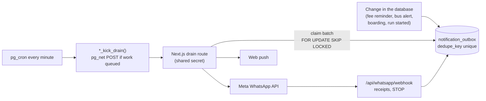
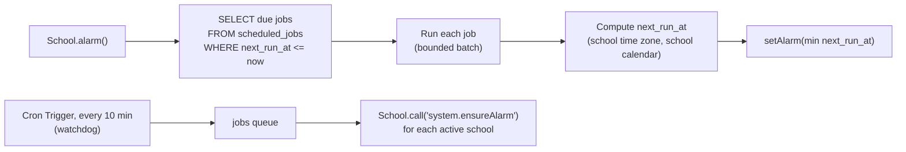
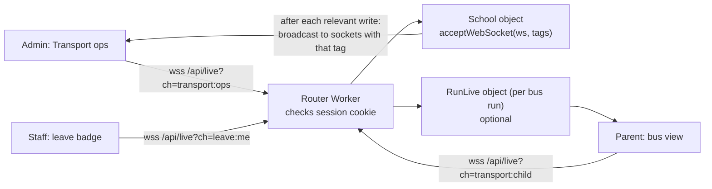

# Scheduled Jobs, Messaging and Live Updates

As of 27 Oct 2026. Part of the [Cloudflare rebuild docs](README.md).

## Summary

- **`pg_cron` (15 jobs) becomes each school's own alarm.** Every school object keeps a `scheduled_jobs` table and sets one alarm for the next due job, in the school's own time zone. A Cron Trigger runs only as a watchdog.
- **`pg_net` calls to drain routes become Queues.** Messages are still written to an outbox inside the same transaction as the change that caused them; the object then hands them to the `outbox` queue, whose consumer sends WhatsApp, web push and email and reports back.
- **Push notifications move to the server.** Today the browser calls `/api/announcements/notify` and `/api/leave/notify` after making a change; in the target the method that makes the change queues the push itself, so a push can no longer be skipped by a closed tab.
- **Supabase Realtime (6 tables, 4 screens) becomes WebSockets on the school object**, using the hibernation API so idle connections cost nothing. Busy bus-run traffic can move to a per-run object.
- **Inbound webhooks get one URL shape**, `/hooks/<schoolId>/<provider>`, verified against that school's secret and processed once, whatever the provider retries.

## How it works today

### Scheduled jobs

From `cron.job` on the live project (times UTC; IST = UTC + 5:30):

| Job | When | What it does | Section |
| --- | --- | --- | --- |
| `transport-tick` | every minute, all day | `transport_tick()`: stale-GPS detection, delay and not-started alerts, auto start and end of runs | 36 |
| `transport-notify-drain` | every minute | `transport_kick_drain()`: if the outbox has work, `pg_net` POSTs to `/api/transport/notify/drain` | 14 |
| `fee-drain` | every minute | `fee_kick_drain()`: same for `/api/fees/cron/drain` | 14 |
| `transport-watch-outbox` | every 15 minutes | Flags stuck outbox rows | 14 |
| `transport-materialise-runs` | 21:30 (03:00 IST) | Creates tomorrow's bus runs from schedules, in the school's time zone | 36 |
| `fee-autogen` | 20:30 (02:00 IST) | Generates invoices whose installment is due | 33 |
| `fee-overdue` | 21:00 (02:30 IST) | Marks overdue invoices, applies late fees | 33 |
| `fee-reminders` | 04:30 (10:00 IST) | Queues fee reminders by schedule | 33 |
| `transport-archive-telemetry` | 02:30 | Thins old GPS fixes into the archive | 36 |
| `cleanup-transport-telemetry` | 03:00 | Deletes raw fixes older than 7 days | 36 |
| `cleanup-transport-archive` | 03:15 | Deletes old archive rows | 36 |
| `cleanup-net-responses` | 03:20 | Clears `pg_net`'s response log | 14 |
| `transport-rollup-metrics` | 03:45 | Per-run and per-stop daily metrics | 36 |
| `cleanup-attendance-location-attempts` | 04:00 | Deletes old geofence attempts | 23 |
| `cleanup-stale-push-subscriptions` | 05:00 | Removes dead push subscriptions | 25 |

The WhatsApp reminders branch (not live) adds `wa_reminders_tick` every minute.

### Outgoing messages



- `notification_outbox` holds every queued message with a `dedupe_key`, channel, template, variables, attempts and status (`queued` → `sending` → `sent`/`delivered`/`failed`/`skipped`/`cancelled`).
- The drain address and secret are stored in the database (`site_settings.fee_runtime`, `transport_runtime_config`) the first time a staff member opens the relevant screen.
- Two drains split the outbox by `module` (`fees` vs everything else).

### Push notifications

- Browsers subscribe through `/api/push/subscribe` (rows in `push_subscriptions`).
- After creating an announcement or deciding a leave application, the browser itself calls `/api/announcements/notify` or `/api/leave/notify`; the server re-checks the caller, works out recipients and sends with the `web-push` library and the deployment's VAPID keys.
- If the tab closes between the change and that call, no push is sent.

### Live updates

| Screen | Subscribes to | Purpose |
| --- | --- | --- |
| Transport → Operations | `transport_trip_runs` (insert, update, delete), `transport_alerts` | Live board of today's runs and alerts |
| Parent's bus view (`useChildTransport`) | The active run, its stops and passengers | Where is my child's bus |
| Run detail (`useRunLive`) | One run, its stops and stop events | Driver and admin view of one run |
| Leave notifications (`useLeaveRealtime`) | `leave_applications`, `leave_approvals` for this user | Badge and list refresh |

Elsewhere screens poll: task unread counts (`task_unread_comment_count`), the midnight date roll-over (every minute), the SOS button and the exam timer. The driver's phone posts a GPS fix every 5 seconds while moving and every 20 seconds while parked, buffering in IndexedDB when offline.

### Inbound webhooks

| Route | From | Purpose |
| --- | --- | --- |
| `/api/fees/razorpay/webhook`, `/api/bus/razorpay/webhook` | Razorpay | Card and netbanking payments |
| `/api/fees/upi/webhook`, `/api/bus/upi/webhook` | The school's bank | Smart-collect and UPI credits |
| `/api/salary/payout/webhook`, `/api/bus/payroll/payout/webhook` | Bank or RazorpayX | Payout status |
| `/api/whatsapp/webhook` | Meta | Delivery receipts, STOP replies |
| `/api/transport/ingest` | Traccar gateway | GPS fixes from devices |

## Target design

### Jobs inside each school



| Column of `scheduled_jobs` | Meaning |
| --- | --- |
| `key` | `fees.autogen`, `fees.overdue`, `fees.reminders`, `transport.tick`, `transport.materialise`, `cleanup.locationAttempts`, ... |
| `schedule` | Local-time rule: `daily 02:00`, `every 1m between 06:00-19:30 on school days`, `weekly sun 03:00` |
| `next_run_at` | UTC instant of the next run |
| `cursor` | Where a batched job stopped (for jobs that run across several alarm ticks) |
| `last_run_at`, `last_status`, `last_error`, `attempts` | For the admin's job status screen and alerts |
| `enabled` | Some jobs are off until the school turns the feature on (transport, WhatsApp) |

Each `pg_cron` job maps to a school job. The differences are on purpose:

| Today | Target |
| --- | --- |
| `transport-tick` runs every minute, 24 hours a day, for every school | Runs every minute only while a run is scheduled or active today; otherwise not at all. A school without buses never ticks |
| Drain kicks every minute | Not needed: messages go to the queue right after the change commits |
| Daily jobs at fixed UTC times chosen for India | Daily jobs at the school's local time |
| Cleanups as separate jobs | One nightly `maintenance` job per school running every cleanup, rollup and the nightly backup export in sequence |
| A failed job is visible only in `cron.job_run_details` | Failures recorded on the job row, shown to admins, and alerted on through Analytics Engine |

Alarms retry automatically if the handler throws. The watchdog only repairs a school whose alarm was never set (for example after a bug), by calling `system.ensureAlarm` through the `jobs` queue; it does nothing to schools that are healthy.

### Outgoing messages through Queues

```mermaid
sequenceDiagram
  participant S as School object
  participant Q as outbox queue
  participant C as Outbox consumer (Worker)
  participant P as Provider (Meta / push / email)
  S->>S: method writes change + outbox rows (one transaction)
  S->>Q: sendBatch(message ids + payloads), mark rows 'queued'
  Q->>C: batch of messages
  C->>P: send (WhatsApp template, push, email)
  P-->>C: provider id or error
  C->>S: call('outbox.report', results)
  S->>S: update status, write per-module log
  Note over C,Q: failures retry with backoff; after N tries → dead-letter queue
```

- The outbox table keeps today's `dedupe_key` rule, so the same fact is never messaged twice.
- A Durable Object holds outgoing messages until its storage write is durable, so a message is never queued for a change that did not commit.
- The alarm sweeps `outbox` rows left `pending` for more than a minute and queues them again, covering a failed queue send.
- Messages that expire (`expires_at`) are dropped by the consumer and reported as `skipped`, as today.
- One consumer handles every module; per-module behaviour (which phone-number id, which template) is data carried on the message.
- Rate limits per provider (Meta's per-number throughput, Cloudflare Email's daily quota) are respected with queue batch size and concurrency settings.

### Push notifications

| Today | Target |
| --- | --- |
| Browser calls a `/notify` route after the change | The method that makes the change writes push rows to the outbox |
| `web-push` library with Node crypto, VAPID keys per deployment | One platform VAPID key pair. Web push (ECDH, AES-128-GCM, ES256 VAPID signature) works with Workers' WebCrypto; `node:crypto` is also available. Confirm the library choice in a spike |
| Subscriptions per user per deployment | Same table, in the school object; dead endpoints (404/410) removed by the consumer's report |

### Live updates



- The Worker authenticates the upgrade with the session cookie and checks the person may watch that channel, then passes the socket to the object.
- The object accepts it with the hibernation API and tags it (`leave:user:<id>`, `transport:ops`, `transport:run:<runId>`, `transport:child:<studentId>`). Idle sockets are not billed; incoming socket messages are billed at 1/20 of a request.
- After a method commits a change that a channel cares about, it broadcasts a small message (what changed, and the new row or a "refetch" hint).
- If the socket cannot connect (some school networks block WebSockets), the screen falls back to polling every 30 seconds.
- Polling that exists today for counts (task unread comments) can move to the same channel later; it is not required for launch.

[36-transport.md](36-transport.md) decides that live bus runs stay in the school object at launch. A 50-bus school sends about 3–10 GPS fixes a second at peak, and each fix writes to SQL only when something changes, which is well within one object's capacity. Runs move to one `RunLive` object each only if load tests or production show the morning bus peak slowing attendance and fees.

### Inbound webhooks

| Step | Where | Detail |
| --- | --- | --- |
| 1 | Worker | `POST /hooks/<schoolId>/<provider>`: look up the school in `platform`; reject unknown or deleted schools |
| 2 | School object | `call('hooks.receive', provider, headers, rawBody)`: verify the signature with this school's stored secret (HMAC is cheap) |
| 3 | School object | Record the provider's event id in `webhook_events` (unique); a repeat returns "already processed" |
| 4 | School object | Apply the event (settle a payment, update a payout, record a receipt or STOP) in the same transaction |
| 5 | Worker | Return 200 quickly; anything slow (a reconciliation sweep) is queued |

Old URLs (`/api/fees/upi/webhook` and the rest) keep working on each school's own host during the move: the Worker maps them to the new handler using the host's school, so banks and Meta do not have to be re-configured on cutover day.

## Cost notes

- Each alarm run is one Durable Object request; each `setAlarm` is one row written. A school with buses ticking every minute for 13 hours on 24 days is about 19,000 alarm runs a month, about $0.003.
- Queue messages cost about 3 operations each; a busy school's 2,000 messages a day is about 0.15 million operations a month, inside the included million for the first schools.
- Hibernated WebSockets cost nothing while idle.

## Parity checklist

- [ ] Every job in the table above runs at the same local time with the same effect.
- [ ] A fee reminder, bus alert and WhatsApp reminder each produce exactly one message per `dedupe_key`.
- [ ] A change that rolls back never produces a message.
- [ ] Delivery receipts and STOP replies update the outbox and the per-module logs.
- [ ] Every screen in the live-updates table updates within 2 seconds of the change.
- [ ] Announcement and leave pushes arrive even if the sender closes the tab straight after saving.
- [ ] Replaying any webhook twice changes nothing the second time.
