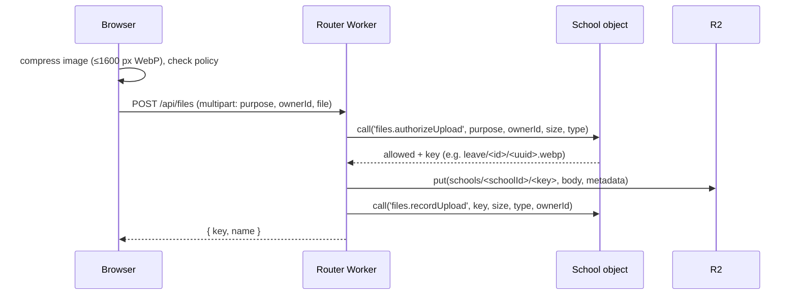

# Files and Media: Supabase Storage to R2

As of 27 Oct 2026. Part of the [Cloudflare rebuild docs](README.md).

## Summary

- **All files move to one R2 bucket**, with every key under `schools/<schoolId>/`. R2 has no egress fees, and the first 10 GB a month is free.
- **Files become private by default.** Today almost everything (including leave medical certificates and task attachments) sits in a public bucket and is served by a permanent public URL. In the target every file is served by the router Worker after a permission check, or by a short-lived signed link.
- **Uploads go through the Worker**, which checks size, type and permission, then writes to R2. The browser keeps today's image compression (≤ 1600 px, WebP) before upload.
- **Database rows store file keys, not URLs**, so a domain change or a move between storage products never breaks a link again.
- **One existing bug** surfaces in the inventory: subtask attachments upload to a `subtask-attachments` bucket that does not exist on the live project.

## How it works today

| Bucket (live) | Objects | Size | Access |
| --- | --- | --- | --- |
| `classroom-files` | 628 | ~996 MB | Public: every file has a permanent public URL |
| `feedback-files` | 2 | ~0.7 MB | Private: one-hour signed URLs (`feedback.ts`) |
| `subtask-attachments` | — | — | Referenced by `src/lib/projects.ts` but does not exist on live; uploads there fail |

What is stored in `classroom-files`, by path:

| Path | Written by | Contents | Sensitive? |
| --- | --- | --- | --- |
| `<classroomId>/<kind>_<ts>_<name>` | `classrooms.ts` | Classroom banner and logo | No |
| `<classroomId>/<ts>_<name>` | `classrooms.ts` | Coursework documents | Low |
| `submissions/<fileId>/<studentId>/<ts>_<name>` | `classrooms.ts` | Student homework submissions | Yes: student work |
| `discussions/<classroomId>/<userId>/<ts>.<ext>` | `classrooms.ts` | Discussion images | Low |
| `task-comments/<taskId>/<userId>/<ts>_<name>` | `tasks.ts` | Task comment attachments | Staff-internal |
| `smartboard-tasks/<homeroomId>/<ts>_<name>` | `smartboard.ts` | Smartboard task attachments | Low |
| `leave/<folder>/<uuid>.<ext>` | `leave.ts` | Leave attachments, often medical certificates | Yes: health data |
| `exam-questions/<examId>/<ts>-<rand>.<ext>` | `exam.ts` | Question figures | Yes until the exam opens |
| `announcements/<ts>_<name>` | `announcements.ts` | Announcement attachments | Audience-limited |
| `avatars/<userId>.<ext>` | `profile/page.tsx` | Profile photos | Personal |
| `site/...` | `pageConfig.ts`, `home/page.tsx`, `update-banner` route | Logo, favicon, login and welcome banners | No (public by design) |

Upload rules already in place, worth keeping:

- `src/lib/attachmentPolicy.ts`: 15 MB limit; images `jpg jpeg png gif webp heic heif`; documents `pdf doc docx xls xlsx ppt pptx txt csv zip`; no SVG or HTML (they would run script from the storage domain).
- `src/lib/imageCompression.ts`: photos resized to ≤ 1600 px on the long edge and re-encoded as WebP before upload.
- `cacheControl: '31536000'` on every upload; names carry a timestamp so a new upload never overwrites a cached one (except `upsert: true` paths such as avatars).
- Database rows store the full public URL (`attachment_url`, `avatar_url`, `banner_url`, `logo_url`, `image_url`, `file_url`, URLs inside `site_settings` JSON), which ties every row to one Supabase project's host.
- `/api/favicon` fetches the school logo server-side and wraps it in an SVG, trusting only the Supabase Storage host.

## Target design

### One bucket, per-school keys

```
eduberry-files/
  schools/<schoolId>/
    public/site/...                 logo, favicon, banners, login background
    classrooms/<classroomId>/...    banners, logos, coursework
    submissions/<fileId>/<studentId>/...
    discussions/<classroomId>/<userId>/...
    tasks/<taskId>/...              task and subtask comment attachments
    smartboard/<homeroomId>/...
    leave/<applicationId>/...
    exams/<examId>/questions/...
    announcements/<announcementId>/...
    avatars/<userId>.<ext>
    feedback/<feedbackId>/...
    exports/<date>/...              spreadsheet and PDF exports kept for download
  exports/<schoolId>/<date>/        offboarding exports
  backups/<schoolId>/<date>/        nightly and weekly backups
  archive/<schoolId>/<year>/        archived logs (GPS, location attempts)
```

The `schoolId` part is always added by the server from the request's host. The browser only ever names the path after it, and the Worker rejects `..` and absolute paths.

### Upload



- `purpose` (avatar, leave attachment, coursework, ...) decides the folder, size limit and who may upload, through the same permission module as everything else.
- Files over 50 MB (none today) would use R2 multipart upload with a presigned URL; not needed for launch.
- A `files` table in the school database records each object (key, owner record, size, type, uploaded_by, uploaded_at), which makes storage usage per school and orphan clean-up simple.

### Download

| Kind | How it is served |
| --- | --- |
| Public school assets (`public/site/...`) | `GET /files/public/...` on the school host; cacheable for a year; no session needed (login page needs the logo) |
| Everything else | `GET /files/<key>` on the school host: the Worker checks the session and asks the school object whether this person may read this file's owning record, then streams it from R2 with `Cache-Control: private` |
| Links that must work without a session (WhatsApp messages, emails) | Short-lived signed links: `/files/s/<key>?exp=...&sig=...` with an HMAC over key and expiry, valid for hours, not forever |

Because rows store keys, the front end builds `/files/<key>` itself; no row ever contains a host name.

### Images

Keep client-side compression. Optional later: Cloudflare Images transformations for thumbnails (class lists showing 40 avatars), priced separately; not needed for launch.

### Favicon and PWA icons

`/api/favicon` and the generated `/manifest.webmanifest` ([11](11-tenancy-and-control-plane.md)) read the school's logo from its own `public/site/` prefix, so the server never fetches an arbitrary URL.

## Moving existing files

1. For each object in each Supabase bucket of a school, copy it to `schools/<schoolId>/<new key>` using the path mapping in the tables above (most paths keep their tail unchanged).
2. Rewrite every URL column and every URL inside JSON settings to the new key (the importer in [13](13-data-layer.md) does this in the same pass).
3. Record each copied file in the `files` table.
4. Verify: object count and total bytes per prefix equal; every key referenced by a row exists in R2; list rows that reference files that never existed (the failing subtask uploads).

## Costs

About 12 GB of new files a year for a 10,000-user school is about $0.18 a month per year of files kept, with reads and writes inside R2's free operations for the first schools. See [02-cost-study.md](02-cost-study.md).

## Parity checklist

- [ ] Every upload in the path table works with the same size and type rules.
- [ ] Images are compressed before upload exactly as today.
- [ ] A student cannot open another student's submission or leave attachment by guessing a key.
- [ ] The login page shows the school's logo and banner without a session.
- [ ] Links in WhatsApp and email messages open without signing in and expire.
- [ ] Subtask attachments work (fixing today's missing bucket).

## Open questions

- [ ] How long to keep student submissions and leave attachments after the academic year closes?
- [ ] Should staff be able to download a whole classroom's submissions as one zip? (Easy with R2 and a Worker; not available today.)
