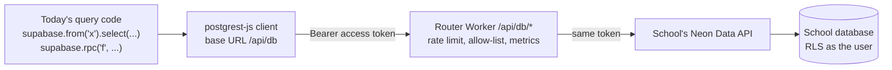

# Front End and API

As of 5 Nov 2026. Part of the [rebuild docs](README.md). The design is a Neon Postgres project per school with Cloudflare for everything else ([01](01-architecture-options.md), [10](10-target-architecture.md)).

## Summary

- **The browser app becomes a static single-page app** (Vite + React + React Router) served from Workers Static Assets, where requests are free. Today's 68 real pages are already client components; Next.js server rendering is used only to stamp a CSP nonce, which a static build does not need.
- **Components move almost unchanged.** A small compatibility layer provides `useRouter`, `usePathname`, `useSearchParams`, `useParams`, `Link` and `dynamic` with the same shapes as Next's, so the 307 components and 79 files that import `next/navigation` need no rewrite.
- **Data access moves in two phases.**
  - Phase 1 keeps today's query code. `supabase.from()` and `.rpc()` are PostgREST calls, and Neon's Data API speaks the same protocol, so about 136 files of queries run unchanged against the school's database through a thin Worker proxy.
  - Only auth (77 uses in 28 files), storage (24 uses in 9 files) and realtime (4 files) change in phase 1.
  - Phase 2 replaces each screen's queries with one Worker endpoint that runs one SQL function.
- **Phase 2 is about speed more than money.** Today's database is in Mumbai; Neon's nearest region is Singapore, about 30–60 ms away from Indian users per round trip. A screen that fires a dozen queries, several in sequence, gets noticeably slower; one call per screen makes it faster than today. On Neon the chatty pattern adds only about 15% to the bill ([02](02-cost-study.md)).
- **Preparation can start in the current repository now:** move every query out of pages and components into `src/lib/*` functions, and turn the worst waterfalls into single RPCs. Both help today's app and make each phase a change to `src/lib` only.

## What the front end is today

| Part | Today |
| --- | --- |
| Framework | Next.js 15.5 App Router, React 19, Tailwind 3.4, TypeScript |
| Pages | 86 `page.tsx`: 68 client components, 18 server components that only redirect (old URLs) |
| Layout | One root layout with `AuthProvider`, `PageConfigProvider`, `ProfileCardProvider`, `BottomNavProvider`; `await headers()` forces dynamic rendering for the CSP nonce |
| Components | 307 `.tsx` files under `src/components`, grouped by feature |
| Data access | `src/lib/*` (180 files, ~31,000 lines) plus direct queries in 51 page files and 10 component files; 107 `.rpc()` calls in 53 files |
| Contexts | Auth (479 lines, most of it Supabase session handling), PageConfig (branding and themes cached in `localStorage` to avoid a flash), AcademicYear, BottomNav, ProfileCard |
| Hooks | 22, including live transport, leave realtime, server-paged lists, school clock |
| Next-specific APIs | `next/navigation` in 79 files (`useRouter` 103 uses, `useSearchParams` 36, `useParams` 29, `usePathname` 8, `redirect` 19); `next/link` 55 files; `next/dynamic` 40 files; `next/image` 4 files; no `next/font` |
| Dynamic routes | 20 (`[id]`, `[examId]`, `[studentId]`, `[runId]`, `[token]`, `[certNo]`, ...) |
| Heavy client libraries | `@react-pdf/renderer` (WebAssembly layout engine), `xlsx` (SheetJS), `leaflet` + `react-leaflet`, `framer-motion`, `qrcode`, Razorpay checkout script |
| Security headers | `src/middleware.ts` sets a nonce-based CSP for pages; `next.config.js` sets HSTS, nosniff, frame options, referrer and permissions policy |
| PWA | `public/manifest.json` (static, "EduBerry"), `public/sw.js` (install, activate, push, notification click) |
| Sessions | Supabase tokens in `localStorage`, with cross-tab locking and timeout handling (`src/lib/supabase.ts`, ~300 lines) |

## Target front end

### Build and hosting

| Item | Target |
| --- | --- |
| Build | Vite, output to `apps/web/dist` |
| Hosting | Workers Static Assets on the router Worker: `not_found_handling: "single-page-application"`; `run_worker_first` for `/api/*`, `/files/*`, `/hooks/*`, `/manifest.webmanifest`, `/favicon` |
| Routing | React Router; one route per current `page.tsx`, the 18 redirect pages become redirect entries |
| Code splitting | One lazy chunk per route (`React.lazy`), plus the existing `next/dynamic` splits mapped to `lazy` |
| Caching | Hashed assets cached for a year (`immutable`); `index.html` `no-cache` so a deploy is picked up on the next load |
| Version check | The API returns the build id in a header; when it differs from the running bundle's, the app reloads at the next navigation |

### Compatibility layer

A file `apps/web/src/next-compat.ts` (and module aliases in the Vite config) maps `next/navigation`, `next/link` and `next/dynamic` to React Router and React equivalents with the same signatures. `next/image` (4 files) becomes a plain ``. This keeps the component move mechanical; individual components can drop the shim later.

### Sessions in the browser

- No long-lived token in JavaScript. The refresh token is an `HttpOnly` cookie; the 15-minute access token is kept in memory only ([12](12-auth-and-permissions.md)).
- On load the app calls `POST /api/auth/refresh`, which returns a fresh access token together with the user, profile, role and the school's branding version.
- A small wrapper adds the access token to every API and Data API request and refreshes it shortly before it expires, or once after a `401`.
- Sign-in and sign-out are plain `POST`s; other tabs learn about them through a `BroadcastChannel` message.
- The ~300 lines of token refresh, cross-tab locking and timeout handling in `src/lib/supabase.ts` and most of `AuthContext.tsx` go away.

### Security headers

| Header | Target |
| --- | --- |
| CSP | `default-src 'self'; script-src 'self' 'wasm-unsafe-eval' https://checkout.razorpay.com; connect-src 'self' <map tiles>; img-src 'self' data: blob: <map tiles>; object-src 'none'; base-uri 'self'; frame-ancestors 'self'; form-action 'self'` — no nonce needed because the static `index.html` has no inline script, and no database host because every call goes to the school's own host |
| Others | HSTS, `X-Content-Type-Options`, `Referrer-Policy`, `Permissions-Policy` (camera, geolocation, payment for Razorpay) carried over from `next.config.js`, set by the Worker and the static `_headers` file |

### PWA

- `/manifest.webmanifest` is generated per school (name, short name, theme colour, icons from the school's branding) instead of the static file.
- `sw.js` keeps its push and notification-click handlers; no offline caching of pages is added for launch.
- The driver app keeps its IndexedDB buffer for GPS fixes taken without signal.

## Data access, phase 1: today's queries against the Data API

| Piece | Today | Phase 1 |
| --- | --- | --- |
| Client | `createClient(SUPABASE_URL, ANON_KEY)` from `@supabase/supabase-js` | A `PostgrestClient` (the same library supabase-js uses inside) with base URL `/api/db` and the access-token wrapper. `src/lib/supabase.ts` exports it as `supabase` so call sites keep their shape |
| Queries and RPCs | `supabase.from()`, `.rpc()` | Unchanged |
| Proxy | — | The Worker forwards `/api/db/*` to the school's Data API URL with the same bearer token. The browser never learns the Neon host; one origin means no CORS set-up per school; and every query gets the school's rate limits and per-route metrics. Paths not on an allow-list of tables and functions are refused |
| Auth | `supabase.auth.*` (77 uses in 28 files) | `/api/auth/*` ([12](12-auth-and-permissions.md)) |
| Storage | `supabase.storage.*` (24 uses in 9 files) | `/api/files` and `/files/<key>` ([15](15-files-and-media.md)) |
| Realtime | `supabase.channel()` (4 files) | The `SchoolHub` socket ([14](14-jobs-messaging-realtime.md)) |
| Writes that send messages or feed live screens | Browser query, then a `/notify` call or a realtime event | Worker routes from the start: leave apply and decide, announcements, driver and transport operations actions ([14](14-jobs-messaging-realtime.md)) |

Spike S3 runs today's query catalogue against the Data API before phase 1 is committed to. It must cover:

- embedding;
- the spread syntax that `PROFILE_EMAIL` relies on (`...profile_emails(email)`);
- `count: 'exact'` with `head`;
- RPCs returning `SETOF`, with filters chained after them (`profileDirectory()`);
- `ilike`/`or` filters, range headers, upserts with `onConflict`;
- error codes the app checks for, such as `PGRST116` for "no rows".

Anything the Data API does not support becomes an RPC or a Worker route early.

## Data access, phase 2: one Worker endpoint per screen

### Shape

| Rule | Detail |
| --- | --- |
| Path | `/api/<section>/<action>`, e.g. `/api/fees/student-summary`, `/api/attendance/mark-homeroom` |
| Method | `POST` with a JSON body for everything except file downloads, the live socket and public `GET` pages; one shape keeps the client simple |
| What the route does | Validate the input with Zod, run one SQL function as the user in one transaction ([10](10-target-architecture.md)), shape the result. CPU work (PDFs, spreadsheets, hashing) stays in the Worker |
| Validation | Zod schemas in `packages/shared`, used by both the client (types) and the Worker (validation) |
| Response | `{ ok: true, data }` or `{ ok: false, error: { code, message, field? } }`, with HTTP status matching (`400`, `401`, `403`, `404`, `409`, `429`, `503`) |
| Idempotency | Money and messaging actions (`fees.collect`, `fees.onlineOrder`, `payroll.payout`, `wa.send`) accept an `Idempotency-Key`; an `idempotency_keys` table in the school database keeps keys for 24 hours and replays the first result |
| Compatibility | During a gradual deploy old bundles call the new API; actions only gain optional fields, and a removed action stays as a shim for one release |
| Errors | SQL functions raise errors with a code; the route turns them into plain-words messages; technical detail only in logs |

### One call per screen

Each screen gets a loader that returns everything it needs, joined in one SQL function:

| Today (home page, staff) | Target |
| --- | --- |
| Profile, site settings version, attendance time zone, server time, holidays, day timings (twice), today's punch, tasks for the week, unread comment count, teams, team members, leave approvals, announcements feed, classrooms, homerooms... (a dozen or more requests, several in sequence) | `POST /api/home/load` → one SQL function returning profile summary, today's attendance state and clock, week's tasks, notification counts, pinned announcements, quick links |

Actions that change data return the updated rows the screen shows, so the screen does not have to reload. Screens move one at a time; the Data API path keeps working for the rest, so phase 2 can ship screen by screen, busiest first. Once no screen uses it, `/api/db` is turned off.

### Mapping today's server routes

The 57 Next.js API routes become Worker routes. Their logic is already mostly SQL functions; the route validates, calls them as the user (or with the `app_jobs` role for webhooks and jobs) and does any CPU work.

| Group | Routes today | Target |
| --- | --- | --- |
| Admin user management | 12 under `/api/admin/*` | `/api/admin/*` routes calling `admin_*` SQL functions; password hashing in the Worker ([12](12-auth-and-permissions.md)) |
| Auth | `/api/auth/forgot-password` | `/api/auth/*` (sign-in, refresh, sign-out, forgot, redeem) |
| Fees | 19 under `/api/fees/*` (collect, invoices, online order and verify, payments and reversal, refunds, instruments, reminders, years, cron drain, public pay and verify links, Razorpay and UPI webhooks) | `/api/fees/*`; webhooks under `/hooks/<schoolId>/...`; the drain route replaced by the outbox queue; public `/pay/<token>` and `/verify/receipt/<token>` pages call public routes that run as `anon` |
| Bus fees and bus payroll | 6 under `/api/bus/*` | Same routes under fees and payroll; webhooks under `/hooks` |
| Salary and payroll | 6 under `/api/salary/*`, `/api/payroll/*` | `/api/payroll/*`; payout webhooks under `/hooks` |
| Transport | `/api/transport/ingest`, `/api/transport/notify/drain` | GPS ingest under `/hooks/<schoolId>/gps/<deviceKey>`; drain replaced by the outbox queue |
| Notifications | `/api/push/subscribe`, `/api/push/unsubscribe`, `/api/announcements/notify`, `/api/leave/notify` | `/api/push/*`; the notify routes kept in phase 1, then folded into the SQL functions that publish an announcement or decide a leave ([14](14-jobs-messaging-realtime.md)) |
| WhatsApp | `/api/whatsapp/webhook` | `/hooks/<schoolId>/whatsapp` |
| Exams | `/api/exam/create`, `/api/exam/submit` | `/api/exams/*` |
| Timetable | `/api/timetable/solve` | `/api/timetable/solve`, which starts the solver container |
| Certificates | `/api/certificates/verify/[certNo]` | Public route running as `anon` |
| Analytics | `/api/analytics/team` | `/api/tasks/team-analytics` |
| Favicon | `/api/favicon` | `/favicon` in the Worker, from the school's R2 prefix |

### Settings and branding cache

`PageConfigContext` keeps its warm-start cache in `localStorage` (it prevents a flash of default colours). The version check uses the branding version returned by `/api/auth/refresh` instead of a separate `site_settings_version` call. Public pages (login, pay links, certificate checks) read branding through a cached public route, so they do not wake the school's database each time ([02](02-cost-study.md)).

## Preparation that can start in the current repository

These steps reduce risk and can be merged to today's app before the rebuild starts:

1. **Move direct queries out of pages and components.** 51 page files and 10 component files call `supabase.from(...)` or `.rpc(...)` directly. Move each into a named function in `src/lib/<section>.ts`. Afterwards, every database touch in the browser is in `src/lib`.
2. **Group per-screen loads.** Where a page fires several queries on load, wrap them in one `load<Screen>()` function in `src/lib`, and where they run in sequence, replace them with one RPC. This speeds up today's app, softens the move to Singapore in phase 1, and defines phase 2's endpoints.
3. **Keep auth, storage and realtime behind `src/lib`.** `supabase.auth`, `supabase.storage` and `supabase.channel` should be called only from `AuthContext`, `privateFiles.ts` and the live hooks, so phase 1 replaces three places.
4. **Stop storing full storage URLs** in new rows: store the path and build the URL in one helper. Existing rows are rewritten by the importer anyway.
5. **Remove the hard-coded school name** from `BRANDING_DEFAULTS` and `LOGIN_DEFAULTS` (the README already requires neutral defaults).

## Alternatives considered

| Option | Why not chosen |
| --- | --- |
| Keep Next.js and run it on Workers (OpenNext or vinext) | Works, but every page navigation runs Worker code (billed requests and CPU) to render pages that are client-rendered anyway, and keeps the framework coupling. A fallback if the compatibility layer meets a blocker |
| Next.js static export (`output: 'export'`) | Dynamic routes would need every id known at build time; not workable for `[examId]`, `[runId]` and the rest |
| Browser calls Neon's Data API directly, without the proxy | One hop less, but the Neon host is exposed, CORS must be set per school, and the Worker sees no query for rate limits or metrics |
| Skip phase 1 and rewrite every screen to endpoints first | Delays the move by the whole rewrite; phase 1 lets the platform go live with today's screens |

## Parity checklist

- [ ] Every route in `src/app/**/page.tsx` exists in the new router, including the 18 redirects.
- [ ] Deep links (`/more/exam/<id>/grade/<studentId>`, `/pay/<token>`, `/verify/<certNo>`) load directly from a cold start.
- [ ] No flash of default branding on load.
- [ ] Desktop and mobile layouts unchanged.
- [ ] PDF previews, spreadsheet exports, maps and Razorpay checkout work under the new CSP.
- [ ] Push notifications and notification clicks work after the service-worker move.
- [ ] Phase 1: every query in today's catalogue returns the same rows through `/api/db` as through Supabase, for each role.
- [ ] Phase 2: each moved screen's first load makes one API call (plus static assets).
