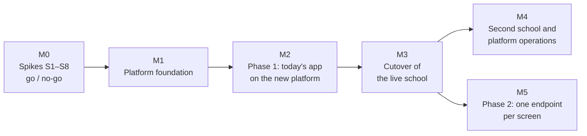

# Build Order

As of 5 Nov 2026. Part of the [rebuild docs](README.md). This doc gives the order of work in the new repository, from the baseline clone to the first school live on Neon and Cloudflare, the second school onboarded, and phase 2. Each milestone ends with something that runs and is tested ([91](91-test-and-parity-plan.md)).

## 1. Starting point

- The new repository starts as a clone of this one: the Next.js app, `src/lib`, components, migrations, `services/solver`, and these docs.
- Nothing is deleted on day one. The old app keeps running from the old repository until cutover ([90](90-data-migration-and-cutover.md)).
- The layout in [10-target-architecture.md](10-target-architecture.md#code-layout-of-the-new-repository) is created alongside, and code moves into it.
- The database does not need rebuilding: its schema becomes the baseline migration, taken from the live database after the hook replacements ([13](13-data-layer.md)). So the work is the platform around the database, then moving the screens onto it, and the order below follows from that.

M4 and M5 can run in parallel once the live school has moved.

## 2. Milestones

### M0: Spikes (about 2–3 weeks)

Run the eight spikes in [01-architecture-options.md](01-architecture-options.md#spikes-to-run-first) and confirm the tool choices in [10](10-target-architecture.md): Hono, `@neondatabase/serverless`, Kysely or plain SQL, Zod, Vite with React Router, Vitest with Neon branches and `@cloudflare/vitest-pool-workers`.

| Exit | Detail |
| --- | --- |
| Go | S1 (restore), S2 (policies with the `auth.uid()` shim), S3 (Data API) and S4 (latency from India) pass |
| S3 fails | Phase 1 cannot rely on the Data API: the screens whose queries it cannot serve move to Worker routes before cutover, so part of phase 2 comes first |
| S4 fails | Screens too slow from Singapore move to one endpoint per screen before cutover, busiest first |
| S1 or S2 fails | Fix forward if the cause is a missing extension or setting; otherwise reconsider with the comparison in [01](01-architecture-options.md) |

### M1: Platform foundation

Everything every section needs. No section work yet.

| Work | Doc |
| --- | --- |
| Monorepo layout; CI with every test layer on Neon branches of a seeded test school; environments (local, preview, staging, production); deploy pipeline with migrations first and gradual rollout | [10](10-target-architecture.md), [91](91-test-and-parity-plan.md) |
| Router Worker: host → school lookup (isolate memory, KV, platform database), API routing, static assets, `/hooks/<schoolId>/...`, rate limiting, security headers | [10](10-target-architecture.md), [11](11-tenancy-and-control-plane.md), [16](16-frontend-and-api.md) |
| Platform database through Hyperdrive: schools, databases and credentials, hosts, plans, features, provisioning runs, migrations, platform users, support grants, audit, usage | [11](11-tenancy-and-control-plane.md) |
| Provisioning through the Neon API; `tools/migrate`; the baseline schema with the hook replacements; the school roles (`app_worker`, `app_jobs`) | [11](11-tenancy-and-control-plane.md), [13](13-data-layer.md) |
| The "run as user" transaction helper and `app_after_write()` | [10](10-target-architecture.md), [14](14-jobs-messaging-realtime.md) |
| Auth: our `auth` schema and `auth.uid()` (S2's choice), scrypt hashing with bcrypt import, refresh cookie and 15-minute access tokens, per-school signing keys and JWKS, sign-in, invite and reset links, admin account functions and bulk import, rate limits, kiosk sign-in | [12](12-auth-and-permissions.md) |
| Data API proxy `/api/db` with its allow-list | [16](16-frontend-and-api.md) |
| Files: R2 keys per school, files route with `can_read_file`, upload flow, `files` table | [15](15-files-and-media.md) |
| `SchoolHub`: job timer and live sockets; queues (`outbox`, `jobs`, `webhooks`) and their consumers; Email Service; web push (platform VAPID keys); WhatsApp sender; `webhook_events` | [14](14-jobs-messaging-realtime.md), [17](17-integrations-and-secrets.md) |
| Secrets: encrypted school secrets, platform secrets, write-only settings forms | [17](17-integrations-and-secrets.md) |
| Front-end shell: Vite build, `next-compat` shim, `PostgrestClient` behind `src/lib/supabase.ts`, the access-token wrapper, PWA manifest per school, branding before sign-in | [16](16-frontend-and-api.md), [21](21-school-settings-and-branding.md) |
| Observability: logs, Analytics Engine metrics per school and route, Neon usage, alerts (including "never sleeps") | [10](10-target-architecture.md) |
| Port the existing test files and the solver test; build the row-level security matrix and the parity harness | [91](91-test-and-parity-plan.md) |

**Exit:** a demo school provisioned from the baseline, restored with anonymised live data, where an admin signs in and today's screens load through the Data API. The RLS matrix and tenant-isolation tests pass with two schools.

### M2: Phase 1, today's app on the new platform

Today's pages and their query code move onto the new shell as they are. Per section, the work is what Supabase did outside the database: sign-in, files, realtime, jobs and the server routes. Sections are taken in groups, so each group can be checked end to end:

| Group | Sections | Main work |
| --- | --- | --- |
| 1. Core | [20](20-users-profiles-and-admin.md), [21](21-school-settings-and-branding.md), [22](22-academic-structure.md), [25](25-announcements-and-notifications.md), [23](23-attendance.md), [24](24-leave.md), [37](37-home-profile-and-misc.md) | Admin routes on the `admin_*` functions; leave and announcement writes through Worker routes, with push from the outbox and live updates through the hub; branding public route |
| 2. Teaching | [28](28-classrooms-and-coursework.md), [30](30-grades-and-report-cards.md), [29](29-exams.md), [31](31-timetable.md), [26](26-tasks-and-projects.md), [27](27-smartboard.md), [32](32-certificates.md) | File uploads and downloads on R2; exam create and submit routes; the solver container; public certificate verify |
| 3. Money | [33](33-fees.md), [35](35-bank-collections-and-payouts.md), [34](34-payroll-and-salary.md) | Fee routes, Razorpay and bank hooks through the `webhooks` queue, fee jobs on the hub's timer, the bank gateway container, payroll batches as jobs |
| 4. Transport | [36](36-transport.md) | Fixes through the Worker route, live board and parent view through the hub, the tick in the transport window, the night jobs, the device hook |

**Exit:** on a rehearsal import of live data, every section's §11 checklist, the RLS matrix, the Data API parity suite and the end-to-end journeys pass; a quiet night shows the compute asleep.

### M3: Cutover of the live school

| Work | Doc |
| --- | --- |
| `tools/import-supabase`, `tools/copy-files`, the verify queries | [90](90-data-migration-and-cutover.md), [13](13-data-layer.md) |
| Read-only switch in the old app (small change in the old repository) | [90](90-data-migration-and-cutover.md) |
| Three rehearsal imports of live data, end-to-end and load runs against them | [91](91-test-and-parity-plan.md) |
| Close the decisions list | [90](90-data-migration-and-cutover.md) §10 |
| Cutover, then 30 days of watching, then retire Supabase and Vercel | [90](90-data-migration-and-cutover.md) |

**Exit:** the live school runs on Neon and Cloudflare; Supabase is paused; the cost model is updated with measured compute hours.

### M4: Second school and platform operations

| Work | Doc |
| --- | --- |
| Platform console: create a school, hosts and custom domains (Cloudflare for SaaS), plans and modules, autoscaling range, support grants, audit | [11](11-tenancy-and-control-plane.md) |
| Onboarding flow: legal entity and work location for payroll, time zone, branding, CSV imports of users and structure | [11](11-tenancy-and-control-plane.md), [20](20-users-profiles-and-admin.md), [34](34-payroll-and-salary.md) |
| Usage roll-up and billing figures per school | [11](11-tenancy-and-control-plane.md), [02](02-cost-study.md) |
| School export, restore and offboarding | [11](11-tenancy-and-control-plane.md), [13](13-data-layer.md) |
| Pods for small schools, before the 100-project line | [11](11-tenancy-and-control-plane.md) |
| Platform-maintained statutory rule-set library for payroll (if decided) | [34](34-payroll-and-salary.md) |

**Exit:** a second school is onboarded without a deploy and without touching the first.

### M5: Phase 2, one endpoint per screen

Screen by screen, busiest first (home, attendance, the fee counter, the transport board, leave, classrooms), each screen's queries become one SQL function behind one Worker route, as §9 of each section doc describes ([16](16-frontend-and-api.md)). When no screen uses it, `/api/db` is turned off. Alongside, the schema improvements the section docs list as later migrations, each once measured: summary tables for reports, folding `task_assignees`, the typed settings table, the transport index review and trails in R2, and the payroll option chosen in [34](34-payroll-and-salary.md).

**Exit:** every screen's first load is one API call; the Data API is off.

## 3. Work that can start now in the current repository

These reduce risk for the rebuild and help the live school today. Under Neon the SQL moves unchanged, so a fix made in the database today is carried into the rebuild with the dump: nothing is fixed twice.

### Fixed on 28 Oct 2026 (they affected live users)

All five were fixed in the current app (migrations `fix_home_fee_summary_v2.sql`, `fix_private_attachments.sql`, `fix_report_card_marks_gate.sql`, `fix_profile_email_visibility_a.sql` and `_b.sql`; `scripts/move-private-attachments.mjs` for the older files). The rebuild carries the same rules.

| Issue | Doc | Why it was urgent |
| --- | --- | --- |
| Any signed-in user can read every profile, including emails | [12](12-auth-and-permissions.md) | Personal data exposure |
| Uploaded files (leave medical certificates, task and comment attachments, announcements) sit in a public bucket with permanent URLs | [12](12-auth-and-permissions.md), [15](15-files-and-media.md) | Anyone with a link can open them |
| Students can read raw marks of a report-card title before the class is published | [30](30-grades-and-report-cards.md) | If the school agrees it is unintended |
| Subtask attachments upload to a `subtask-attachments` bucket that does not exist on live | [15](15-files-and-media.md), [26](26-tasks-and-projects.md) | Uploads fail today |
| Home fee widgets read the first-generation fee tables and never show v2 bills | [37](37-home-profile-and-misc.md) | Students see no overdue fees; admins see no collections on home |

### Prepare (no behaviour change)

From [16](16-frontend-and-api.md#preparation-that-can-start-in-the-current-repository):

1. Move direct `supabase.from` and `.rpc` calls out of 51 pages and 10 components into `src/lib`.
2. Group per-screen loads into one `load<Screen>()` per page, and turn sequential queries into one RPC.
3. Keep `supabase.auth`, `supabase.storage` and `supabase.channel` behind `AuthContext`, `privateFiles.ts` and the live hooks.
4. Store file paths, not full URLs.
5. Remove the hard-coded school name from the branding and login defaults.

### Fix now; the fix carries over

| Issue | Doc |
| --- | --- |
| `Asia/Kolkata` hard-coded in edu points, two other migrations, and the fee date engine | [28](28-classrooms-and-coursework.md), [33](33-fees.md) |
| Streak date taken from the browser clock | [37](37-home-profile-and-misc.md) |
| Bank UPI collection settles only into first-generation tables | [35](35-bank-collections-and-payouts.md) |
| Staff can read every student's full details | [12](12-auth-and-permissions.md) |

### Leave for the rebuild (they depend on the new platform)

| Issue | Doc |
| --- | --- |
| Leave sync and push notifications triggered from the browser | [24](24-leave.md) |
| Payout status polling configured but never run | [35](35-bank-collections-and-payouts.md) |
| The shared Traccar admin token held by every school deployment | [36](36-transport.md) |
| Per-deployment environment fallbacks for payment secrets | [17](17-integrations-and-secrets.md), [35](35-bank-collections-and-payouts.md) |
| Every-minute `pg_cron` jobs | [14](14-jobs-messaging-realtime.md) |

## 4. How to work a section

For each section doc, in the new repository:

1. Read the section doc and its live schema entry. Run the measurement queries in the [README](README.md#measuring-the-live-school-again) if the doc is more than a few weeks old.
2. Run the section's parity comparison and row-level security matrix on a Neon branch ([91](91-test-and-parity-plan.md) §4).
3. Phase 1: replace the section's uses of Supabase Auth, Storage and Realtime; move its server routes to Worker routes; move its jobs to the hub's timer; move its pages and components onto the new shell, keeping `src/lib` and the components.
4. Pass the doc's §11 checklist, the parity comparison, the RLS matrix and the end-to-end journeys for the section.
5. Phase 2, later: write each screen's SQL function as a migration in `db/migrations`, its Worker route and typed client function, using the names in §9 of the doc and today's `src/lib/<section>.ts`.
6. Update the doc if anything changed, and tick the section in the README.

## 5. Tracking

The README's documents table gains a column for build status per section: Not started, Phase 1, Parity passed, Live, Phase 2. The progress log records each milestone.
