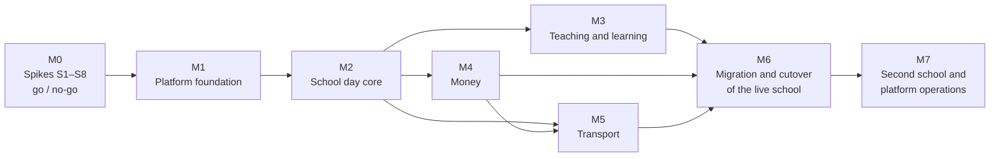

# Build Order

As of 27 Oct 2026. Part of the [Cloudflare rebuild docs](README.md). This doc gives the order of work in the new repository, from the baseline clone to the first school live on Cloudflare and the second school onboarded. Each milestone ends with something that runs and is tested ([91](91-test-and-parity-plan.md)).

## 1. Starting point

- The new repository starts as a clone of this one: the Next.js app, `src/lib`, components, migrations, `services/solver`, and these docs.
- Nothing is deleted on day one. The old app keeps running from the old repository until cutover ([90](90-data-migration-and-cutover.md)).
- The layout in [10-target-architecture.md](10-target-architecture.md#code-layout-of-the-new-repository) is created alongside, and code moves into it section by section.

M3, M4 and M5 can run in parallel once M2 is done. M5 needs the transport fee head and notification routing from M4 and M2.

## 2. Milestones

### M0 — Spikes (about 2–3 weeks)

Run the eight spikes in [01-architecture-options.md](01-architecture-options.md#spikes-to-run-first-in-the-new-repository) and confirm the tool choices in [10](10-target-architecture.md): Hono, Drizzle (or raw SQL), Zod, Vite with React Router, and `@cloudflare/vitest-pool-workers`.

| Exit | Detail |
| --- | --- |
| Go | S1–S3 pass: a school object is fast enough, holds a 10,000-user peak, and keeps money logic transactional |
| No-go | Fall back to option F for school data, keeping everything else in these docs, and update [10](10-target-architecture.md) |

### M1 — Platform foundation

Everything every section needs. No school features yet.

| Work | Doc |
| --- | --- |
| Monorepo layout, CI with every test layer, environments (dev, staging, production), deploy pipeline with gradual rollout | [10](10-target-architecture.md) |
| Router Worker: host → school lookup (cached), API routing, static assets, `/hooks/<schoolId>/...`, rate limiting, security headers | [10](10-target-architecture.md), [16](16-frontend-and-api.md) |
| `platform` D1: schools, hosts, plans, features, provisioning runs, platform users, support grants, audit, usage | [11](11-tenancy-and-control-plane.md) |
| `School` object skeleton: `call()` dispatch, migrations on wake plus the post-deploy sweep, `transactionSync` helpers, alarm with the due-jobs table, WebSocket topics, the archive object class | [10](10-target-architecture.md), [13](13-data-layer.md), [14](14-jobs-messaging-realtime.md) |
| Schema package: STRICT tables, type map (paise, basis points, hundredths, ISO UTC), enum CHECKs | [13](13-data-layer.md) |
| Auth: accounts, scrypt hashing with bcrypt import, sessions in an `HttpOnly` cookie, sign-in, invite and password-reset links by email, admin account creation and bulk import, rate limits, kiosk sign-in for smartboards | [12](12-auth-and-permissions.md) |
| Permissions module: roles, role grants, user grants, relationship helpers, the generated permission matrix tests | [12](12-auth-and-permissions.md) |
| Files: R2 keys per school, files route with permission checks, upload flow, `files` table, image resizing | [15](15-files-and-media.md) |
| Outbox, queues (`outbox`, `jobs`, `webhooks`), Email Service, web push (platform VAPID keys), WhatsApp adapter, `webhook_events` | [14](14-jobs-messaging-realtime.md), [17](17-integrations-and-secrets.md) |
| Secrets: per-school encrypted secrets, platform secrets, write-only settings forms | [17](17-integrations-and-secrets.md) |
| Front-end shell: Vite build of the app shell, `next-compat` shim, typed API client, session handling, PWA manifest per school, branding loaded before sign-in | [16](16-frontend-and-api.md), [21](21-school-settings-and-branding.md) |
| Observability: logs, Analytics Engine metrics per school and method, alerts | [10](10-target-architecture.md) |
| Port the 40 existing test files and the solver test; all pass | [91](91-test-and-parity-plan.md) |

**Exit:** a provisioned demo school where an admin can sign in, see an empty home, and upload a logo. Tenant-isolation tests pass with two schools.

### M2 — School day core

The sections every school uses daily, and that most other sections depend on.

| Order | Section | Why here |
| --- | --- | --- |
| 1 | [20 Users, profiles and admin](20-users-profiles-and-admin.md) | Everyone else references users and roles. Includes CSV import and the audit log |
| 2 | [21 School settings and branding](21-school-settings-and-branding.md) | Typed settings used by every section |
| 3 | [22 Academic years, homerooms and teams](22-academic-structure.md) | Grades, sections and years scope most data |
| 4 | [25 Announcements and notifications](25-announcements-and-notifications.md) | The notification routing that leave, fees and transport use |
| 5 | [23 Attendance](23-attendance.md) | Daily use; geofence; reports with rollups |
| 6 | [24 Leave](24-leave.md) | Approval chains; feeds attendance and payroll |
| 7 | [37 Home, profile and other](37-home-profile-and-misc.md) | `home.load` with the cards available so far; it grows as later sections land |

**Exit:** a demo school can run a school day: users imported, attendance marked, leave approved, announcements sent and received by push. The golden fixtures for attendance and leave pass.

### M3 — Teaching and learning

| Order | Section |
| --- | --- |
| 1 | [28 Classrooms and coursework](28-classrooms-and-coursework.md) |
| 2 | [30 Assessments, marks and report cards](30-grades-and-report-cards.md) |
| 3 | [29 Exams](29-exams.md) |
| 4 | [31 Timetable](31-timetable.md) (with the solver container) |
| 5 | [26 Tasks and projects](26-tasks-and-projects.md) (uses the timetable) |
| 6 | [27 Smartboard](27-smartboard.md) |
| 7 | [32 Certificates](32-certificates.md) (uses marks and attendance) |

**Exit:** a full academic cycle works on the demo school: coursework, homework, exams, marks, published report cards, timetable published, certificates verified by QR.

### M4 — Money

| Order | Section | Notes |
| --- | --- | --- |
| 1 | [33 Fees](33-fees.md) | Largest port. Golden fixtures for every fee function before starting |
| 2 | [35 Bank collections and payouts](35-bank-collections-and-payouts.md) | Razorpay first; bank collect settling into v2 bills; payouts; the bank gateway container for mutual TLS |
| 3 | [34 Payroll and salary](34-payroll-and-salary.md) | Salary cycles first (in use); the v2 engine after, per the option chosen |

**Exit:** fee year on the demo school: grid issued, counter collection, online payment, refund, carry-forward, reports equal to the fixtures; a salary cycle generated and paid by bank file.

### M5 — Transport

[36 Transport](36-transport.md):

1. Setup screens.
2. Runs and materialise.
3. The TypeScript derivation engine, built against the recorded fixtures.
4. Driver app fixes and boarding.
5. Live sockets for the board and parents.
6. Tick, alerts and SOS.
7. Notifications.
8. Trails to R2, replay, metrics, reports and GTFS.
9. Device linking through the platform's Traccar token.

**Exit:** a simulated day and the recorded real runs replay with the same events and alerts. The bus-peak load scenario passes in the school object.

### M6 — Migration and cutover of the live school

| Work | Doc |
| --- | --- |
| `tools/import-supabase`, `tools/copy-files`, `system.importBatch` / `verify` / `recompute` | [90](90-data-migration-and-cutover.md), [13](13-data-layer.md) |
| Read-only switch in the old app (small change in the old repository) | [90](90-data-migration-and-cutover.md) |
| Three rehearsal imports of live data, end-to-end and load runs against them | [91](91-test-and-parity-plan.md) |
| Close the decisions list | [90](90-data-migration-and-cutover.md) §10 |
| Cutover, then 30 days of watching, then retire Supabase and Vercel | [90](90-data-migration-and-cutover.md) |

**Exit:** the live school runs on Cloudflare; Supabase is paused.

### M7 — Second school and platform operations

| Work | Doc |
| --- | --- |
| Platform admin: create a school, hosts and custom domains (Cloudflare for SaaS), plans and modules, support grants, audit | [11](11-tenancy-and-control-plane.md) |
| Onboarding flow: legal entity and work location for payroll, time zone, branding, CSV imports of users and structure | [11](11-tenancy-and-control-plane.md), [20](20-users-profiles-and-admin.md), [34](34-payroll-and-salary.md) |
| Usage roll-up and billing figures per school | [11](11-tenancy-and-control-plane.md), [02](02-cost-study.md) |
| School export and offboarding | [11](11-tenancy-and-control-plane.md) |
| Year-close archive job used for real | [13](13-data-layer.md) |
| Platform-maintained statutory rule-set library for payroll (if decided) | [34](34-payroll-and-salary.md) |

**Exit:** a second school is onboarded without a deploy and without touching the first.

## 3. Work that can start now in the current repository

These reduce risk for the rebuild and help the live school today.

### Fix now (they affect live users)

| Issue | Doc | Why now |
| --- | --- | --- |
| Any signed-in user can read every profile, including emails | [12](12-auth-and-permissions.md) | Personal data exposure |
| Uploaded files (leave medical certificates, task and comment attachments, announcements) sit in a public bucket with permanent URLs | [12](12-auth-and-permissions.md), [15](15-files-and-media.md) | Anyone with a link can open them |
| Students can read raw marks of a report-card title before the class is published | [30](30-grades-and-report-cards.md) | If the school agrees it is unintended |
| Subtask attachments upload to a `subtask-attachments` bucket that does not exist on live | [15](15-files-and-media.md), [26](26-tasks-and-projects.md) | Uploads fail today |
| Home fee widgets read the first-generation fee tables and never show v2 bills | [37](37-home-profile-and-misc.md) | Students see no overdue fees; admins see no collections on home |

### Prepare (no behaviour change)

From [16](16-frontend-and-api.md#preparation-that-can-start-in-the-current-repository):

1. Move direct `supabase.from` and `.rpc` calls out of 51 pages and 10 components into `src/lib`.
2. Group per-screen loads into one `load<Screen>()` per page.
3. Store file paths, not full URLs.
4. Remove the hard-coded school name from the branding and login defaults.

### Leave for the rebuild (fixing twice is waste)

| Issue | Doc |
| --- | --- |
| `Asia/Kolkata` hard-coded in edu points, two other migrations, and the fee date engine | [28](28-classrooms-and-coursework.md), [33](33-fees.md) |
| Leave sync and push notifications triggered from the browser | [24](24-leave.md) |
| Bank UPI collection settles only into first-generation tables | [35](35-bank-collections-and-payouts.md) |
| Payout status polling configured but never run | [35](35-bank-collections-and-payouts.md) |
| Streak date taken from the browser clock | [37](37-home-profile-and-misc.md) |
| The shared Traccar admin token held by every school deployment | [36](36-transport.md) |
| Per-deployment environment fallbacks for payment secrets | [17](17-integrations-and-secrets.md), [35](35-bank-collections-and-payouts.md) |

## 4. How to work a section

For each section doc, in the new repository:

1. Read the section doc and its live schema entry. Run the measurement queries in the [README](README.md#measuring-the-live-school-again) if the doc is more than a few weeks old.
2. Record the golden fixtures for the section's SQL logic ([91](91-test-and-parity-plan.md) §4).
3. Write the tables in the schema package and the migration.
4. Write the module: methods from §9 of the doc, permissions from its table, triggers turned into explicit code.
5. Write the HTTP handlers and the typed client functions, using the same names as today's `src/lib/<section>.ts`.
6. Move the pages and components: swap `src/lib` imports to the typed client; keep the components.
7. Pass the doc's §11 checklist, the golden fixtures, the permission matrix and the end-to-end journeys for the section.
8. Update the doc if anything changed, and tick the section in the README.

## 5. Tracking

The README's documents table gains a column for build status per section: Not started, In progress, Parity passed, Live. The progress log records each milestone.
