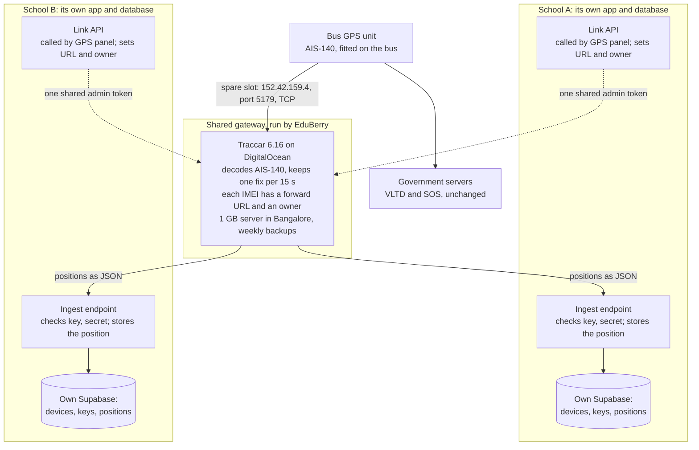

# GPS System Status

As of 24 Oct 2026.

The GPS system is built but not live. No school can link a bus yet: the branch is not merged and no school has the gateway settings. The running server needs no rebuild; an admin-account token stands in for the missing service-account token.

All the code sits on branch `claude/quirky-feynman-jxi3p0`, now up to date with main. It is not on main and has no pull request.

On multitenancy, the school side is ready: each school has its own app and its own database. The shared gateway already serves many schools from one server. The main gap is that every school's app holds the same full-control gateway token, so keeping schools apart on the gateway depends on our code, not on Traccar.

Going live takes three steps: generate a gateway token, set the Vercel and GitHub secrets, and merge the branch.

## How it works

Solid arrows carry positions. Dashed arrows link devices, using one token every school shares.

The government feed never passes through EduBerry. Each school's app links its own devices on the gateway, and the gateway sends each bus's positions only to the school recorded as its owner.

## Components

There are two tiers: one shared gateway that EduBerry runs, and each school's own app and database.

| Part | Where it lives | What it does |
| --- | --- | --- |
| GPS unit (AIS-140) | On the bus | Keeps reporting to the government (VLTD) and SOS servers. A spare slot reports to EduBerry over TCP. |
| Gateway server | DigitalOcean droplet 612010283, Bangalore, 1 GB RAM, weekly backups | Runs Traccar 6.16 on PostgreSQL, with Caddy for HTTPS, fail2ban, and 2 GB of swap. Costs about $7.20 a month. |
| Network | Reserved IP 152.42.159.4 and firewall `gps-gateway` | Devices use the reserved IP, which survives a rebuild. Open ports: 22, 80, 443, and 5001–5300 on TCP and UDP. |
| Traccar setup | `infra/gps-gateway/cloud-init.yaml` | AIS-140 decoder on port 5179. Forwards each position as JSON, with retries. Drops bad, zero and duplicate fixes, keeps one fix per 15 s (alarms always pass), and deletes data older than 7 days. |
| Link API | `src/app/api/transport/devices/link/route.ts` and `src/lib/transport/traccar.ts` | Admin-only. Creates, updates and deletes the device on Traccar, and sets its forward URL and owning school. |
| GPS panel | `src/components/transport/sections/IntegrationsSection.tsx` | The school registers a device by IMEI and bus. The panel links it, offers a vendor message to copy or send on WhatsApp, and can re-link, rotate, test or remove it. |
| Ingest endpoint | `src/app/api/transport/ingest/route.ts` | Checks the device's key and secret. Reads Traccar's JSON, rejects stale or impossible fixes, flags jumps over 150 km/h, and stores the rest. |
| Device registry | `transport_telemetry_sources` and `integration_secrets`, in each school's Supabase | One row per device. The key id is public; the secret is readable only server-side. |
| Provisioning | `infra/gps-gateway/provision.py` and `.github/workflows/gps-gateway-sync.yml` | Creates the server once. Every night it gives each school's Vercel project `TRACCAR_URL`, `TRACCAR_TOKEN` and `GPS_GATEWAY_HOST`, then redeploys it. |

Traccar cannot sign its requests, so each device's forward URL carries its key and secret in the query string.

The Link API, the Traccar client, the provisioning sync and the workflow exist only on the branch until it is merged.

## Current status

The server is up and locked down, the code is written and tested, and one blocker stands between them: the server has no service-account token.

| Item | Status | Notes |
| --- | --- | --- |
| Gateway server | Live | Droplet running Traccar 6.16. The admin page answers at https://168-144-154-4.sslip.io. |
| Admin account | Live | Registered by the owner. Public sign-up is off (checked on 24 Oct). |
| Gateway token | Unblocked, not done | The server was built without a service-account token, but an admin-account token works the same (verified on Traccar 6.16 on 25 Oct). Generate it under Settings → Preferences → Token and pass it to `provision.py` as `GPS_GATEWAY_TOKEN`. No rebuild needed. |
| Automatic linking (register, rotate, enable, remove) | Built, not merged | On the branch. Tested against a Traccar 6.16 server when written. Unit tests pass. |
| GPS panel: Traccar only, IMEI form, vendor message | Built, not merged | On the branch. Typecheck, lint and all 588 tests pass. Not yet clicked through in a browser. |
| Nightly sync workflow | Not verified | Needs the `DIGITALOCEAN_TOKEN` and `VERCEL_TOKEN` repository secrets; not checked whether they exist. It skips quietly until they do. |
| School Vercel projects connected | Not started | None can be connected until the server has a service token. |
| Merged to main | Not started | No pull request yet. Main has moved on since. |
| Devices linked and reporting | Not started | No device can be linked through the app until schools are connected. |
| Uptime alerts | Not started | The DigitalOcean monitoring agent is installed, but our scripts set no alert policies. |

To go live:

1. Generate a token in the gateway's admin account (Settings → Preferences → Token, expiry years ahead). Keep the current server; a rebuild is no longer needed. If it is ever rebuilt, `provision.py` moves the old reserved IP across.
2. Set `DIGITALOCEAN_TOKEN`, `VERCEL_TOKEN` and `GPS_GATEWAY_TOKEN` (plus `VERCEL_TEAM_ID` if schools sit under a team), then run `provision.py`. It finds the existing server and connects every school.
3. Add `DIGITALOCEAN_TOKEN` and `VERCEL_TOKEN` as GitHub repository secrets, so the nightly sync connects new schools.
4. Merge main into the branch, open a pull request, and merge it.
5. Run one real bus end to end: register it, have the vendor set the server, and check its health turns to Reporting.

## Multitenant readiness

The design is multitenant, and it is ready for schools whose deployments EduBerry runs itself. School data is fully separated. The shared gateway is not yet a hard boundary between schools: every school's app holds the same full-control token, so the separation there depends on our code behaving.

| Area | How it works today | Readiness | Gap and fix |
| --- | --- | --- | --- |
| School data | One Vercel project and one Supabase project per school. No tables are shared. | Ready | None. |
| Device credentials | Each device gets its own key id and secret, stored in that school's database. Ingest looks devices up only there. | Ready | The secret travels in the forward URL, so it sits in Traccar's database and in request logs. Rotate a device's key if it leaks. |
| Onboarding a new school | The nightly sync finds every Vercel project with `SUPABASE_SERVICE_ROLE_KEY`, gives it the gateway settings, and redeploys it. | Partly | Not run yet. Any other Vercel project with that variable would get the token too. Set `VERCEL_PROJECTS` to list the school projects by name. |
| Device ownership | Each Traccar device records its owning school's URL. Linking or removing another school's IMEI is refused. | Partly | First to register an IMEI wins, with no proof that the school owns the device. A school that changes domain, or has no `NEXT_PUBLIC_SITE_URL`, finds its own devices marked as another school's. Support has to fix both by hand. |
| Gateway access | All school apps share one service-account token, which acts as a Traccar admin. | Gap | Anyone with access to one school's server or Vercel settings could list every device (with the other schools' forward secrets), re-point any bus, or delete any device. Fix: a Traccar user and token per school, or a small EduBerry service that alone holds the admin token. |
| Capacity | One 1 GB server for every school. | Partly | Plan for 2 GB at about 150 buses and 4 GB at about 500. Resizing is manual. |
| Availability | One server, weekly backups, no failover, no alerts. | Gap | If it stops, every school loses GPS-device tracking at once; driver phones keep working. Add an uptime alert first. Daily backups cost little more. |
| Fair sharing | One decoder and forwarder for every fleet. | Partly | The 15 s filter caps load per device, but nothing limits one school. A faulty fleet slows everyone. |

Close the gateway-access gap before anyone outside EduBerry can run or reach a school's deployment. The other gaps can wait until there are more buses than one server comfortably holds.
