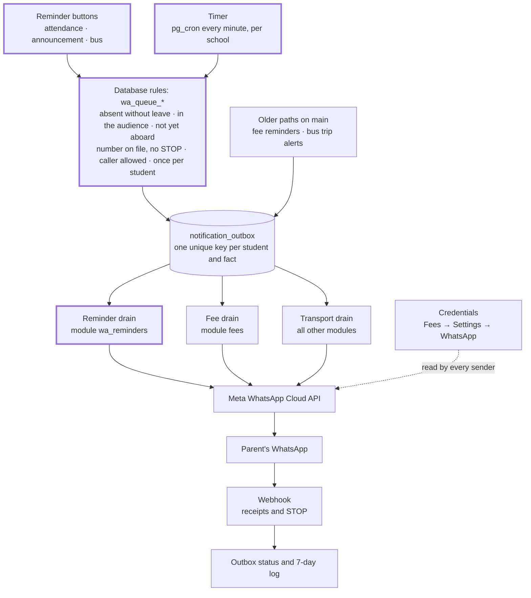

# EduBerry WhatsApp System: Design and Status

As of 24 October 2026. Written from the code on branch `claude/whatsapp-integration-plan-zw9spy`.

## Summary

The three new WhatsApp reminder buttons are built and tested, but nothing is live: the database migration has not been applied to any school, and this code has not yet sent a message to Meta.

- **What exists.** One WhatsApp stack on Meta's Cloud API, shared by fee reminders and bus trip alerts (both already on main) and the new attendance, announcement and bus reminders.
- **Where the work is.** Branch `claude/whatsapp-integration-plan-zw9spy`, commit `16ae5ff`, built on main at `25dd8c7`. No pull request is open.
- **Design choice.** Every rule (who is absent, who is in the audience, one message per student) is enforced in the database, so no screen or script can bypass it.
- **Multi-tenant.** Ready for EduBerry's current model of one database and one deployment per school: everything a school changes is data it edits in the app. Not ready for many schools sharing one database.
- **Blocking go-live.** Apply the migration, register three templates in WhatsApp Manager, and decide four open questions (section 9).

## Architecture

Every message, new or old, is a row in one database queue; a sender takes it to Meta, and a webhook brings the receipts back.

Thick borders mark what this work added; the rest was already on main.

The new reminders and the older fee and bus paths share the queue, the credentials and the webhook, but each module has its own sender. pg\_cron calls a sender through pg\_net only when something is queued, and the reminder send route also sends straight away so staff see the result in seconds.

## The three reminder buttons

Each button opens a popup shaped like the fee app's Reminders popup, in its own page's colours with rounded edges. Every popup has four views: Remind (the list), Log (last 7 days), Automatic (timer) and Message (template mapping).

| Button | Where | Who can send | Who it lists | Timer |
| --- | --- | --- | --- | --- |
| Attendance | Attendance → Student report, beside the date | Admin, principal, coordinator; class teachers for their own homerooms only | Students marked absent today with no linked leave and no pending or approved leave for today; filter by classroom | One time a day on chosen days; skips school holidays; set by admin or principal |
| Announcement | Each announcement card, beside Pin | Whoever posted it, or a principal or admin | The announcement's student audience: all students, a grade, a grade-section or named students; filter by class | None, sent by hand |
| Bus | Bus → Operations → Today · Trips | Admin | Children on today's trips still expected, or marked absent or no-show by the crew; grouped by trip, filter by direction and route | Morning and afternoon, each with its own time; a trip with nobody marked aboard is skipped |

What the parent reads (default wording; schools register it in WhatsApp Manager under the names in brackets):

- **Attendance** (`attendance_absent_not_arrived`): "Dear Parent, this is \[school\]. \[student\] has not arrived at school as of \[time\] today. If you were not expecting this, please contact the school office."
- **Announcement** (`announcement_reminder`): "Dear Parent, this is \[school\]. A reminder about "\[title\]" for \[student\]: \[summary up to 280 characters\] Please open the school app for the full announcement." A school can add more announcement templates and the sender picks one.
- **Bus** (`bus_not_arrived`): "Dear Parent, this is \[school\]. \[student\] has not arrived for the school bus on \[route\] as of \[time\] today. If your child is not travelling today, please ignore this message."

## Rules that hold everywhere

All rules live in `supabase-migrations/whatsapp_reminders_r1.sql`; the popups only display what the database decides.

| Rule | What happens | Enforced by |
| --- | --- | --- |
| Never twice | One message per student per day (attendance), per announcement, or per trip (bus). A second attempt is skipped as "already reminded". | Unique `dedupe_key` on `notification_outbox`: `wa:attendance:<date>:<student>`, `wa:announcement:<id>:<student>`, `wa:bus:<trip>:<student>` |
| Siblings | Keyed on the student, not the phone, so siblings sharing a number each get their own message. | Same key |
| Retry what never arrived | A failed, skipped or expired message frees its key; pressing Remind queues it again. | `wa_enqueue` |
| Child turned up | A child marked present, or who boards, before the send is dropped and logged "Arrived before the message went". | `wa_claim_outbox`, before each batch |
| Not too late | Attendance expires 3 hours after queueing, bus 2 hours, announcements 2 days. | `expires_at` on the outbox row |
| Leave | Students with linked leave, or a pending or approved application covering today, are never listed or messaged. | `wa_attendance_absentees`, `wa_queue_attendance_internal` |
| Opt-out | A number that replied STOP is never messaged again, for any child. | `whatsapp_numbers.opt_out_at`, checked per number in `wa_contact` |
| Contact | Guardian's number first, then the student's. For the bus, the route assignment's guardian number wins. | `wa_contact` |
| Timer window | Each timer fires once a day, on its chosen days, in the school's time zone, and only within 2 hours of its time. | `wa_reminders_tick`, every minute |
| No surprise send | Saving a timer for a time already past today waits for tomorrow. | `wa_save_schedule` |
| Holidays | Attendance timer skips dates in `attendance_holidays`; bus timer skips any trip with nobody marked aboard. | `wa_reminders_tick` |
| Permissions | Re-checked in SQL on every call. A signed-in user cannot pass someone else's id as the sender. | `fee_actor()`, role checks in each `wa_queue_*` |
| Log | Last 7 days only, numbers masked to the last four digits. | `wa_purge_reminder_log` nightly, `wa_reminder_log_recent` |

## WhatsApp paths already on main

Two older paths send WhatsApp today and were left unchanged, except that the transport sender no longer takes reminder rows.

| Path | What triggers it | Sender | Phone number id read from | State |
| --- | --- | --- | --- | --- |
| Fee reminders | Fees → Reminders popup; `fee_reminder_tick()` daily at 10:00 IST | Fee drain, `module = 'fees'` | Fees → Settings → WhatsApp (`fee_settings.whatsapp`) | Built; its rows can also be taken by the transport sender (section 8) |
| Bus trip alerts | Database triggers: child not boarded, not dropped, trip delayed, emergency | Transport drain, every other module | `integration_secrets` or the `WHATSAPP_PHONE_NUMBER_ID` env var | Sends only to opted-in families, and only once approved template names are entered; they ship empty |
| New reminders | The three buttons and their timers | Reminder drain, `module = 'wa_reminders'` | Fees → Settings → WhatsApp, then `integration_secrets`, then env | Built and tested; not deployed |

All three share the `notification_outbox` table, the `message_templates` table, the access token in `integration_secrets`, the STOP ledger and the webhook at `/api/whatsapp/webhook`.

The two older libraries (`src/lib/whatsapp` and `src/lib/notifications/whatsapp`) both wrap the same Meta call. The new reminders use the first, the one the fee module uses.

## Current status

The code is complete on the branch and verified locally; the remaining work is deployment and setup on each school.

| Part | Status | Evidence or next step |
| --- | --- | --- |
| Database migration `whatsapp_reminders_r1.sql` | Built, not deployed | Applies cleanly twice on a local Postgres 16; 17 behaviour checks pass. Not applied to any school. |
| Routes: send, drain, status | Built, not deployed | Compile in the production build. |
| Three popups and their buttons | Built, not deployed | Typecheck and lint clean. Not yet opened against real data. |
| Webhook receipts into the reminder log | Built, not deployed | Delivered, read and failed are copied to `wa_reminder_log`. |
| Transport sender kept off reminder rows | Built, not deployed | Part of the migration. |
| WhatsApp credentials screen (Fees → Settings → WhatsApp) | Done | Already on main. Whether a live school has saved credentials was not checked. |
| Three templates approved in WhatsApp Manager | To do | Copy each body from the popup's Message view; category Utility. |
| Drain address and secret | To do | Written automatically the first time staff open a reminder popup on the live site. |
| Pull request and merge to main | To do | None opened yet. |

Verification run on the branch:

- TypeScript (`tsc --noEmit`): 0 errors.
- ESLint on the 13 changed files: no warnings.
- `next build`: passes with Supabase environment variables set. Without them it fails on `/api/admin/bulk-import`, which this work did not touch.
- Vitest: 38 files, 568 tests pass.
- SQL: 17 checks against stubbed versions of the tables the migration depends on. They found one real bug, now fixed: the template-name check used a regex repetition count above Postgres's limit of 255, so every template save would have failed.

Not yet verified: the migration against the live schema, a real send through Meta, and the popups with real data.

An earlier WhatsApp commit on this branch (`5e0d76c`) duplicated main's stack and was replaced. It is kept as the local tag `backup/whatsapp-v1-superseded`.

## Multi-tenant readiness

The WhatsApp system is ready for EduBerry's current model of one Supabase database and one app deployment per school. A school sets everything from the app, and no code names a school, domain, time or time zone. It is not ready for many schools sharing one database, which would need tenant scoping across the whole app.

### What each school sets, and where

| Setting | Stored in | Set from |
| --- | --- | --- |
| Phone number id, WABA id, display number | `fee_settings.whatsapp` | Fees → Settings → WhatsApp |
| Access token, app secret, webhook verify token | `integration_secrets` (admin-only, no public read) | Same screen |
| Approved template names and language | `message_templates` | Each popup's Message view (admin) |
| Extra announcement templates | `message_templates`, `announcement.*` keys | Announcement popup → Message (admin) |
| Timer on or off, time, days | `wa_reminder_schedules` | Each popup's Automatic view |
| Drain address and cron secret | `wa_runtime_config` (service role only) | Written by the app the first time staff open a reminder popup |
| Time zone | `site_settings` → `attendance_config.timezone`, default Asia/Kolkata | Attendance settings |
| School name in messages | `site_settings` → `branding.schoolName` | App Settings → Branding |
| Popup colours | Page themes | App Settings → Themes |
| STOP list | `whatsapp_numbers` | The webhook, when a parent replies STOP |

### Readiness by tenancy model

| Model | Ready | What it would take |
| --- | --- | --- |
| One database and one deployment per school (today) | Yes | Run the migrations on each new school's database, then the in-app setup |
| One deployment serving many schools, each with its own database | No, app-wide | Pick the school's database per request; today `NEXT_PUBLIC_SUPABASE_URL` ties a deployment to one database. The WhatsApp code itself would need no change. |
| Many schools in one shared database | No | `tenant_id` on every table, RLS by tenant, tenant-prefixed dedupe keys, a timer that loops over tenants, a runtime row per tenant |

### Gaps in the current model

- **Country code is fixed at 91 (India).** `normalize_msisdn` adds it to every 10-digit number, so a school outside India needs a setting for it.
- **English only.** Templates are stored per language, but the popups read and edit only `en`.
- **Migrations are applied by hand per school.** There is no rollout pipeline in the repository.
- **The drain address is written once.** If a school changes domain, the row in `wa_runtime_config` must be cleared; there is no screen for it.
- **Meta onboarding is per school.** Each school needs its own business verification, WhatsApp number and template approvals (one to five working days at Meta).
- **Setup lives under Fees.** A school opens the fee module's settings to connect WhatsApp for every feature.

## Known issues and risks

The one high risk sits in code that was already on main: fee reminders may be failing silently on live.

| Issue | Severity | Effect | Fix or mitigation |
| --- | --- | --- | --- |
| Transport sender claims queued fee reminders | High | Without a phone number id in `integration_secrets` or the env, it marks them failed permanently. Not checked on the live database. | One-line change to `notify_claim_batch` so it takes only `module = 'transport'`; waits for approval |
| Migration tested against stubs, not the live schema | Medium | A column that differs on live would surface the first time a popup opens. | Apply on a Supabase branch first and open each popup |
| No recorded opt-in for reminders | Medium | Meta expects opt-in evidence; complaints lower the number's quality rating. | Decide the opt-in policy (section 9) |
| Bus trip alerts cannot use in-app WhatsApp setup | Medium | Their sender reads the phone number id from `integration_secrets` or env, which the settings screen does not write; their templates ship without approved names. | Read the id the way the reminder drain does |
| Two messages about one missed bus | Low | Once both are live, a parent could get the automatic "did not board" alert and a bus reminder the same morning. | Turn one off, or let the reminder skip children already alerted |
| Large sends finish over a minute or two | Low | The send route sends up to 50 inside its 60-second request; the timer-driven sender finishes the rest. | None needed; the popup shows each row's state |
| Build needs Supabase variables | Low | `next build` fails without them, on a route this work did not touch. | Deployments already set them |
| Receipts before the app secret is saved are lost | Low | The webhook refuses unsigned calls by design, so delivery receipts and STOP replies before setup are dropped. | Save the app secret during setup |

## Decisions and next steps

Four decisions are open; none blocks applying the migration, but the first two shape what parents receive.

### Decisions

- [ ] Should fee reminders and bus trip alerts keep sending WhatsApp, or should only the three new buttons send?
- [ ] Should reminders require a recorded opt-in (`student_details.whatsapp_opt_in_at`), as bus trip alerts do?
- [ ] Approve the one-line fix that keeps the transport sender off fee reminder rows?
- [ ] Will any school be outside India? If so, add a country-code setting.

### Steps to go live, in order

- [ ] Apply `whatsapp_reminders_r1.sql` on a Supabase branch and open each popup once.
- [ ] Apply it to the live database.
- [ ] Confirm the WhatsApp credentials are saved in Fees → Settings → WhatsApp.
- [ ] Register `attendance_absent_not_arrived`, `announcement_reminder` and `bus_not_arrived` in WhatsApp Manager, category Utility, and wait for approval.
- [ ] Open any reminder popup on the live site, so the timer's address and secret are written.
- [ ] Send one reminder to a test student whose guardian number is your own phone, and watch it reach Delivered in the log.
- [ ] Switch on the timers the school wants.
- [ ] Open a pull request and merge to main.
